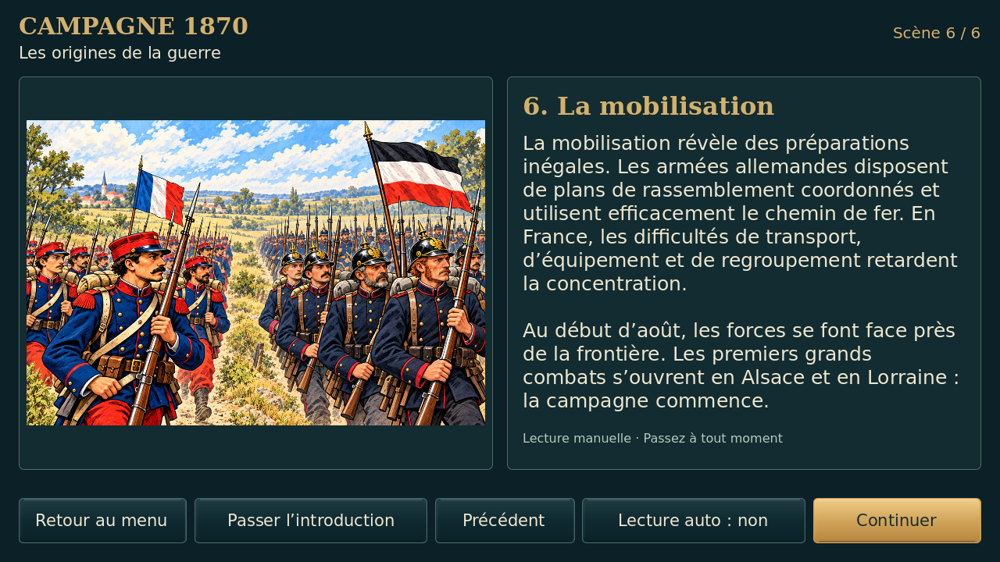

# Campagne 1870 — introduction BD expérimentale, essai 3

Version `0.8.43.15-bd3`, branche **v43-intro-bd-experimental**, base V43.15 + graphismes 12. Nouvelle vignette de mobilisation, sans modification du jeu.

## Télécharger

- **[APK Android — essai BD 3](https://raw.githubusercontent.com/ratapignata/campagne-1870/v43-intro-bd-experimental/experiments/intro-bd/essai-03/1870_V43_Intro_BD_Experimental_03.apk)**
- [Sources complètes ZIP](experiments/intro-bd/essai-03/1870_V43_Intro_BD_Experimental_03_Sources.zip)
- [Comparatif avant/après de la vignette 6](prototype_1870/captures/introbd3/README.md)
- [Rapport](experiments/intro-bd/essai-03/INTRO_BD_EXPERIMENTAL.md), [tests](experiments/intro-bd/essai-03/TESTS_INTRO_BD.md), [uniformes et propositions](experiments/intro-bd/essai-03/UNIFORMES_ET_PISTES_BD.md), [fichiers modifiés](experiments/intro-bd/essai-03/FICHIERS_INTRO_BD.txt)

**Installer par-dessus « 1870 · Essai introduction BD » précédent sans désinstaller**, pour conserver sa partie. Même paquet/certificat, code Android 3. Applications stable et graphique séparées ; leurs sauvegardes ne sont pas transférées automatiquement.

## Vignette 6

Visages prussiens distincts, tuniques bleu sombre et pantalons gris plus lisibles, casque à pointe conservé. Épaulettes françaises rouges et deux colonnes séparées dans un montage symbolique. Illustration évocatrice, sans certification régimentaire. Les références de musées essayées ont été bloquées par HTTP 403 ; elles ne sont pas présentées comme consultées.

Les images 1 à 5, les textes historiques, la navigation, la lecture automatique de 30 secondes, les graphismes de bataille, les règles, l’IA et les sauvegardes restent inchangés. Les propositions pour les autres vignettes sont uniquement documentées.

**3 085 contrôles réussis**, source ZIP extraite/importée et reprise vérifiée indépendamment ; APK compilé et signature vérifiée. Aucun essai physique ou émulateur Android, aucune nouvelle bataille complète. Aucune fusion avec main ou [la branche graphique](https://github.com/ratapignata/campagne-1870/tree/v43-graphismes-2d-experimental). [Essai BD 2 conservé](experiments/intro-bd/essai-02/).

