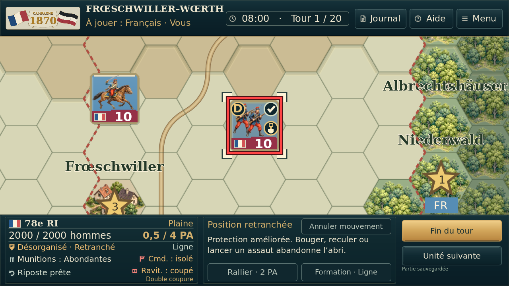
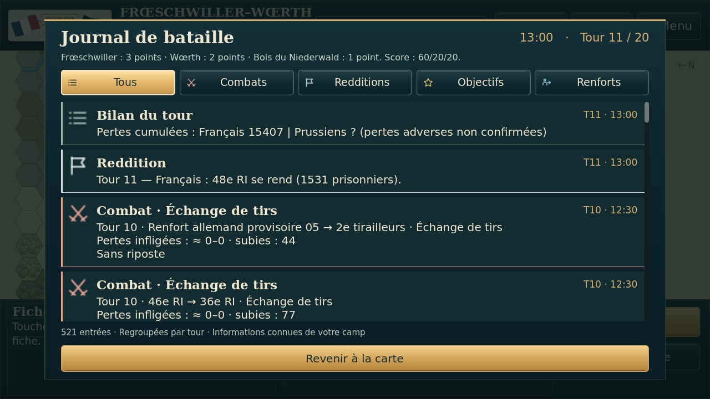
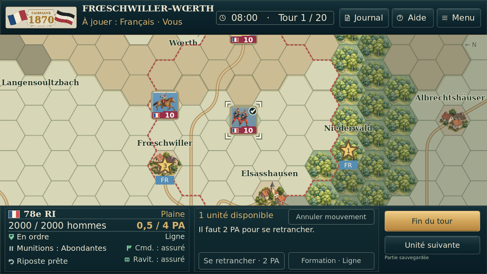
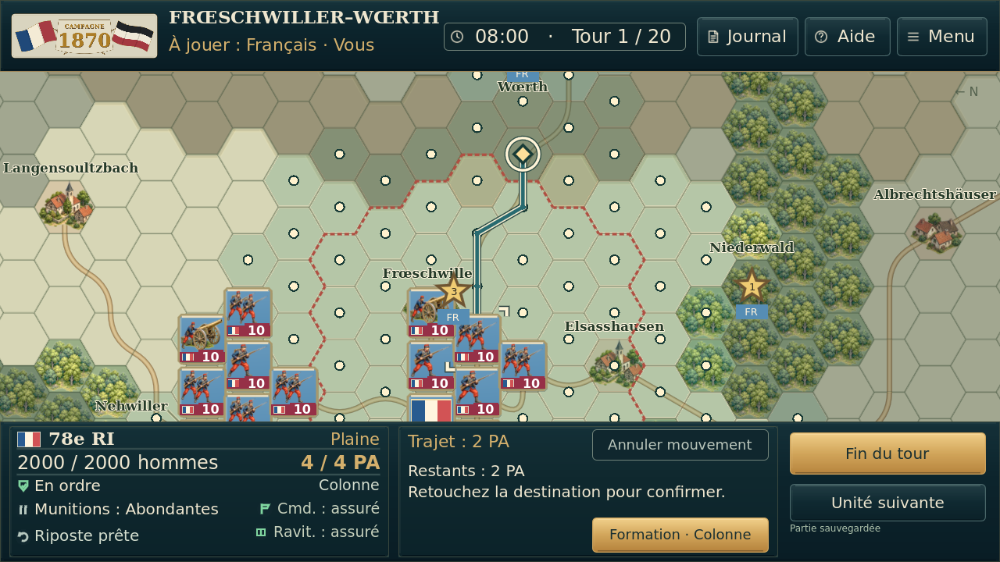
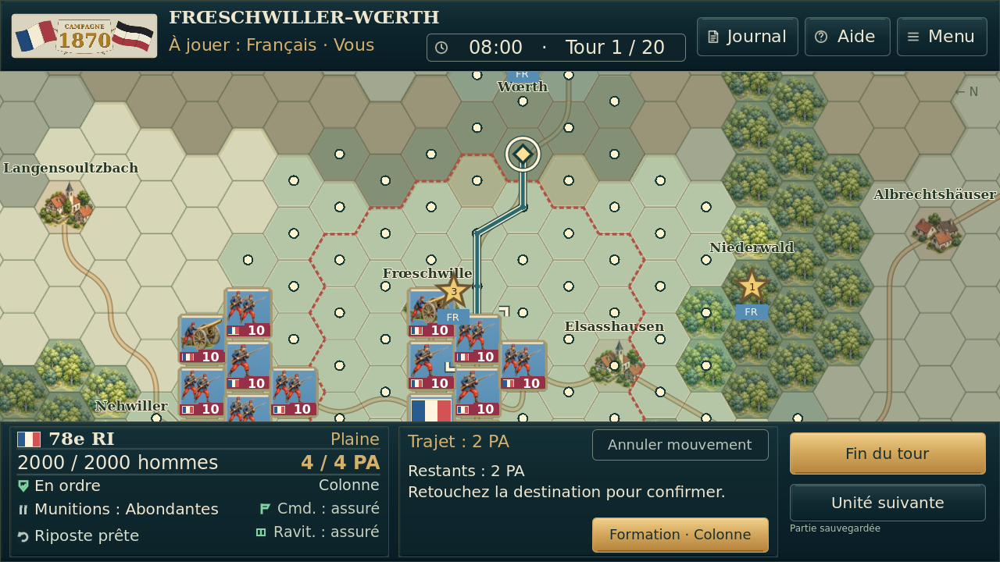
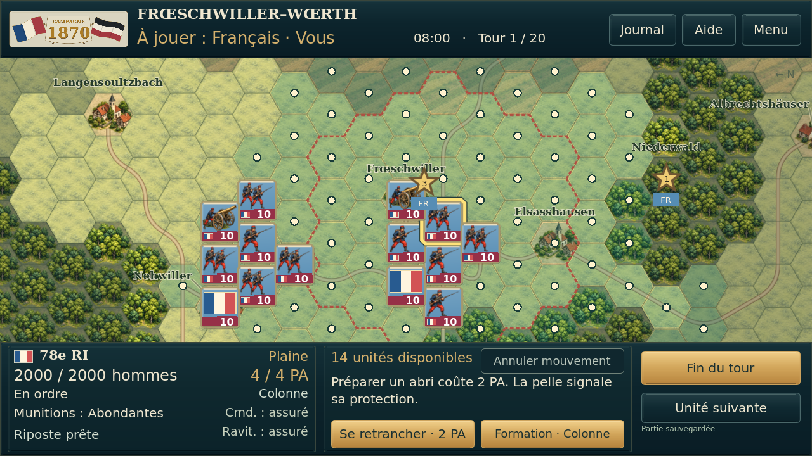

# Essai graphique 2D № 12 — lisibilité des pions et de l’interface

Version `0.8.43.15-g2d12`, base essai 11. Quatre retouches visuelles approuvées :

- Marqueurs de même taille et emplacements fixes : coche en haut à droite, D/déroute en haut à gauche, retranchement à droite ; force préservée.
- Forêts et villages adoucis progressivement au dézoom, mêmes illustrations et détails conservés de près.
- Surbrillance discrète de 0,85 seconde lorsqu’un effectif, des PA ou l’état moral affiché de la même unité du joueur change.
- Fin liseré et icônes colorés par catégorie dans le journal ; cinq filtres et informations connues conservés.

**[Télécharger l’APK de l’essai 12](https://raw.githubusercontent.com/ratapignata/campagne-1870/v43-graphismes-2d-experimental/experiments/graphismes-2d/essai-12/1870_V43_Graphismes_2D_Experimental_12.apk)** · [Sources complètes ZIP](experiments/graphismes-2d/essai-12/1870_V43_Graphismes_2D_Experimental_12_Sources.zip) · [Captures avant/après](prototype_1870/captures/graphismes2d12/README.md).

[Rapport](experiments/graphismes-2d/essai-12/GRAPHISMES_2D_EXPERIMENTAL.md) · [Tests réellement exécutés](experiments/graphismes-2d/essai-12/TESTS_GRAPHISMES_2D.md) · [Fichiers modifiés](experiments/graphismes-2d/essai-12/FICHIERS_GRAPHISMES_2D.txt).

**Installer par-dessus l’essai précédent sans le désinstaller pour conserver sa partie.** Même paquet expérimental et certificat, code Android 12. La stable reste sur main, séparée, sans aucune intégration de cet essai.

Disposition et dimensions des bandeaux, règles, IA, sauvegardes et animations de combat conservées. Aucun bouton TIRER ou autre commande de jeu ajouté. **5 006 assertions distinctes réussies**, captures réelles Godot 4.5.1/Linux, source extraite et vérifiée indépendamment, APK compilé et signature vérifiée. Aucun essai physique ou émulateur Android ; aucun gain de fluidité Android revendiqué.

---

# Archive — essai 11

# Essai graphique 2D № 11 — coche en haut à droite

Version `0.8.43.15-g2d11`. La coche occupe maintenant le coin supérieur droit du pion, sans masquer le chiffre de force. Même taille, couleur et logique de disponibilité que dans l’essai 10. Journal filtré et toutes les autres fonctions conservés.

- **[Télécharger l’APK de l’essai 11](https://raw.githubusercontent.com/ratapignata/campagne-1870/v43-graphismes-2d-experimental/experiments/graphismes-2d/essai-11/1870_V43_Graphismes_2D_Experimental_11.apk)**.
- [Sources complètes ZIP](experiments/graphismes-2d/essai-11/1870_V43_Graphismes_2D_Experimental_11_Sources.zip).
- [Captures comparatives et zooms](prototype_1870/captures/graphismes2d11/README.md).
- [Rapport](experiments/graphismes-2d/essai-11/GRAPHISMES_2D_EXPERIMENTAL.md), [tests réellement exécutés](experiments/graphismes-2d/essai-11/TESTS_GRAPHISMES_2D.md), [fichiers modifiés](experiments/graphismes-2d/essai-11/FICHIERS_GRAPHISMES_2D.txt).

**Installer par-dessus l’essai précédent sans le désinstaller pour conserver sa partie.** Même application expérimentale, paquet et certificat, code Android 11. La version stable et sa partie restent séparées. Aucune modification de main.

Six suites existantes relancées et contrôles avec rendu : 4 641 assertions distinctes réussies. Disponibilité, journal, bandeau, sauvegardes et intégrité contrôlés ; source extraite et vérifiée indépendamment. APK compilé et signature vérifiée. Aucun test physique ou émulateur Android.

---

# Archive — essai 10

# Essai graphique 2D № 10 — journal filtré et fin d’action

Version `0.8.43.15-g2d10`. [La stable V43.15 reste sur main](https://github.com/ratapignata/campagne-1870/tree/main).

- **[Télécharger l’APK de l’essai 10](https://github.com/ratapignata/campagne-1870/raw/refs/heads/v43-graphismes-2d-experimental/experiments/graphismes-2d/essai-10/1870_V43_Graphismes_2D_Experimental_10.apk)**.
- [Sources complètes ZIP](experiments/graphismes-2d/essai-10/1870_V43_Graphismes_2D_Experimental_10_Sources.zip).
- [Journal et exemples à 0,5 PA](prototype_1870/captures/graphismes2d10/README.md) ou [galerie ZIP](experiments/graphismes-2d/essai-10/1870_Graphismes_2D_Comparaisons_10.zip).
- [Rapport](experiments/graphismes-2d/essai-10/GRAPHISMES_2D_EXPERIMENTAL.md), [tests](experiments/graphismes-2d/essai-10/TESTS_GRAPHISMES_2D.md), [fichiers modifiés](experiments/graphismes-2d/essai-10/FICHIERS_GRAPHISMES_2D.txt).

Journal avec cinq filtres actifs, icônes et défilement tactile : Tous, Combats, Redditions, Objectifs, Renforts. Informations connues uniquement ; les arrivées anciennes sans date sont signalées. Longues listes chargées au défilement, explications d’arrivée de Raoult conservées.

La coche indique l’absence de toute action active légale accessible, même s’il reste des PA. À 0,5 PA, un fantassin sans déplacement abordable est coché ; un cavalier pouvant encore avancer reste disponible. Aucun PA retiré, aucune activation clôturée de force ; les réactions restent inchangées. La coche disparaît si un allié libère un passage. Compteur, Unité suivante et confirmation de fin de tour cohérents avec cette disponibilité. Moteur/IA/règles inchangés.

**Installer par-dessus l’essai précédent sans le désinstaller pour conserver sa partie.** Même application expérimentale, paquet et certificat, code Android 10. Sauvegardes des essais 1 à 9 vérifiées ; stable et partie stable séparées.

**7 494 assertions finales réussies**, dont 353 contrôles de disponibilité et 990 contrôles du journal avec rendu. Source propre extraite/importée/testée, APK compilé/signature vérifiée. Aucun essai physique ou émulateur Android. Aucune intégration à main avant validation visuelle.

---

# Archive — essai 9

# Essai graphique 2D № 9 — cadre horaire centré

Version `0.8.43.15-g2d9`. [La stable V43.15 reste sur main](https://github.com/ratapignata/campagne-1870/tree/main).

- **[Télécharger l’APK de l’essai 9](https://github.com/ratapignata/campagne-1870/raw/refs/heads/v43-graphismes-2d-experimental/experiments/graphismes-2d/essai-09/1870_V43_Graphismes_2D_Experimental_09.apk)**.
- [Sources complètes ZIP](experiments/graphismes-2d/essai-09/1870_V43_Graphismes_2D_Experimental_09_Sources.zip).
- [Captures avant/après](prototype_1870/captures/graphismes2d9/README.md) ou [galerie ZIP](experiments/graphismes-2d/essai-09/1870_Graphismes_2D_Comparaisons_09.zip).
- [Rapport](experiments/graphismes-2d/essai-09/GRAPHISMES_2D_EXPERIMENTAL.md), [tests](experiments/graphismes-2d/essai-09/TESTS_GRAPHISMES_2D.md), [fichiers modifiés](experiments/graphismes-2d/essai-09/FICHIERS_GRAPHISMES_2D.txt).

Le cadre heure/tours partage désormais le centre vertical des boutons Journal/Aide/Menu. Titre dégagé, polices agrandies 24/22 conservées, même hauteur de bandeau. Carte, pions, fiche et commandes inférieures identiques en pixels à l’essai 8 dans huit vues. IA, règles, animations et sauvegardes inchangées.

**Installer par-dessus l’essai précédent sans le désinstaller pour garder sa partie.** Même application expérimentale, même paquet et certificat, code Android 9. Sauvegardes des essais 1 à 8 vérifiées ; application stable et partie stable séparées.

**3 369 assertions finales réussies**, APK compilé/signature vérifiée, sources extraites/importées/testées. Aucun essai sur appareil ou émulateur Android. Aucune intégration à main avant validation visuelle.

---

# Archive — essai 8

# Essai graphique 2D № 8 — heure, tours et commandes agrandis

Version `0.8.43.15-g2d8`. [La stable V43.15 reste sur main](https://github.com/ratapignata/campagne-1870/tree/main).

- **[Télécharger l’APK de l’essai 8](https://github.com/ratapignata/campagne-1870/raw/refs/heads/v43-graphismes-2d-experimental/experiments/graphismes-2d/essai-08/1870_V43_Graphismes_2D_Experimental_08.apk)**.
- [Sources complètes ZIP](experiments/graphismes-2d/essai-08/1870_V43_Graphismes_2D_Experimental_08_Sources.zip).
- [Captures avant/après](prototype_1870/captures/graphismes2d8/README.md) ou [galerie ZIP](experiments/graphismes-2d/essai-08/1870_Graphismes_2D_Comparaisons_08.zip).
- [Rapport](experiments/graphismes-2d/essai-08/GRAPHISMES_2D_EXPERIMENTAL.md), [tests](experiments/graphismes-2d/essai-08/TESTS_GRAPHISMES_2D.md), [fichiers modifiés](experiments/graphismes-2d/essai-08/FICHIERS_GRAPHISMES_2D.txt).

Heure/tours : police 20 → 24 (+20 %). Journal/Aide/Menu : 17 → 22 (+29 %), pictogrammes plus grands, boutons un peu plus larges. Même hauteur du bandeau, aucune place retirée à la carte. Carte, pions, fiche et commandes inférieures identiques en pixels à l’essai 7 dans huit vues. IA, règles, animations et sauvegardes conservées.

**Installer par-dessus l’essai précédent sans le désinstaller pour conserver sa partie.** Même application « 1870 · Essai graphique 2D », même paquet expérimental distinct de la stable, même certificat, code Android 8. Sauvegardes des essais 1 à 7 vérifiées ; pas de transfert automatique depuis la stable.

**5 971 assertions finales réussies**, dont tests de lisibilité et d’ouverture des trois commandes par événements tactiles simulés. APK compilé/signature vérifiée et sources extraites/importées/testées. Aucun essai physique ou émulateur Android. Aucune intégration à main avant validation visuelle.

---

# Archive — essai 7

# Essai graphique 2D № 7 — sélection et guidage tactile

Version expérimentale `0.8.43.15-g2d7`. [La version stable V43.15 reste sur main](https://github.com/ratapignata/campagne-1870/tree/main).

- **[Télécharger l’APK de l’essai 7](https://github.com/ratapignata/campagne-1870/raw/refs/heads/v43-graphismes-2d-experimental/experiments/graphismes-2d/essai-07/1870_V43_Graphismes_2D_Experimental_07.apk)**.
- [Sources complètes ZIP](experiments/graphismes-2d/essai-07/1870_V43_Graphismes_2D_Experimental_07_Sources.zip).
- **[Captures avant/après et aides tactiles](prototype_1870/captures/graphismes2d7/README.md)** ou [galerie ZIP](experiments/graphismes-2d/essai-07/1870_Graphismes_2D_Comparaisons_07.zip).
- [Rapport](experiments/graphismes-2d/essai-07/GRAPHISMES_2D_EXPERIMENTAL.md), [tests](experiments/graphismes-2d/essai-07/TESTS_GRAPHISMES_2D.md), [fichiers modifiés](experiments/graphismes-2d/essai-07/FICHIERS_GRAPHISMES_2D.txt).

Sélection par coins ivoire, trajet bleu bordé de clair, destination en losange doré, noms de localités mieux détachés. Fiche séparée plus clairement et actions indisponibles plus lisibles. Toucher les pictogrammes de la fiche pour lire une explication ; aucun ordre n’est déclenché. Même luminosité, mêmes illustrations, mêmes dimensions des bandeaux et mêmes commandes.

**Installer par-dessus l’essai précédent sans le désinstaller pour conserver sa sauvegarde.** Même application « 1870 · Essai graphique 2D », même paquet expérimental distinct de la stable, code Android 7. Sauvegardes des essais 1 à 6 vérifiées ; pas de transfert automatique depuis la stable.

**5 350 contrôles finaux réussis**, huit situations et 121 zones de chiffres de force comparées. Les cadres tactiques rouges/verts restent inchangés ; un drapeau voisin anciennement recouvert par le contour plein est dégagé. Sources propres extraites/importées et testées. APK compilé/signature vérifiée ; aucun essai physique ou émulateur Android. IA, règles, géographie et animations conservées. Aucune fusion dans main avant validation visuelle.

---

# Archive — essai 6

# Essai graphique 2D № 6 — bandeaux et fiche d’unité

Version expérimentale `0.8.43.15-g2d6`. [La version stable V43.15 reste sur main](https://github.com/ratapignata/campagne-1870/tree/main).

- **[Télécharger l’APK de l’essai 6](https://github.com/ratapignata/campagne-1870/raw/refs/heads/v43-graphismes-2d-experimental/experiments/graphismes-2d/essai-06/1870_V43_Graphismes_2D_Experimental_06.apk)**.
- [Sources complètes ZIP](experiments/graphismes-2d/essai-06/1870_V43_Graphismes_2D_Experimental_06_Sources.zip).
- **[Comparaisons avant/après](prototype_1870/captures/graphismes2d6/README.md)** ou [galerie ZIP](experiments/graphismes-2d/essai-06/1870_Graphismes_2D_Comparaisons_06.zip).
- [Rapport](experiments/graphismes-2d/essai-06/GRAPHISMES_2D_EXPERIMENTAL.md), [tests](experiments/graphismes-2d/essai-06/TESTS_GRAPHISMES_2D.md), [fichiers modifiés](experiments/graphismes-2d/essai-06/FICHIERS_GRAPHISMES_2D.txt).

Heure/tour regroupés, commandes Journal/Aide/Menu avec pictogrammes, nom du régiment et PA mieux visibles. Repères de moral, munitions, riposte, commandement et ravitaillement, toujours accompagnés des textes. Aucun changement d’IA ou de règle. Carte et pions de l’essai 5 conservés ; bandeaux et commandes de mêmes dimensions.

**Installer par-dessus l’essai précédent sans le désinstaller pour conserver sa sauvegarde.** Même application « 1870 · Essai graphique 2D », même paquet expérimental distinct de la stable, code Android 6. Sauvegardes des essais 1 à 5 vérifiées ; pas de transfert automatique depuis la stable.

**5 183 contrôles finaux réussis**, six états/commandes identiques, carte et 90 bandes de force identiques en pixels à l’essai 5. Sources propres extraites, importées et testées. APK compilé/signature vérifiée ; aucun essai physique ou sur émulateur Android. Aucune fusion dans main avant validation visuelle.

---

# Archive — essai 5

# Essai graphique 2D № 5 — clarté de référence V43.15

Version expérimentale `0.8.43.15-g2d5`. [La version stable V43.15 reste sur main](https://github.com/ratapignata/campagne-1870/tree/main), inchangée.

- **[Télécharger l’APK de l’essai 5](https://github.com/ratapignata/campagne-1870/raw/refs/heads/v43-graphismes-2d-experimental/experiments/graphismes-2d/essai-05/1870_V43_Graphismes_2D_Experimental_05.apk)**.
- [Sources complètes ZIP](experiments/graphismes-2d/essai-05/1870_V43_Graphismes_2D_Experimental_05_Sources.zip).
- **[Comparaison V43.15 stable / essai 4 / essai 5](prototype_1870/captures/graphismes2d5/README.md)** ou [galerie ZIP](experiments/graphismes-2d/essai-05/1870_Graphismes_2D_Comparaisons_05.zip).
- [Rapport](experiments/graphismes-2d/essai-05/GRAPHISMES_2D_EXPERIMENTAL.md), [tests](experiments/graphismes-2d/essai-05/TESTS_GRAPHISMES_2D.md), [fichiers modifiés](experiments/graphismes-2d/essai-05/FICHIERS_GRAPHISMES_2D.txt).

Retour aux couleurs de fond exactes des hexagones de V43.15, sans la couche peinte verte. Bois, villages et soldats détaillés conservés, ombres des illustrations relevées. Les nouveaux dessins ne sont pas identiques aux anciens symboles ; leur luminosité est comparable à la stable et légèrement supérieure dans les zones de pions mesurées. Doubles soldats dès 2 000 hommes connus, marqueurs contrastés et noms mieux dégagés conservés.

**Installer par-dessus l’essai précédent sans le désinstaller pour conserver sa sauvegarde.** Même application « 1870 · Essai graphique 2D », même paquet distinct de la stable, code Android 5. Sauvegardes des essais 1 à 4 vérifiées, pas de transfert automatique depuis la stable.

**5 090 contrôles finaux réussis**, six états/commandes identiques à la stable et 90 bandes de force identiques en pixels. APK compilé/signature vérifiée ; aucun essai physique Android. Règles, IA, géographie et brouillard inchangés ; aucune fusion dans main avant validation visuelle.

---

# Archive — essai 4

# Essai graphique 2D № 4 — carte et pions plus lumineux

Version expérimentale `0.8.43.15-g2d4`. [La version stable V43.15 reste sur main](https://github.com/ratapignata/campagne-1870/tree/main), inchangée.

- **[Télécharger l’APK de l’essai 4](https://github.com/ratapignata/campagne-1870/raw/refs/heads/v43-graphismes-2d-experimental/experiments/graphismes-2d/essai-04/1870_V43_Graphismes_2D_Experimental_04.apk)**.
- [Sources complètes ZIP](experiments/graphismes-2d/essai-04/1870_V43_Graphismes_2D_Experimental_04_Sources.zip).
- [Comparaisons avant/après](prototype_1870/captures/graphismes2d4/README.md) ou [galerie ZIP](experiments/graphismes-2d/essai-04/1870_Graphismes_2D_Comparaisons_04.zip).
- [Rapport](experiments/graphismes-2d/essai-04/GRAPHISMES_2D_EXPERIMENTAL.md), [tests](experiments/graphismes-2d/essai-04/TESTS_GRAPHISMES_2D.md), [fichiers modifiés](experiments/graphismes-2d/essai-04/FICHIERS_GRAPHISMES_2D.txt).

Sol plus clair, bois éclaircis, fonds des pions moins sombres et silhouettes plus lumineuses, particulièrement prussiennes. Même palette nationale, même uniformisation des terrains, mêmes points contrastés et règle d’un/deux soldats à 2 000 hommes. Le brouillard garde sa surimpression et ses informations ; les bandeaux restent bleu nuit. Aucun shader, image lourde ou post-traitement supplémentaire.

**Installer par-dessus l’essai précédent sans le désinstaller pour conserver sa sauvegarde.** Même application « 1870 · Essai graphique 2D », même paquet expérimental distinct de la stable, code Android 4. Sauvegardes des essais 1/2/3 vérifiées, pas de transfert automatique depuis la stable.

**5 085 contrôles finaux réussis**, six états/commandes identiques et 90 bandes de force identiques en pixels ; carte et pions mesurés plus clairs dans les six comparaisons. APK compilé/signature vérifiée, aucun test physique Android. IA, règles, géographie, animations et commandes conservées. Aucune fusion dans main avant avis visuel.

---

# Archive — essai 3

# Essai graphique 2D № 3 — lisibilité et effectifs

Version expérimentale `0.8.43.15-g2d3`. [La version stable V43.15 reste sur main](https://github.com/ratapignata/campagne-1870/tree/main), inchangée.

- **[Télécharger l’APK de l’essai 3](https://github.com/ratapignata/campagne-1870/raw/refs/heads/v43-graphismes-2d-experimental/experiments/graphismes-2d/essai-03/1870_V43_Graphismes_2D_Experimental_03.apk)**.
- [Sources complètes ZIP](experiments/graphismes-2d/essai-03/1870_V43_Graphismes_2D_Experimental_03_Sources.zip).
- [Comparaisons avant/après et banc des seuils](prototype_1870/captures/graphismes2d3/README.md) ou [galerie ZIP](experiments/graphismes-2d/essai-03/1870_Graphismes_2D_Comparaisons_03.zip).
- [Rapport](experiments/graphismes-2d/essai-03/GRAPHISMES_2D_EXPERIMENTAL.md), [tests](experiments/graphismes-2d/essai-03/TESTS_GRAPHISMES_2D.md), [fichiers modifiés](experiments/graphismes-2d/essai-03/FICHIERS_GRAPHISMES_2D.txt).

Un même motif par type de terrain, teintes plus douces, points de déplacement ivoire opaques à contour sombre. Infanterie : deux soldats à partir de 2 000 hommes actuels, un en dessous, dans le même pion. Pour l’ennemi, seules les données connues sont utilisées ; une estimation ambiguë reste générique. Contraste prussien amélioré, noms de villages moins masqués, bordures des bandeaux plus discrètes.

**Installer par-dessus l’essai précédent sans le désinstaller pour conserver sa sauvegarde.** Même application « 1870 · Essai graphique 2D », même paquet expérimental distinct du jeu stable, code Android 3. Sauvegardes des essais 1/2 vérifiées ; pas de transfert automatique avec la stable. IA, règles, géographie, animations, commandes et chiffres de force conservés. Aucun bouton TIRER ajouté.

**5 078 contrôles finaux réussis**, six snapshots de commandes identiques et 90 bandes de force identiques en pixels dans les comparaisons. APK compilé et signature vérifiée ; aucun essai physique Android. Aucune fusion dans main avant validation visuelle.

---

# Archive — essai 2

# Essai graphique 2D № 2 — carte peinte, pions et bandeaux

Version expérimentale `0.8.43.15-g2d2`, inspirée de la référence visuelle du joueur. La [version stable V43.15 reste sur main](https://github.com/ratapignata/campagne-1870/tree/main), inchangée.

- **[Télécharger l’APK de l’essai 2](https://github.com/ratapignata/campagne-1870/raw/refs/heads/v43-graphismes-2d-experimental/experiments/graphismes-2d/essai-02/1870_V43_Graphismes_2D_Experimental_02.apk)**.
- [Sources complètes ZIP](experiments/graphismes-2d/essai-02/1870_V43_Graphismes_2D_Experimental_02_Sources.zip).
- [Voir les captures réelles avant/après](prototype_1870/captures/graphismes2d2/README.md) ou [télécharger la galerie](experiments/graphismes-2d/essai-02/1870_Graphismes_2D_Comparaisons_02.zip).
- [Rapport détaillé](experiments/graphismes-2d/essai-02/GRAPHISMES_2D_EXPERIMENTAL.md), [tests](experiments/graphismes-2d/essai-02/TESTS_GRAPHISMES_2D.md), [fichiers modifiés](experiments/graphismes-2d/essai-02/FICHIERS_GRAPHISMES_2D.txt).

Champs et prairies peints, bois plus denses, maisons et pions détaillés par arme/camp ; bandeaux bleu nuit et laiton, boutons mieux finis. Positions, géographie, forces, informations, commandes, IA, règles et animations conservées. Aucun bouton TIRER ajouté.

**Installer par-dessus l’essai 1 sans le désinstaller pour conserver sa sauvegarde.** Même application « 1870 · Essai graphique 2D », paquet expérimental distinct du jeu stable, code Android 2. La sauvegarde de l’essai 1 est compatible. Le jeu stable et sa partie restent séparés ; aucun transfert automatique entre applications.

**5 036 contrôles réussis**, six snapshots de commandes identiques, 76 bandes de force identiques pixel par pixel sur les comparaisons. APK compilé et signature vérifiée ; pas d’essai physique Android. Le rendu et les sources restent expérimentaux jusqu’à validation visuelle, sans fusion dans main.

---

# Archive — premier essai

# Essai graphique 2D — branche expérimentale indépendante

**La version stable V43.15 n’est pas remplacée.** [Revenir à la branche main](https://github.com/ratapignata/campagne-1870/tree/main).

- [Télécharger l’APK expérimental](https://github.com/ratapignata/campagne-1870/raw/refs/heads/v43-graphismes-2d-experimental/experiments/graphismes-2d/1870_V43_Graphismes_2D_Experimental_01.apk) — application **1870 · Essai graphique 2D**, installable à côté du jeu actuel.
- [Sources complètes ZIP](experiments/graphismes-2d/1870_V43_Graphismes_2D_Experimental_01_Sources.zip).
- [Voir les cinq comparaisons avant/après](prototype_1870/captures/graphismes2d/README.md) ou [télécharger la galerie complète](experiments/graphismes-2d/1870_Graphismes_2D_Comparaisons.zip).
- [Rapport des changements](experiments/graphismes-2d/GRAPHISMES_2D_EXPERIMENTAL.md), [tests exécutés](experiments/graphismes-2d/TESTS_GRAPHISMES_2D.md) et [inventaire des fichiers](experiments/graphismes-2d/FICHIERS_GRAPHISMES_2D.txt).

Carte plus texturée, forêts et maisons illustrées, Sauer avec berges et reflets, bordures des pions et boutons plus lisibles. Illustrations militaires conservées, fiche inférieure gauche identique sur les cinq captures, mêmes commandes et dispositions. IA, règles, carte, animations et format de sauvegarde inchangés.

**5 033 contrôles réussis**, APK compilé et signature vérifiée ; aucun essai physique Android. Application séparée et sauvegarde de test distincte : la partie du jeu actuel n’est pas transférée automatiquement. Garder le jeu actuel installé ; pour revenir au graphisme habituel, l’ouvrir simplement.

Aucune intégration de cet essai dans main avant validation visuelle.

---

# Prototype courant : V43.15

- [Télécharger l’APK V43.15](https://github.com/ratapignata/campagne-1870/raw/refs/heads/main/releases/1870_v0.8.43.15.apk)
- [Sources complètes V43.15](releases/1870_v0.8.43.15_Sources.zip)
- [Changements](releases/VERSION_0843_15.md), [tests et comparaisons](releases/TESTS_V43_15.md), [référence tactique](releases/REFERENCE_IA_V43.md)

**Pour jouer les Prussiens contre une défense française renforcée : sélectionner Difficile, puis Prussiens.** L’IA française répartit ses missions entre les objectifs, recherche le couvert, prépare ses formations et ses retranchements, conserve des réserves et contre-attaque les points perdus lorsque le rapport de forces est favorable. Les batteries gardent leurs positions de tir utiles.

L’ossature prussienne V43.14 et les deux politiques Normal sont conservées. Aucun bonus de combat français, aucun changement des effectifs, coûts, portées, ripostes ou règles de sauvegarde. Le calendrier antérieur des renforts prussiens en Difficile reste inchangé.

Comparaison de huit tours chronologiques avec une attaque prussienne active et identique en politique : la nouvelle défense garde **Frœschwiller et Niederwald**, contre Frœschwiller seul pour le témoin. Elle effectue **17 tirs de canon contre 10**, et 3 assauts contre 1. Les Français ont subi davantage de pertes pour défendre plus de terrain ; les pertes prussiennes restent proches. Une seule graine/style sur la grande carte ; calendrier physique commun pour isoler la politique française. Détails et deux graines de franchissement dans le rapport.

**2 490 contrôles techniques réussis**, plus **6 901 contrôles de légalité/état** des simulations. APK compilé et signature vérifiée. Aucun nouveau test T1–T20 ni essai physique Android.

Installer comme mise à jour **sans désinstaller**, pour conserver les sauvegardes.

---

# Archive : V43.14

- [Télécharger l’APK V43.14](https://github.com/ratapignata/campagne-1870/raw/refs/heads/main/releases/1870_v0.8.43.14.apk)
- [Sources complètes V43.14](releases/1870_v0.8.43.14_Sources.zip)
- [Changements](releases/VERSION_0843_14.md), [tests exécutés](releases/TESTS_V43_14.md) et [référence d’IA conservée](releases/REFERENCE_IA_V43.md)

**Ossature et agressivité V43.13 conservées.** Les fiches Cmd./Ravit. expliquent la double coupure, le QG et les plafonds de PA. Les nouvelles coupures sont documentées dans le journal sans révéler les ennemis cachés. Le rapport final présente objectifs, pertes, prisonniers, capitulations, chronologie et calcul 60/20/20.

En Difficile prussien : une batterie sans ligne de tir peut quitter une garnison devenue inutile pour soutenir un combat observé ; les mouvements individuels abandonnant les deux liaisons sans soutien sous menace visible sont évités. Normal inchangé, aucun nouveau bonus de combat ni modification des règles.

2 560 contrôles techniques réussis, plus 944 contrôles de légalité/état dans la comparaison de reprise T11–T12. Sur ces deux tours : 28 tirs de canon et 10 assauts dans chaque version, trois objectifs conservés. Pas de nouvelle campagne complète T1–T20 ni de test physique Android. APK compilé et signature vérifiée.

Installer comme mise à jour **sans désinstaller** pour conserver la partie. Aucun nouveau départ nécessaire pour les améliorations ; les anciennes dispositions d’objectifs restent respectées.

---

# Archive : V43.13

- [Télécharger l’APK V43.13](https://github.com/ratapignata/campagne-1870/raw/refs/heads/main/releases/1870_v0.8.43.13.apk)
- [Sources complètes V43.13](releases/1870_v0.8.43.13_Sources.zip)
- [Changements](releases/VERSION_0843_13.md), [tests](releases/TESTS_V43_13.md) et [comparaison Normal / Difficile](releases/COMPARAISON_NORMAL_DIFFICILE_V43_13.md)

**Nouvelles parties : Frœschwiller 3, Wœrth 2, Niederwald 1.** Elsasshausen redevient un village sans objectif. Les anciennes parties conservent leurs anciens objectifs et leurs scores.

Le Normal garde son IA V43.11. Le Difficile stabilise ses batteries en position de tir et conserve les PA d’approche pour lancer les assauts favorables. Comparaison de dix tours sur les mêmes nouveaux objectifs : **144 tirs de canon et 29 assauts en Difficile, contre 117 et 15 en Normal**. Trois objectifs prussiens en fin T8 en Difficile ; Frœschwiller reste français fin T10 en Normal. Une seule graine/style, défense française active de test ; aucune garantie universelle ni simulation de vingt tours.

2 522 contrôles techniques réussis et 4 564 contrôles de légalité/état des deux simulations. Avertissement ObjectDB restant à la fermeture du test UI, documenté dans les tests. APK signé, aucun essai physique Android. Installer sans désinstaller ; démarrer une nouvelle partie pour déplacer l’objectif 2 à Wœrth.

---

# Archive : V43.12

- [Télécharger l’APK V43.12](https://github.com/ratapignata/campagne-1870/raw/refs/heads/main/releases/1870_v0.8.43.12.apk)
- [Sources complètes V43.12](releases/1870_v0.8.43.12_Sources.zip)
- [Changements](releases/VERSION_0843_12.md), [tests](releases/TESTS_V43_12.md) et [analyse comparative](releases/ANALYSE_IA_V43_12.md)

**Normal reprend le Difficile apprécié de V43.11**, avec son calendrier habituel. Nouveau Difficile : axes Wœrth–Frœschwiller et aile droite française, tirs préparatoires et priorité aux assauts favorables dès T8. Renforts prussiens un tour plus tôt en Difficile, dates françaises inchangées. Balles d’infanterie noires avec contour discret ; canon conservé.

Comparaison chronologique contrôlée : Wœrth occupé T4 contre T9, Frœschwiller contrôlé T8 contre T10. 207 tirs contre 190 ; infanterie 116 contre 79, canon 90 contre 111 ; sept assauts contre neuf au total, mais quatre contre deux au T8. Le gain n’est donc pas uniforme. Elsasshausen reste français en fin T10 dans le nouveau test ; détails, pertes et méthode de rejeu/continuation dans le rapport. Le calendrier avancé contribue au résultat ; aucune validation globale de l’équilibre sur 20 tours.

2 492 contrôles techniques réussis et 2 117 contrôles de rejeu/continuation. APK compilé et signature vérifiée, aucun essai physique Android. Installer sans désinstaller pour conserver les données.

---

# Archive : V43.11

- [Télécharger l’APK V43.11](https://github.com/ratapignata/campagne-1870/raw/refs/heads/main/releases/1870_v0.8.43.11.apk)
- [Sources complètes V43.11](releases/1870_v0.8.43.11_Sources.zip)
- [Changements](releases/VERSION_0843_11.md) et [tests](releases/TESTS_V43_11.md)
- [Test depuis le début : Wœrth pris au T9 et tenu fin T10](audit_v43/V43_11_T10/RAPPORT.md)
- [Comparaison IA Wœrth](releases/IA_WOERTH_V43_11.md) et [vérification Spachbach](releases/SPACHBACH_V43_11.md)

Difficile : préparation d’artillerie des passages et repositionnement légal. Comparaison depuis T12 : Wœrth occupé au T13 contre T14, avec davantage de pertes prussiennes ; ce n’est pas une validation globale de l’équilibre. Normal inchangé. Projectiles d’infanterie plus visibles ; canon inchangé. Texte de Spachbach repositionné, village et rivière inchangés ; référence historique originale non accessible pour une nouvelle vérification indépendante.

489 contrôles de non-régression et rendu réussis, plus 1 056 contrôles de légalité dans la comparaison. APK signé, aucun essai physique Android. Installer sans désinstaller pour conserver la partie.

---

# Archive : V43.10

- [Télécharger l’APK V43.10](https://github.com/ratapignata/campagne-1870/raw/refs/heads/main/releases/1870_v0.8.43.10.apk)
- [Sources complètes V43.10](releases/1870_v0.8.43.10_Sources.zip)
- [Changements](releases/VERSION_0843_10.md) et [tests réellement exécutés](releases/TESTS_V43_10.md)
- [Diagnostic réel T12 et comparaison IA](releases/DIAGNOSTIC_IA_T12_V43_10.md)
- [Avis sur Wœrth comme objectif et la fusion](releases/PROPOSITIONS_OBJECTIFS_FUSION_V43_10.md)

Redditions confirmées nommées dans le journal ; noms RI sans suffixe de QG ; effet du canon V43.8 rétabli et nouvelle animation de volée d’infanterie. Correction locale en Difficile : un assaut d’infanterie déjà accepté n’est plus abandonné pour refaire les munitions. La comparaison T12 passe d’un à deux assauts, mais le verrou de Wœrth et les limites de mobilité subsistent ; ce n’est pas une validation globale de l’IA.

Les objectifs actuels sont conservés et aucune fusion n’est ajoutée. Cavalerie en village à 1,25 et autres règles conservées. 431 contrôles réussis, APK signé, aucun essai physique Android. Installer sans désinstaller.

---

# Archive : V43.9

- [Télécharger l’APK V43.9](https://github.com/ratapignata/campagne-1870/raw/refs/heads/main/releases/1870_v0.8.43.9.apk)
- [Sources complètes V43.9](releases/1870_v0.8.43.9_Sources.zip)
- [Changements, tests et limites](releases/VERSION_0843_9.md)

Noms de l’infanterie prussienne précisés (régiments et bataillons), ligne d’arme retirée aussi pour l’artillerie et la cavalerie, fiche réorganisée avec textes plus grands. Bille d’artillerie noire avec contour gris et traînée sombre. Règles et IA inchangées, réglage de cavalerie à 1,25 et sauvegardes conservés. 246 vérifications réussies ; aucun essai physique Android. Installer sans désinstaller.

---

# Archive : V43.8

- [Télécharger l’APK V43.8](https://github.com/ratapignata/campagne-1870/raw/refs/heads/main/releases/1870_v0.8.43.8.apk)
- [Sources complètes V43.8](releases/1870_v0.8.43.8_Sources.zip)
- [Changements et vérifications](releases/VERSION_0843_8.md)
- [Partie réelle T20 : diagnostic du flanc droit et propositions IA](audit_v43/ANALYSE_PARTIE_T20_FLANC_DROIT.md)

Nom et portée du fusil retirés de la fiche des fantassins et QG, sans modifier le tir. Cavalerie en village à 1,25 conservée. IA de production inchangée ; diagnostic et proposition de débordement séparés. 85 vérifications réussies ; aucun essai Android physique. Installer sans désinstaller.

---

# Archive : V43.7

- [Télécharger l’APK V43.7](https://github.com/ratapignata/campagne-1870/raw/refs/heads/main/releases/1870_v0.8.43.7.apk)
- [Sources complètes V43.7](releases/1870_v0.8.43.7_Sources.zip)
- [Règle validée, tests et compatibilité](releases/VERSION_0843_7.md)

Défense de cavalerie en village réduite de 1,50 à 1,25 pour les deux camps, conformément à la validation utilisateur. Infanterie à 1,50, charge à 2 PA, tirs et ripostes conservés. Sauvegardes précédentes compatibles. 4 825 vérifications réussies. APK compilé et signé, aucun essai physique Android. Installer par-dessus sans désinstaller.

---

# Archive : V43.6

- [Télécharger l’APK V43.6](https://github.com/ratapignata/campagne-1870/raw/refs/heads/main/releases/1870_v0.8.43.6.apk)
- [Sources complètes V43.6](releases/1870_v0.8.43.6_Sources.zip)
- [Correction de l’export, tests et limites](releases/VERSION_0843_6.md)

Correction d’un faux échec d’export après écriture sur Android ; relecture intégrale obligatoire conservée. 67 vérifications réussies. Aucun test physique Android. Installer par-dessus sans désinstaller. Corrections V43.5 conservées, aucune modification de l’IA ou des règles.

---

# Archive : V43.5

- [Télécharger l’APK V43.5](https://github.com/ratapignata/campagne-1870/raw/refs/heads/main/releases/1870_v0.8.43.5.apk)
- [Sources complètes V43.5](releases/1870_v0.8.43.5_Sources.zip)
- [Changements, tests et limites](releases/VERSION_0843_5.md)

Contour rouge de même taille que le vert fluo. Correction de la coupure logistique causée par un ennemi totalement encerclé sur ses six hexagones voisins. Chiffre de force conservé. 200 vérifications réussies ; aucun essai Android physique. Installer par-dessus sans désinstaller.

---

# Archive : V43.4

- [Télécharger l’APK V43.4](https://github.com/ratapignata/campagne-1870/raw/refs/heads/main/releases/1870_v0.8.43.4.apk)
- [Sources complètes V43.4](releases/1870_v0.8.43.4_Sources.zip)
- [Changements et vérifications](releases/VERSION_0843_4.md)

Seul le numéro d’unité en haut à droite est retiré. Le chiffre de force reste en bas du pion. Installer sans désinstaller l’application. Règles et IA inchangées.

---

# Archive : V43.3 — pions sans numéros

- [Télécharger l’APK V43.3](https://github.com/ratapignata/campagne-1870/raw/refs/heads/main/releases/1870_v0.8.43.3.apk)
- [Sources complètes V43.3](releases/1870_v0.8.43.3_Sources.zip)
- [Changements et vérifications](releases/VERSION_0843_3.md)

Numéros d’unité et chiffres d’effectif retirés des pions ; effectifs consultables dans les fiches. Export de sauvegarde et corrections précédentes conservés. Aucun changement de comportement de l’IA. Installer sans désinstaller l’ancienne version. APK compilé et signé ; aucun essai sur appareil physique.

---

# 1870 : Frœschwiller-Wœrth — V43.2

**V43.2 ajoute l’export de la partie courante en JSON. Le comportement de l’IA et toutes les règles V43.1 sont conservés.**

- **[Télécharger l’APK V43.2](https://github.com/ratapignata/campagne-1870/raw/refs/heads/main/releases/1870_v0.8.43.2.apk)**
- **[Sources complètes V43.2](https://github.com/ratapignata/campagne-1870/raw/refs/heads/main/releases/1870_v0.8.43.2_Sources.zip)**
- [Utilisation et changements](releases/VERSION_0843_2.md)
- [Tests exécutés et limites](releases/TESTS_V43_2.md)
- **[Audit complet de l’IA Difficile V43](audit_v43/AUDIT_IA_V43.md)**
- [Diagnostic : sources de test, traces et données](releases/1870_V43_Diagnostic_IA_2026-10-21.zip)
- [Empreintes SHA256](releases/SHA256SUMS.txt)

Pour transmettre une partie : installer la mise à jour sans désinstaller l’ancienne application, reprendre la partie, ouvrir **Menu → Exporter la sauvegarde**, choisir **Téléchargements**, puis **Enregistrer**. Joindre ensuite le fichier JSON depuis **Mes fichiers / Fichiers → Téléchargements**.

Export natif disponible à partir d’Android 10 avec Godot 4.5.1. L’original et sa copie de secours sont conservés. Le JSON inclut toute la partie, les informations cachées et les paramètres IA, pour permettre un diagnostic exact.

11 suites : **6 103 contrôles fonctionnels réussis**, dont 28 sur l’export. Archive propre extraite et export retesté : 28/28. APK 0.8.43.2, code 59, signature et alignement vérifiés, même certificat de développement que V43.1. Aucun essai physique Android ; le sélecteur Android doit encore être essayé sur appareil.

Raoult entre sur un voisin libre et praticable si un ennemi occupe son entrée. Charge 2 PA, variante B 0,90, ripostes, isolement, commandement, ravitaillement, 20 tours, score 60/20/20, objectifs 3/2/1, 95 000 Allemands/50 unités : inchangés. Normal/Difficile, aucun bouton TIRER, aucun bonus IA.

Sources Godot 4.5.1 dans `prototype_1870`. Le diagnostic de l’IA Difficile est terminé : 20 tours des 95 unités contre une défense française mobile, 1 936 contrôles réussis. Au T12, 17 unités restent sans commande et 106,25 PA sont inutilisés ; les Prussiens finissent par prendre le dernier objectif au T19 et gagnent 82,42 contre 16,65. Congestion de progression, choix de tirs avant assaut et sécurisation des conquêtes sont détaillés dans le rapport. Ce n’est pas une reproduction de la partie personnelle du joueur. Aucune correction du comportement IA n’est appliquée à cet APK ; l’accord de l’utilisateur est attendu. Les versions précédentes restent archivées dans `releases` et l’historique Git.
