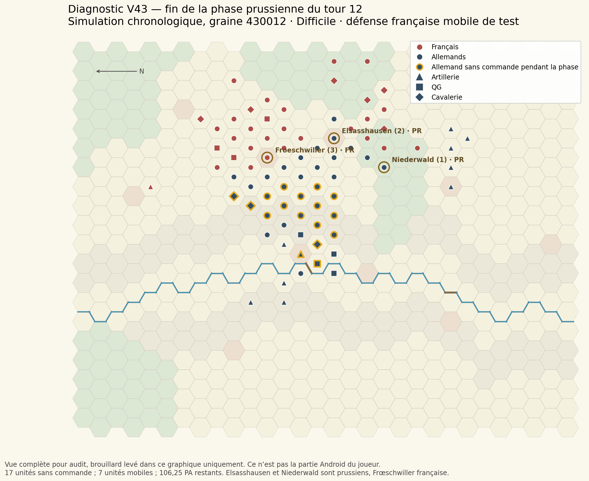

# Audit IA prussienne V43 — diagnostic et export JSON

**21 octobre 2026. Aucun comportement IA ni règle de combat modifié dans les sources principales.** L’APK V43.2 livré ajoute l’export de la partie, avec le moteur, le scénario et les profils de V43.1 conservés octet par octet.

## Conclusion vérifiable

Une campagne de test complète avec défense française active confirme une forte baisse d’activité autour du tour 12 : **17 unités allemandes sans commande, 106,25 PA restants sur un budget initial de 187 PA**. La congestion devant le dernier objectif et les choix de tir au détriment d’assauts acceptés par l’évaluateur expliquent une partie de ce ralentissement.

L’IA n’est toutefois ni incapable de franchir la Sauer ni incapable de gagner : dans cette campagne, elle prend Niederwald au tour 10, Elsasshausen au tour 11 et reprend définitivement Frœschwiller au tour 19. Elle gagne finalement 82,42 points contre 16,65. Un seul scénario chronologique et une seule graine ne certifient pas le niveau Difficile face à un joueur humain.

**La partie Android signalée n’a pas été reproduite exactement : aucune sauvegarde ni capture de cette bataille n’était disponible.** Le graphique et les résultats ci-dessous proviennent d’une autre partie, réellement simulée depuis le tour 1. Dans cette simulation, une grande partie des Allemands a déjà franchi la rivière au tour 12. La localisation précise du blocage signalé au nord de la Sauer reste donc à vérifier sur l’export du joueur.

## 1. Sources et règles contrôlées

Base réellement examinée : V43.1, main GitHub `9c3b9f40e2e5f0bb1c83fa5fc7d9c74323ac94c6`, source locale `afb27f7`. Godot **4.5.1 stable officiel**. La mise à jour d’export publiée sur main est `a38acd197d8d391047616a5aa6c9e651f70b9280`, version Android 0.8.43.2/code 59 ; elle conserve le même pack de règles V43.1.

Projet complet : scènes, ressources et scénario disponibles. 95 unités déclarées, dont 50 allemandes totalisant 95 000 hommes. Carte 30 × 20, 20 tours, charge 2 PA, variante B d’assaut infanterie 0,90 présente, objectifs Frœschwiller/Elsasshausen/Niederwald pondérés 3/2/1, score 60/20/20. Deux modes Normal/Difficile. Aucun bouton TIRER ajouté. Ripostes, coûts, portées, isolement, ravitaillement et commandement conservés. La correction des renforts ennemis adjacents, dont Raoult, est présente et retestée (32/32).

[Empreintes des dix fichiers protégés](data/protected_sources.json) : scripts IA et moteur, support, reconnaissance, profils, scénario et carte/rendu identiques à la base. Code de référence : [décideur tactique](https://github.com/ratapignata/campagne-1870/blob/a38acd197d8d391047616a5aa6c9e651f70b9280/prototype_1870/war_engine/ai/tactical_ai.gd), [moteur](https://github.com/ratapignata/campagne-1870/blob/a38acd197d8d391047616a5aa6c9e651f70b9280/prototype_1870/war_engine/core/engine.gd), [liaisons](https://github.com/ratapignata/campagne-1870/blob/a38acd197d8d391047616a5aa6c9e651f70b9280/prototype_1870/war_engine/core/support.gd). Les différences de difficulté portent sur les notes de décision, pas sur des dégâts, PA ou renseignements supplémentaires. Le plan proposé ci-dessous doit rester limité au Difficile et préserver Normal.

## 2. Protocole et résultats

Scénario V43 original, renforts et brouillard actifs, **graine 430012, difficulté hard, ai_style=0**. Défense française mobile de test : tirs, déplacements, replis, ralliement, occupation des objectifs et contre-attaques légales. Script existant `tests/v42_lot8/mobile_defence.gd`, alimenté uniquement par l’observation autorisée. Il ne prétend pas reproduire la tactique du joueur.

La simulation chronologique va réellement du tour 1 au tour 20 : **1 799 commandes, 1 936 contrôles réussis, zéro échec** ; sauvegarde finale et reprise exacte vérifiées. Aux tours demandés, les phases prussiennes sont rejouées depuis les états capturés et comparées sur tout l’état : **737/737 contrôles**. Dix choix de début/fin de phase sont aussi comparés entre IA V43 originale, instrumentation et commandes enregistrées : **10/10**. Cela ne signifie pas que les 1 092 décisions allemandes ont toutes été recalculées une seconde fois par l’IA originale.

### Mesures des cinq phases prussiennes

| Tour | Unités avec ordre de mouvement / présentes | Sans commande | PA restants / budget initial | Tirs canons | Tirs inf. | Assauts | Franchissements | Objectifs PR en fin de phase |
|---|---:|---:|---:|---:|---:|---:|---:|---|
| 6 | 27 / 40 | 4 | 28.75 (18.1 %) | 6 | 11 | 1 | 6 | aucun |
| 9 | 29 / 49 | 3 | 32.75 (17.3 %) | 9 | 19 | 2 | 4 | aucun |
| 12 | 7 / 47 | 17 | 106.25 (56.8 %) | 9 | 17 | 1 | 3 | E, N |
| 15 | 18 / 47 | 11 | 71.5 (38.4 %) | 8 | 18 | 2 | 2 | E, N |
| 18 | 12 / 47 | 16 | 84.75 (45.1 %) | 12 | 20 | 0 | 0 | E, N |

F = Frœschwiller, E = Elsasshausen, N = Niederwald. « Sans commande » ne compte pas comme inactive une batterie ayant tiré. Les PA restants comprennent des reliquats légitimes ; ils ne sont pas tous du gaspillage. Les mouvements sont des commandes `move` : au tour 12, une unité supplémentaire change de case par avance après assaut, soit **8 changements de position** contre 7 unités avec commande de mouvement.

Les franchissements sont les arêtes de rivière réellement parcourues, dans les deux sens, sur ces cinq phases uniquement. Un même régiment peut en effectuer plusieurs. Au tour 12 : trois passages au pont de Wœrth, dont deux vers l’arrière et un vers l’avant. Au tour 18 : zéro nouveau franchissement, alors que le gros des forces est déjà de l’autre côté. Aucun total exhaustif des franchissements des vingt tours n’est annoncé.

### Campagne complète

- Allemands : **433 mouvements, 395 tirs (151 d’artillerie, 244 autres tirs), 21 assauts**.
- Français actifs : **404 mouvements, 214 tirs**, 25 ralliements ; la défense n’est pas immobile. Aucun assaut français n’est exécuté : la politique privilégie le tir ; la reprise de Frœschwiller au T9 se fait par mouvement.
- Frœschwiller : prise PR tour 8, reprise FR tour 9, nouvelle prise PR tour 19.
- Niederwald : PR tour 10. Elsasshausen : PR tour 11.
- Fin : trois objectifs PR, aucun renfort encore en attente ; déroute en fin de bataille FR 2 / PR 0 ; maximum observé FR 8 / PR 1.

| Bilan final | Français | Allemands |
|---|---:|---:|
| Pertes hors prisonniers | 31 398 | 12 216 |
| Prisonniers | 4 486 | 3 527 |
| Objectifs finaux / 60 | 0 | 60 |
| Pertes adverses / 20 | 3,3143 | 15,7559 |
| Durée de contrôle / 20 | 13,3333 | 6,6667 |
| **Score total** | **16,6476** | **82,4225** |

Le score militaire inclut les prisonniers selon le code existant. Le JSON `parts` conserve l’ordre interne objectifs/durée/pertes ; le tableau ci-dessus suit objectifs/pertes/durée. Le moteur classe ce résultat en victoire majeure prussienne. Aucun seuil de victoire n’a été modifié.

## 3. Causes confirmées et portée du constat

### C1 — Congestion de progression, sans plan pour libérer les cases

Fichiers : `war_engine/ai/tactical_ai.gd`, `choose`, `mission_goal`, `approach_distances`, `offer` ; `war_engine/core/rules_base.gd`, `reach`.

Le planificateur calcule des champs de distance sans occupation amie, puis élimine les destinations finales occupées. Il valorise essentiellement la progression individuelle immédiate. Un dégagement latéral ou en arrière, utile à plusieurs unités suivantes, reçoit une progression nulle/négative et peut rester sous le seuil `minimum_move=3`. Il n’existe pas de réservation de passage ni d’évaluation du gain pour la colonne entière. La cohésion d’axe de formation favorise encore la convergence.

Au tour 12, **12 fantassins et 3 cavaliers** sans commande conservent chacun 4 PA et leurs deux liaisons. S’y ajoutent un QG à son point de stationnement et une batterie sans ligne utile : 17 unités au total. Pour les fantassins, les traces distinguent les destinations de progression occupées des destinations libres :

| Unité | Position | Destinations libres | Libres améliorant l’axe | Destinations de progression occupées | Meilleure note |
|---|---|---:|---:|---:|---:|
| pru_39 | (14,9) | 32 | 0 | 10 | −83,66 |
| pru_40 | (13,7) | 18 | 0 | 3 | −114,24 |
| pru_44 | (14,7) | 11 | 0 | 10 | −76,16 |
| pru_51 | (15,9) | 42 | 3 | 22 | 2,02 |
| v42_de_reserve_06 | (15,8) | 17 | 0 | 21 | −26,54 |

Pour `pru_51`, la meilleure progression vaut +9,52 mais le couvert coûte −7,50 : la note 2,02 ne dépasse pas 3. Pour `pru_39`, toutes les cases libres accessibles sont des détours mal notés vers l’objectif encore français. Ce sont des unités légalement mobiles qui choisissent de ne pas agir, pas des unités privées de PA.

**Limite :** une destination occupée ne bloque pas nécessairement un trajet. Le transit ordinaire à travers un ami reste autorisé. Le problème confirmé est l’absence de destination finale utile pour certaines unités et de plan collectif de dégagement, pas une règle générale interdisant de traverser un allié.

### C2 — Le tir peut consommer les PA d’un assaut pourtant accepté

Fichier : `tactical_ai.gd`, `choose`.

Le tri est global et porte sur des actions isolées. Il ne réserve pas les 3 PA nécessaires à un assaut après une préparation. Le bonus de concentration `focus_fire × friends_near` augmente la note de tir ; l’assaut n’a pas le même bonus. Le gain d’une percée et de la libération de cases n’est pas explicitement évalué.

Exemples réellement observés :

- T6, `pru_40` : ratio d’assaut 1,4076, accepté ; tir 195,70 contre assaut 145,46. Deux tirs sont exécutés, aucun mouvement.
- T9, `pru_49` : ratio 1,6995, accepté ; tir 211,70 contre assaut 193,82. Deux tirs contre `fr_3`, PA épuisés.
- T12, `pru_47` : ratio 1,9061, accepté ; tir 161,15 contre assaut 155,99. Deux tirs contre `fr_17`, PA épuisés.

Le refus n’est donc pas toujours un rapport de forces insuffisant. Ces tirs peuvent avoir une utilité défensive ; l’anomalie de planification est qu’ils sont comparés sans coût d’opportunité de l’offensive collective ou du temps restant. Une correction ne doit pas imposer un assaut à chaque tir possible.

### C3 — L’urgence baisse brutalement après la prise de la moitié des points

Fichiers : `tactical_ai.gd`, `choose`, `mission_goal`.

Base : `1 + 0,6 × tour/20`. Bonus Difficile offensif seulement si moins de la moitié de la valeur des objectifs est contrôlée : `0,25 + 0,35 × tour/20`. À 3 points contrôlés sur 6, ce bonus disparaît, alors que Frœschwiller représente encore les 3 points restants.

Urgence dans la campagne : 1,535 au T6, 1,6775 au T9, **1,36 au T12**, 1,45 au T15 et 1,54 au T18. À situation initiale synthétique identique sans aucun objectif pris, les valeurs sont respectivement 1,535 / 1,6775 / 1,82 / 1,9625 / 2,105. Les deux séries ne décrivent pas la même situation.

Les seuils ordinaires d’assaut restent 1,25 et de charge 1,35 ; l’assaut peut descendre à 1,10 contre un adversaire désorganisé/en déroute avec un ami proche. Le temps n’abaisse pas ces seuils. Le choix d’objectif tient davantage compte de l’accessibilité dans les quatre derniers tours, mais il n’y a pas de plan explicite de sortie de stagnation.

### C4 — Objectif conquis puis volontairement évacué pour restaurer les liaisons

Fichiers : `tactical_ai.gd`, `choose` (garde de position et note des liaisons), `legacy_ai.gd`, `target_goal`, `core/support.gd`, `strict_report`.

Cas chronologique rejoué et confirmé **215/215** : T8, `v42_de_reserve_04` élimine une batterie et avance de (12,6) à Frœschwiller (11,5). Effectif restant 2 483 ; 1 PA restant ; deux liaisons coupées, encerclement signalé. Le déplacement volontaire suivant revient en (12,6), note **62,37**, dont **+108 pour rétablir les liaisons**. Les deux liaisons redeviennent bonnes. Au tour 9, `fr_5` reprend l’objectif par déplacement.

Le garde de position saute quand une liaison est perdue ; le score d’un départ ne prévoit pas le coût probable de la reconquête adverse. La retraite locale est cohérente avec la sécurité de l’unité, mais aucune relève ni restauration coordonnée du réseau ne sécurise la conquête. **Ne pas supprimer les risques d’isolement pour masquer ce problème.**

### C5 — Préparation d’assaut et acceptation utilisent des estimations différentes

Fichiers : `tactical_ai.gd`, `exploitation_value`, `preparation_value`, `choose`.

`exploitation_value` récompense un rapport brut ≥ 1,15, sans la même déduction de riposte que l’assaut final. Celui-ci exige normalement 1,25 après estimation du feu défensif. `preparation_value` vérifie la légalité d’un assaut ou la proximité/les PA, mais pas son acceptation par l’évaluateur final.

Microcas de diagnostic sur la carte originale : 1 400 Prussiens contre 700 Français en village, tour 12, défenseur stable. Assaut légal, ratio après feu défensif **1,19756 < 1,25**, refusé ; bonus d’exploitation pourtant **100**. Ce test réduit sert à isoler l’écart d’estimation, pas à conclure à l’équilibre d’une bataille historique.

### C6 — Une réaction réellement observée n’est pas mémorisée

Fichiers : `core/engine.gd`, `observation` ; `tactical_ai.gd`, `choose`.

L’observation réinitialise l’estimation de riposte ennemie à la valeur de référence ; les événements sont retirés de l’observation. C’est une protection contre la lecture d’informations cachées, mais aucune mémoire spécifique ne conserve ensuite une réaction observée pendant un échange de l’IA.

Microcas réellement exécuté **6/6** : un premier tir prussien déclenche la riposte française. Pour un second régiment, l’assaut sans nouvelle riposte aurait un ratio 1,25259 ; la vue reconstruite réintroduit une riposte estimée à 54 pertes et donne 1,20637, sous 1,25. Le choix est identique avec l’IA originale.

Il ne faut pas donner à l’IA la vraie valeur cachée `reactions`. Une éventuelle amélioration devrait seulement mémoriser les réactions qu’elle a vues, sans modifier leur règle, leur nombre ou leur déclenchement. Cet effet est confirmé dans le microcas ; son poids dans le blocage de la partie du joueur n’est pas mesuré.

## 4. Sauer, occupation et liaisons

59 arêtes de rivière. Deux passages pontés définis :

| Passage | Coordonnées moteur, base zéro | Disponibilité |
|---|---|---|
| Wœrth | (13,11) ↔ (14,11), arête 343:344 | à partir du tour 4 |
| Passage oriental | (22,12) ↔ (22,13), arête 382:412 | dès le départ |

Sur l’arête de Wœrth avant T4 : infanterie 11 quarts de PA (2,75 PA), arrêt du mouvement après franchissement ; cavalerie et artillerie interdites. À T4 et T12, sur cette arête routière précise : infanterie/artillerie 0,5 PA, cavalerie 0,25 PA. Ce ne sont pas de nouveaux coûts : ce sont les valeurs réellement retournées par le moteur existant sur ce passage. Elles ne généralisent pas le coût de toutes les cases « pont ».

Un gué peut donc laisser des PA tout en interdisant la suite du mouvement. Des PA restants ne suffisent pas à conclure à une inaction évitable. Le test ponts/légalité passe aux tours 3/4/12. Le pont de Wœrth n’est pas resté fermé au tour 12 dans les sources examinées.

T6 : trois unités successives passent l’arête 343→344. L’occupation finale du pont par un ami n’impose donc pas une capacité d’une unité par tour. T12 : deux de ses cases sont occupées à la fin, mais des passages dans les deux sens ont quand même eu lieu. Il faut traiter les destinations et dégagements, sans changer les règles de mouvement.

Commandement et ravitaillement restent séparés. Dans le groupe des 17 unités sans commande au T12, toutes ont leurs deux liaisons. Une unité en double coupure existe ailleurs et les assauts isolés sont légalement refusés : ce cas n’explique pas l’inactivité de ce groupe. Les pénalités de PA existantes et les interdictions de charge sont conservées.

## 5. Artillerie–infanterie

Le comportement actuel possède déjà des dispositions utiles : bonus aux cibles proches d’objectifs et d’infanterie amie, valeur de préparation, priorité de déploiement, conservation d’une position de tir sûre, coût du cycle atteler/déplacer/déployer et prise en compte des niveaux de munitions.

Ce n’est pas une artillerie globalement inactive : **151 tirs allemands sur la campagne**, dont 9 au T12. Sur les cinq phases mesurées, les assauts sur une cible bombardée plus tôt dans la même phase sont respectivement **0 / 1 / 0 / 0 / 0**. C’est un indicateur de succession, pas la preuve que tout autre tir est inutile ou qu’aucun effet n’est exploité au tour suivant.

Deux limites sont établies :

1. Les bonus de proximité ne constituent pas un ordre partagé d’attaque. Une infanterie `can_act` très pauvre en PA peut encore compter dans `artillery_target_value`, et `preparation_value` n’utilise pas le même seuil que l’assaut final. Rien ne réserve un chemin ni les PA d’un régiment pour exploiter la cible bombardée.
2. T12, `art_pr_Schmidt0`, (13,10), attelée, 4 PA, deux liaisons bonnes et munitions niveau 0 : aucune cible valide, 40 destinations libres, **aucune destination offrant une ligne de tir au prochain tour dans cette portée de déplacement**, 17 destinations de progression occupées. Le meilleur déplacement vaut −15. Elle reste immobile. Ce cas réclame un itinéraire de mise en batterie et un dégagement sur plusieurs activations, pas l’ordre de tirer sans LOS.

**Risque de conception à tester, pas anomalie observée prouvée :** le garde de position considère toute perte attendue positive comme une ligne utile ; il peut empêcher de comparer une meilleure position quand une batterie sûre dispose d’un tir très faible. Il faut mesurer la qualité du tir et le coût complet du repositionnement avant de toucher ce garde, afin de conserver la stabilité appréciée.

Les niveaux de munitions actuels, le repos/réapprovisionnement et les coûts existants sont utilisés. Aucun stock détaillé ni limitation de tirs supplémentaire ne sont proposés ici.

## 6. Temps de calcul et difficulté

| Tour | Urgence réelle | Moyenne décision PR (ms) | Maximum (ms) | Unités encore légalement mobiles en fin | Commandement coupé / ravitaillement coupé / double coupure |
|---|---:|---:|---:|---:|---:|
| 6 | 1.5350 | 2106 | 3201 | 9 | 1 / 1 / 1 |
| 9 | 1.6775 | 2041 | 3042 | 7 | 6 / 1 / 1 |
| 12 | 1.3600 | 1953 | 2419 | 21 | 4 / 1 / 1 |
| 15 | 1.4500 | 1698 | 2494 | 18 | 3 / 2 / 2 |
| 18 | 1.5400 | 1881 | 2556 | 20 | 0 / 0 / 0 |

Campagne : moyenne décision PR **1900 ms**, médiane **1945 ms**, p95 **3165 ms**, maximum **4373 ms**. Durée totale **44 min 29,876 s**. Ces temps concernent une machine cloud, une copie instrumentée et l’observation ; d’autres vérifications ont tourné en parallèle. Ce n’est ni un benchmark Android ni une garantie de temps de réponse sur téléphone. Les timings séparés IA originale/instrumentée sont dans `trace_comparison.json`.

Le test réduit complémentaire de 12 unités termine aussi 20 tours (515/515), avec prises des objectifs aux tours 3/7/16. La différence avec la campagne des 95 unités montre qu’un succès sur petit effectif ne valide pas la circulation de toute l’armée.

Aucun bonus de combat ou de renseignement n’est donné à Difficile. Le mode Normal reste byte-identique ; cet audit n’effectue pas une nouvelle comparaison statistique complète Normal/Difficile.

## 7. Corrections proposées — aucune appliquée

| Priorité | Modification limitée proposée | Bénéfice attendu | Risque / complexité | Validation indispensable |
|---|---|---|---|---|
| **P0** | Plan de dégagement local en Difficile : identifier la première case/formation qui bloque un axe, réserver une case de débouché et valoriser un déplacement latéral utile à plusieurs suivants | Utiliser les régiments arrière et désengorger le front sans nouvelle règle de déplacement | Élevé : oscillations, passage libéré au prix d’une exposition, coût CPU ; découper en petits cas | Colonne au pont, unités amies traversables, débouché occupé, détour légal, maintien de la sécurité des canons/QG |
| **P0** | Comparer tir et assaut accepté avec le coût d’opportunité des PA, de la percée et de l’objectif ; garder les PA d’une exploitation planifiée | Réduire les doubles tirs qui ferment une attaque favorable | Moyen/élevé : attaques imprudentes si pondération globale ; garder Normal et les règles inchangés | Rejouer pru_40 T6, pru_49 T9, pru_47 T12 ; défense active ; pertes, capture, ripostes et PA |
| **P1** | Désigner une cible de bombardement et un régiment légalement capable de l’exploiter, avec chemin et PA vérifiés | Coordination réelle plutôt que seule proximité | Moyen/élevé : cibles obsolètes après repli, tir masquant une autre opportunité | Cible qui recule, cible éliminée, gué, village, dernier PA, absence de cible observée |
| **P1** | Relève/liaisons d’une conquête : prévoir sa tenue avant de faire repartir la seule unité présente | Conserver Frœschwiller sans nier l’isolement | Moyen/élevé : maintien dangereux si relève impossible | Cas chronologique T8→T9, secours impossible, double coupure, reddition et retraite inchangées |
| **P1** | Unifier l’évaluation préparation/exploitation/assaut, même traitement de la riposte et des seuils | Éviter les préparations que le décideur refusera ensuite | Moyen : peut réduire certaines attaques préparatoires si trop strict | Ratio autour de 1,15/1,25, village, défenseur désorganisé, cavalerie strictement hors changement |
| **P2** | Urgence proportionnelle au temps et à la valeur restante, sans décrochage binaire à 3 points contrôlés | Maintenir la pression sur Frœschwiller après E+N | Moyen : précipitation ; aucun abaissement général des seuils | T6/9/12/15/18, contrôle 0 à 6 points, objectifs défendables, score final |
| **P2** | Itinéraires de batterie sur plusieurs activations ; comparer un gain de LOS au cycle complet de repositionnement | Débloquer les batteries sans cible, garder celles bien installées | Moyen : dérive permanente, exposition, consommation de PA | art_pr_Schmidt0 T12, bonne batterie à laisser fixe, munitions et portées constantes |
| **P2** | Mémoire des seules réactions effectivement observées, pour Difficile, sans lire la valeur cachée de l’ennemi | Meilleure estimation des assauts successifs | Élevé pour le brouillard ; ne pas toucher aux règles de riposte | Microcas 6/6, monde caché différent mais vue identique, réinitialisation au bon tour, export/reprise de la mémoire |

Il ne faut pas simplement augmenter tous les coefficients d’agressivité ou supprimer les pénalités de liaisons. Un coefficient de progression plus fort peut même pénaliser davantage le recul nécessaire pour dégager un camarade.

### Campagne de validation avant adoption

1. Rejouer les cas réduits identifiés, puis les cinq fenêtres exactes de cette simulation et la sauvegarde du joueur quand disponible.
2. Comparer V43 initiale et correctif dans des conditions identiques : graines 430012, 430013, 430014 ; même défense active ; mêmes observations. Les deux graines supplémentaires sont **à exécuter, pas réalisées dans cet audit**.
3. Mesurer mobilité, unités sans commande et raison, PA inutilisés, captures et reconquêtes, pertes/prisonniers, tirs/assauts, qualité des lignes de batteries, durée de décision et trajectoires qui oscillent.
4. Vérifier toutes les règles protégées, le brouillard, le coût de charge 2 PA, les ripostes inchangées et la sauvegarde/reprise ; contrôler que Normal reste inchangé.
5. Essayer le résultat sur Android et sur la partie exportée. Ne pas accepter un simple gain de pertes au prix de l’abandon des objectifs ou d’une perte de fluidité importante.

## 8. Export JSON livré pour la reproduction exacte

**[APK V43.2](https://github.com/ratapignata/campagne-1870/raw/refs/heads/main/releases/1870_v0.8.43.2.apk)** · **[Sources complètes](https://github.com/ratapignata/campagne-1870/raw/refs/heads/main/releases/1870_v0.8.43.2_Sources.zip)** · [Changements et mode d’emploi](https://github.com/ratapignata/campagne-1870/blob/main/releases/VERSION_0843_2.md) · [Tests de livraison](https://github.com/ratapignata/campagne-1870/blob/main/releases/TESTS_V43_2.md).

Installer en mise à jour, reprendre la partie puis **Menu → Exporter la sauvegarde → Téléchargements → Enregistrer**. Le fichier `1870_V43_T12_….json` peut être joint depuis Fichiers/Mes fichiers. Le sélecteur Android natif Godot 4.5.1 utilise ACTION_CREATE_DOCUMENT, disponible à partir d’Android 10 dans cette implémentation. Android plus ancien affiche une limite explicite. Le partage se fait ensuite depuis l’application Fichiers.

28 contrôles spécifiques passent, ainsi que 6 075 contrôles de non-régression : **6 103** au total dans la livraison. Archive extraite indépendamment : export 28/28. Vérification supplémentaire de l’export sur l’état réel de cette simulation au T12 : **7/7**, avec 95 unités, double coupure, contacts de brouillard, historique de pertes et changement IA non sauvegardé ; relecture intégrale et sauvegarde/.bak byte-identiques.

Original et copie de secours sont protégés, y compris pendant l’ouverture du menu, le sélecteur externe et la fermeture du résultat. Le fichier exporté conserve le format de sauvegarde existant et son checksum. Aucun moteur, profil ou règle n’a changé. APK compilé, signé avec le même certificat que V43.1, contrôlé pour version et alignement. **Aucun essai physique Android effectué** ; le parcours du sélecteur reste à vérifier sur appareil.

## 9. Tests réussis, échecs corrigés et limites

| Test réellement exécuté | Résultat final |
|---|---:|
| Campagne V43, 95 unités, 20 tours | 1 936/1 936 |
| Rejeu exact des cinq phases | 737/737 |
| Choix originaux / instrumentés / enregistrés, dix instantanés | 10/10 |
| Ponts, mécanismes et cinq horloges synthétiques | 21/21 |
| Réaction observée et estimation d’assaut | 6/6 |
| Capture, départ, reprise de Frœschwiller | 215/215 |
| Sonde LOS/mobilité de batterie T12 et parité | 1/1 |
| Combat mobile réduit, 12 unités, 20 tours | 515/515 |
| Export complet de l’état T12 | 7/7 |
| Export et non-régression livrés avec l’APK | 6 103/6 103 |

Un premier test de parité du départ de Frœschwiller affichait 214/215 à cause des chemins entiers du moteur comparés aux nombres flottants du JSON, malgré les mêmes valeurs. Le harnais a été corrigé par normalisation JSON ; la relance complète passe 215/215. Aucun correctif IA n’a servi à le faire passer. Les premiers essais de mise en page du message d’export ont aussi révélé un débordement, corrigé avant livraison et retesté. Les avertissements Ogg/ObjectDB intermittents du test UI sont reproduits sur la V43.1 originale ; ils ne constituent pas un échec fonctionnel nouveau démontré.

**Non réalisés :** reproduction de la partie personnelle, analyse de sa capture absente, plusieurs campagnes complètes à graines différentes, duel humain, benchmark sur smartphone, essai physique du sélecteur/export Android, test d’un fournisseur de documents distant. La simulation complète n’est pas un test sur appareil.

## 10. Livrables et décision

- [Méthode détaillée](METHODE_DIAGNOSTIC.md) et [manifeste des sources](manifest.json).
- [Mesures des cinq phases](data/windows_analysis.json), [tableau des unités CSV](data/unites_allemandes.csv), [résumé CSV](data/phases.csv).
- [Rapport chronologique complet](data/full_battle_report.json), [sauvegarde finale de la simulation](data/simulation_finale.json), traces de début/fin de chaque phase dans `data`.
- [Comparaisons à l’IA originale](data/trace_comparison.json), [rétention d’objectif](data/objective_retention.json), [estimation des réactions](data/observed_reaction.json), [sonde artillerie](data/snapshot_probe_T12.json).
- Copie de diagnostic et scripts reproductibles dans l’archive ZIP dédiée ; [instructions](REPRODUIRE.md). Cette copie instrumentée n’est pas l’APK du joueur.

**Recommandation :** conserver V43 comme base et valider d’abord un petit lot Difficile consacré aux dégagements et au choix tir/assaut. Le succès final de cette simulation ne justifie pas de nier l’inactivité mesurée au T12, ni de modifier les règles pour la contourner. L’export du joueur est nécessaire pour confirmer la cause exacte de son blocage au nord de la Sauer.

**Aucune correction de comportement IA n’est appliquée. Attente de la validation utilisateur avant toute mise en œuvre.**
