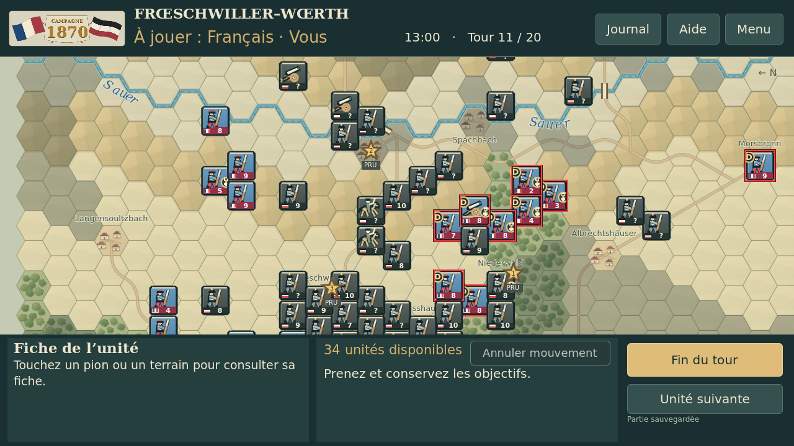
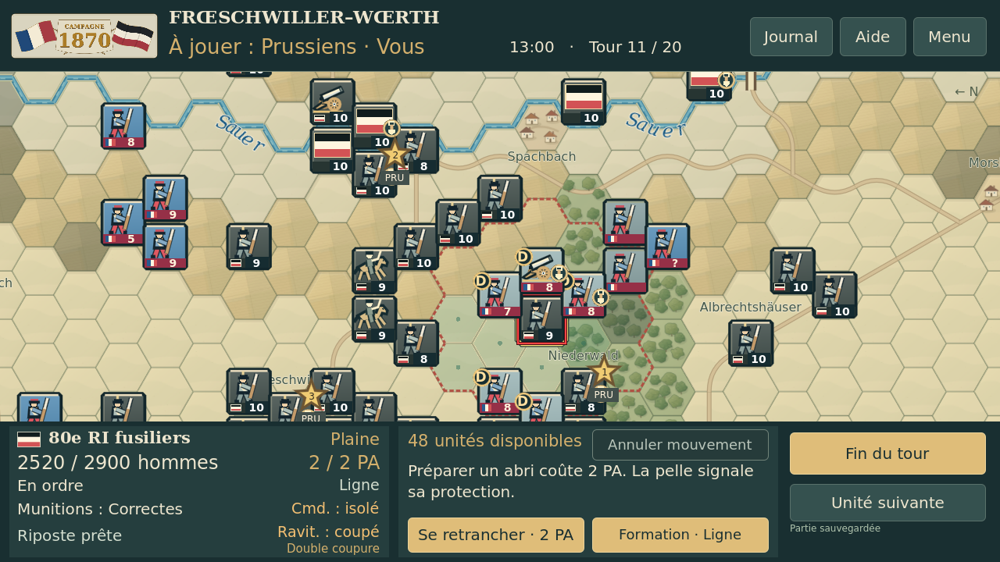
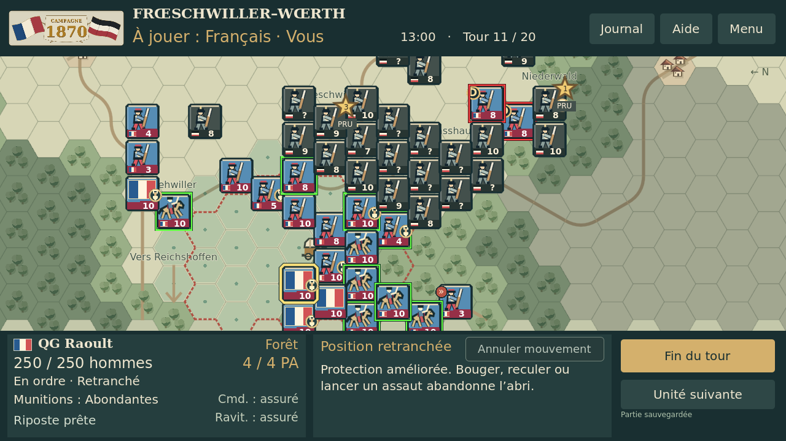
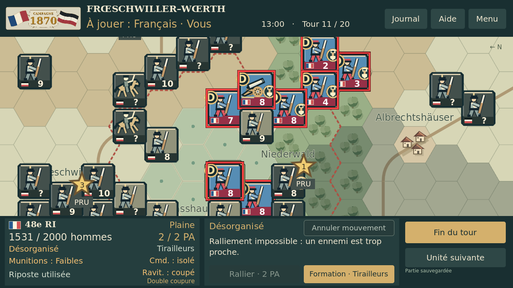

# Comparaison graphique — V43.15 / essai 2D

Captures réelles Godot 4.5.1, 1280 × 720, rendu Linux X11/OpenGL logiciel. Même état, caméra, zoom et sélection dans chaque paire. Fixture de test T11 existante ; ce ne sont pas des captures Android ni une nouvelle simulation chronologique.

La fiche inférieure gauche est identique pixel par pixel dans les cinq paires. Les commandes gardent leurs dimensions, textes, conditions et fonctions.

## Vue générale — deux inscriptions Sauer, ponts et objectifs

| V43.15 actuelle | Essai graphique 2D |
| --- | --- |
|  |  |

## Français — terrain et pions en situation de combat

| V43.15 actuelle | Essai graphique 2D |
| --- | --- |
|  |  |

## Prussiens — illustrations et indications de force

| V43.15 actuelle | Essai graphique 2D |
| --- | --- |
|  |  |

## QG Raoult — contours verts et rouges de liaison

| V43.15 actuelle | Essai graphique 2D |
| --- | --- |
|  |  |

## Vue rapprochée — bois, village, pions et fiche conservée

| V43.15 actuelle | Essai graphique 2D |
| --- | --- |
|  |  |

## Zooms extrêmes de l’essai

[Vue générale à 0,42](zooms/min_zoom.png) · [Détail à 2,3](zooms/max_zoom.png)

[Galerie HTML hors ligne](index.html) · [Mesures et preuves](preuves/)
