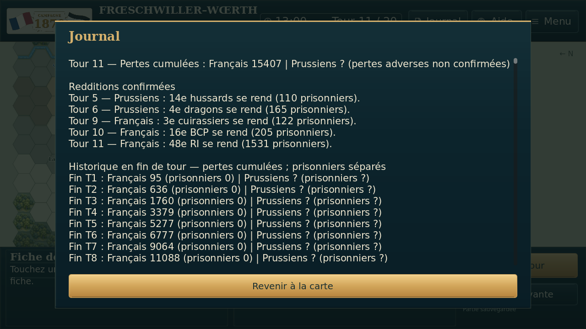
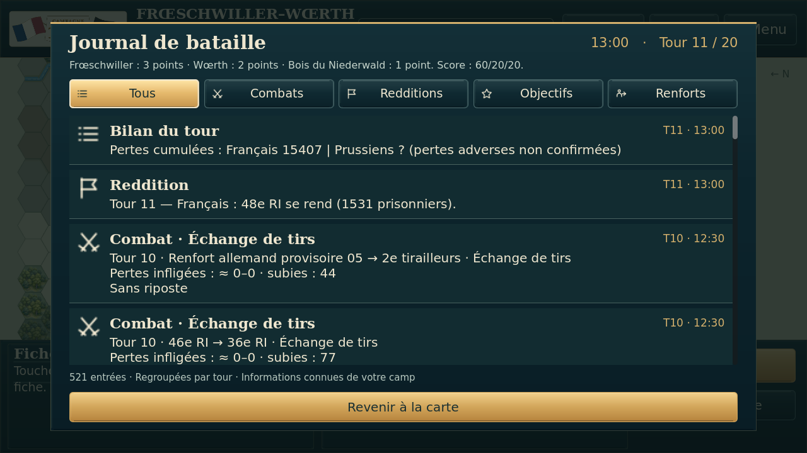
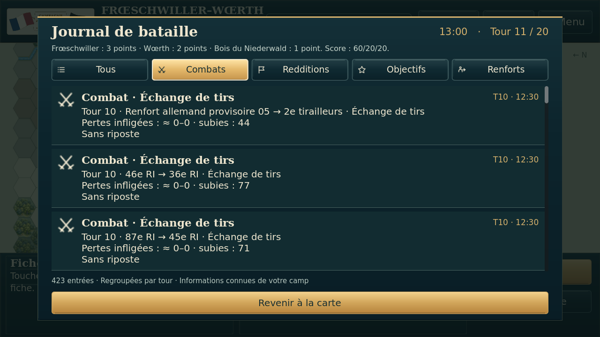
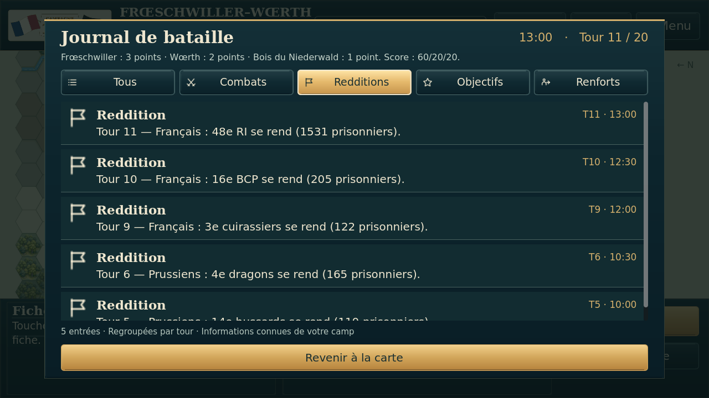
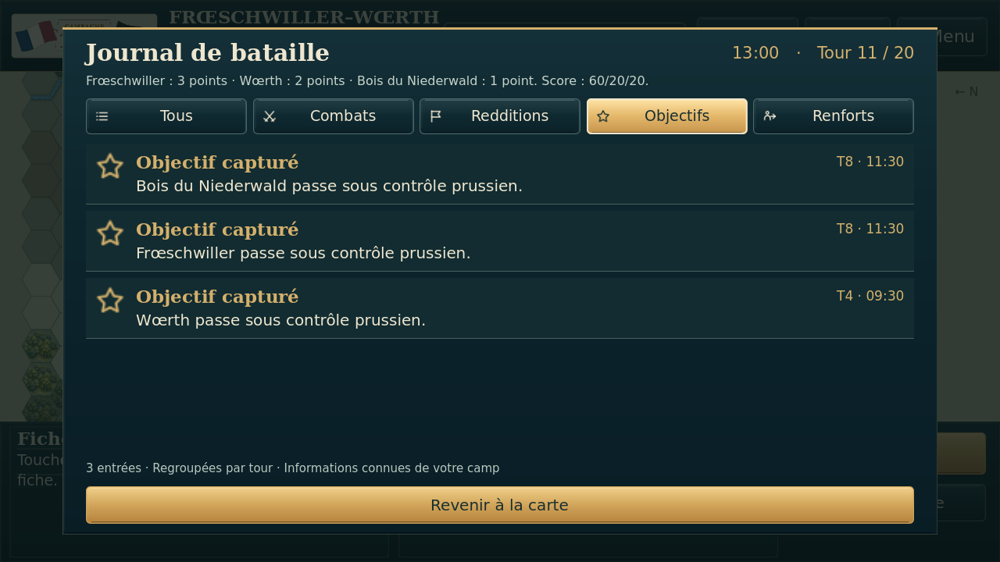
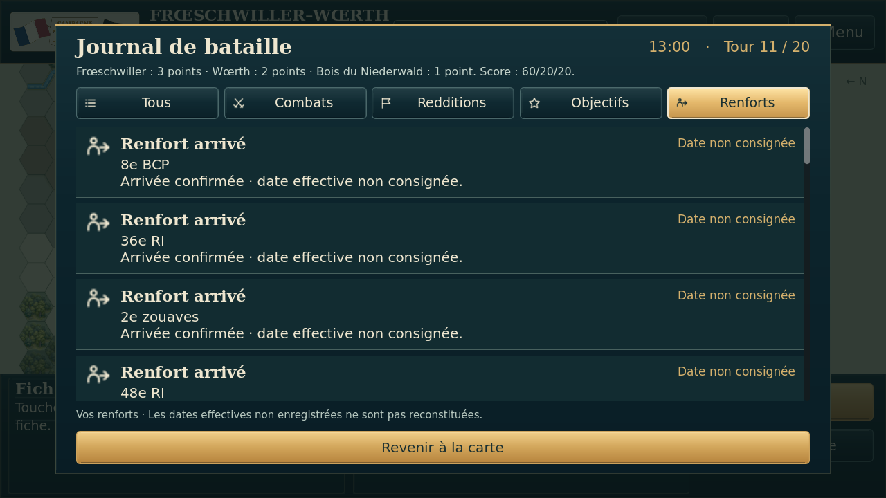
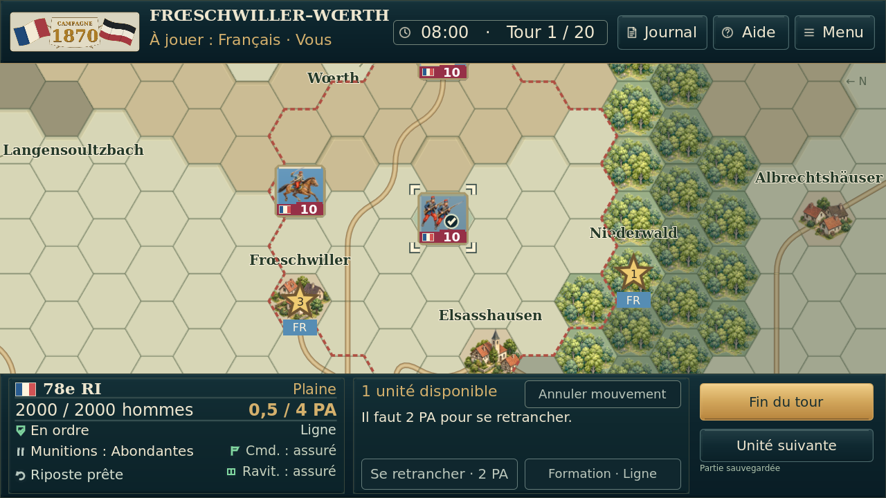
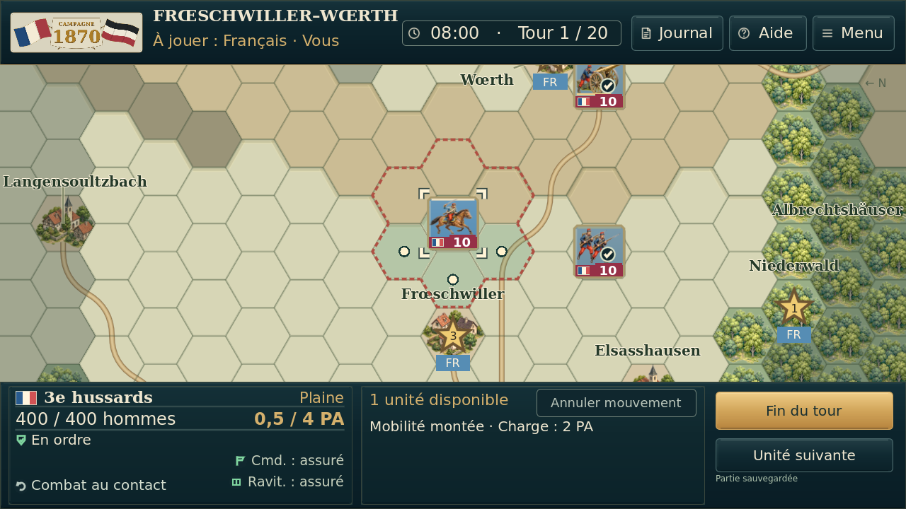
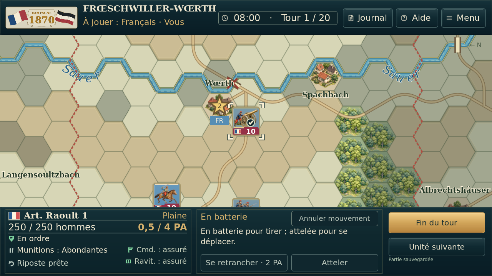

# Essai 10 — journal et coche de fin d’action

Captures réelles sous Godot 4.5.1, sans retouche. États synthétiques : la reddition du 48e RI dans le journal a été ajoutée au test de la fixture T11 pour vérifier le filtre. Les trois unités à 0,5 PA constituent un autre état de test, pas une partie chronologique du joueur.

## Journal avant/après, même état

| Ancien — essai 9 | Nouveau — essai 10 |
| --- | --- |
|  |  |

## Filtres utilisables

## Même budget de 0,5 PA, possibilités différentes

La coche ne clôture pas l’unité et ne supprime aucun PA. Elle disparaît lorsqu’une action redevient possible. Les ennemis sous brouillard ne reçoivent aucun nouvel indicateur de disponibilité. [Résultats détaillés](preuves/). Aucun essai physique Android.
