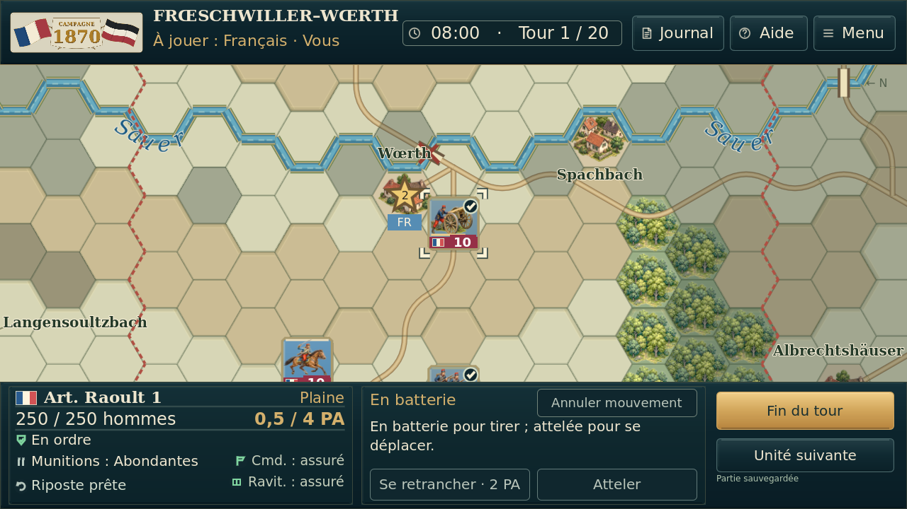
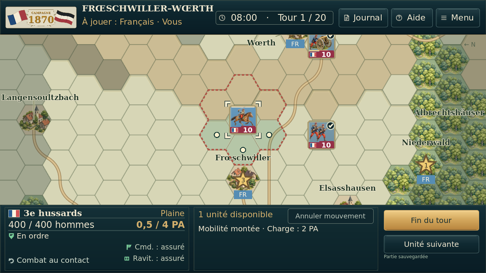
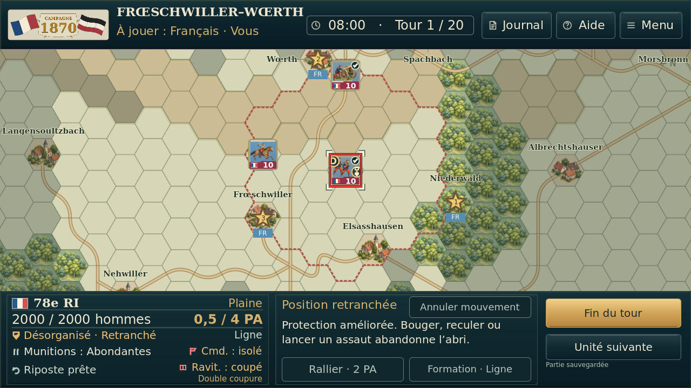
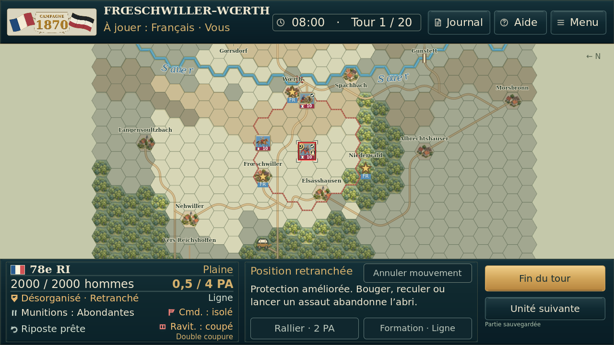
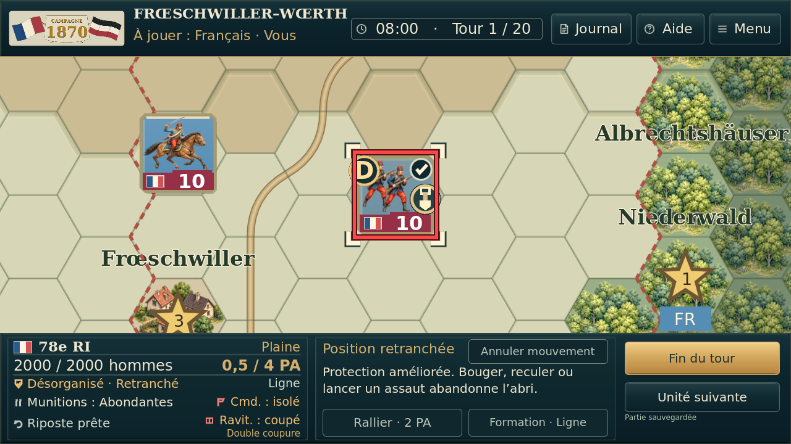

# Essai 11 — coche dans le coin supérieur droit

Captures réelles Godot 4.5.1/Linux, sans retouche. Même état synthétique de trois unités à 0,5 PA pour la comparaison ; aucune bataille du joueur reconstituée.

| Essai 10 — avant | Essai 11 — après |
| --- | --- |
|  |  |

## Coche, désorganisation, retranchement et isolement

Aucun changement de PA, de disponibilité ou de règles. [Résultats détaillés](preuves/). Aucun test sur appareil Android.
