# Essai graphique 12 — quatre retouches de lisibilité

Captures réelles Godot 4.5.1/Linux, sans retouche. Avant : essai 11. Après : essai 12. Même fixture synthétique T11, caméra et dimensions pour chaque paire ; pas une nouvelle bataille complète du joueur.

## Carte, pions et bandeaux

| Avant — essai 11 | Après — essai 12 |
| --- | --- |
|  | 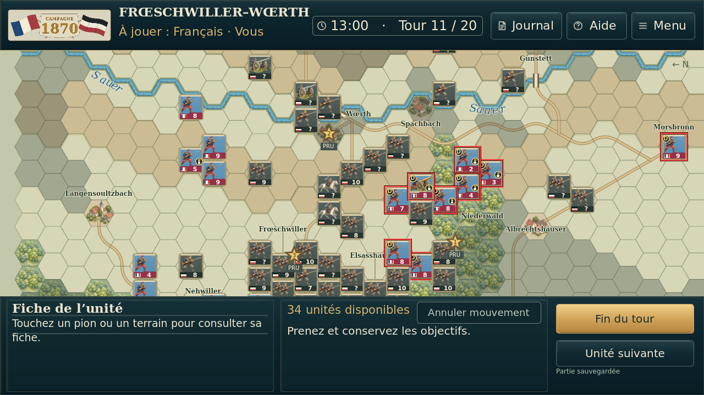 |
|  | 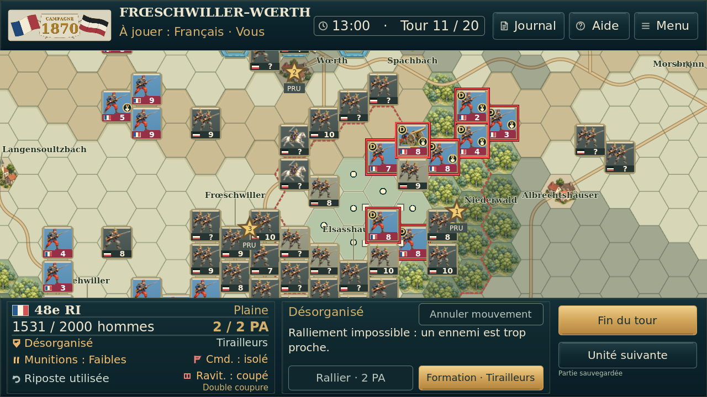 |
|  | 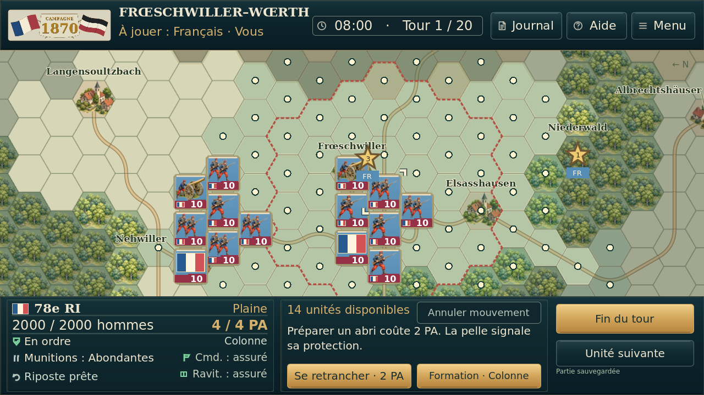 |
| 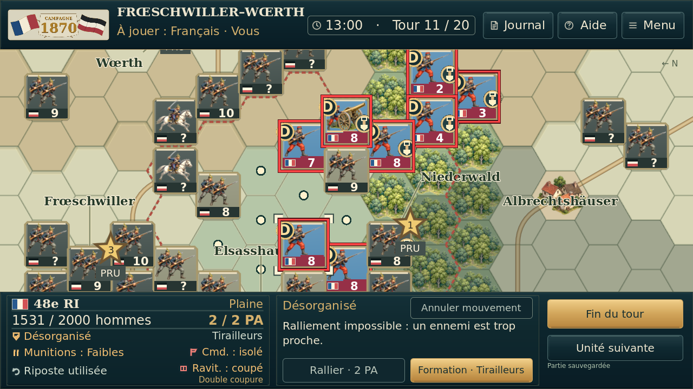 |  |

## Marqueurs harmonisés

Coche en haut à droite, D en haut à gauche, retranchement à droite ; force dégagée. État synthétique de trois unités à 0,5 PA.

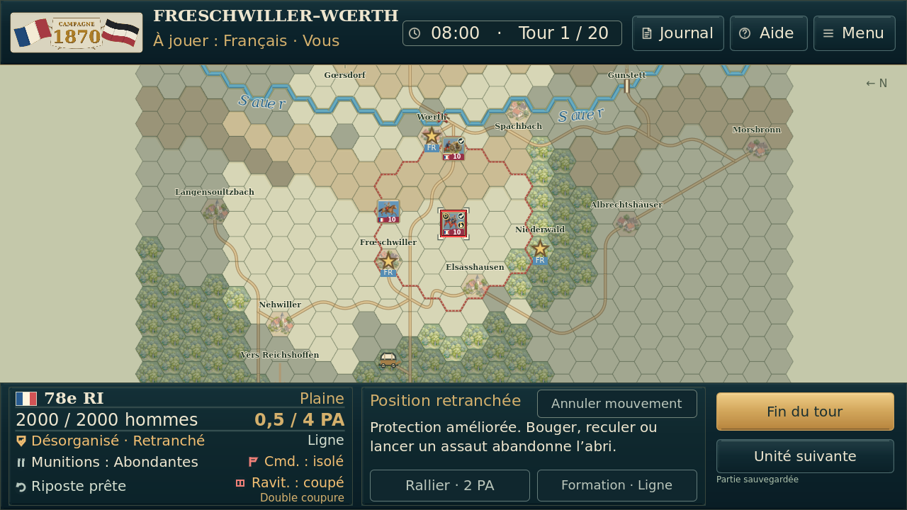

## Fiche avant, pendant et après la surbrillance

Le test exécute un vrai déplacement, puis modifie les effectifs et le moral dans une fixture pour vérifier l’effet décoratif. Aucun changement de règle.

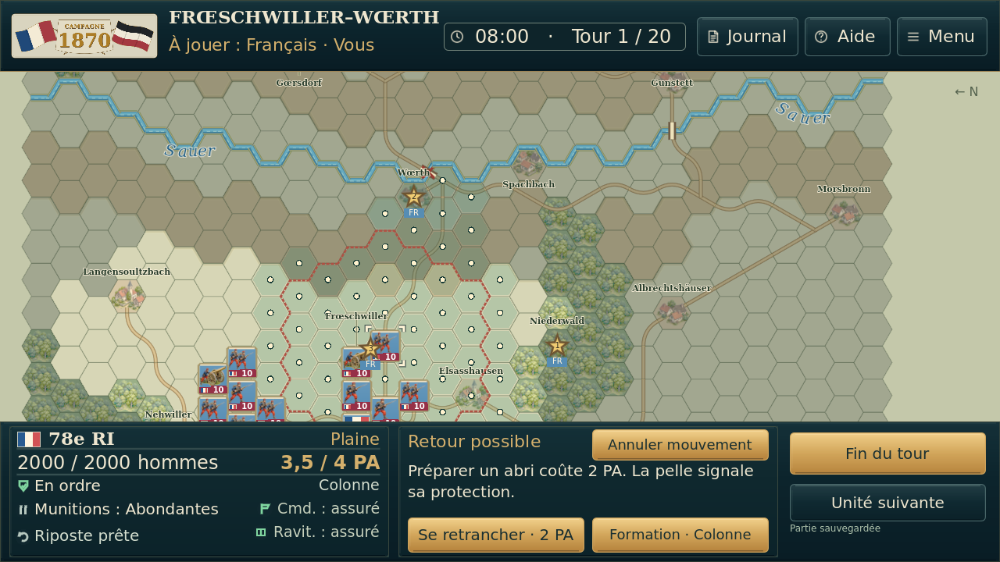

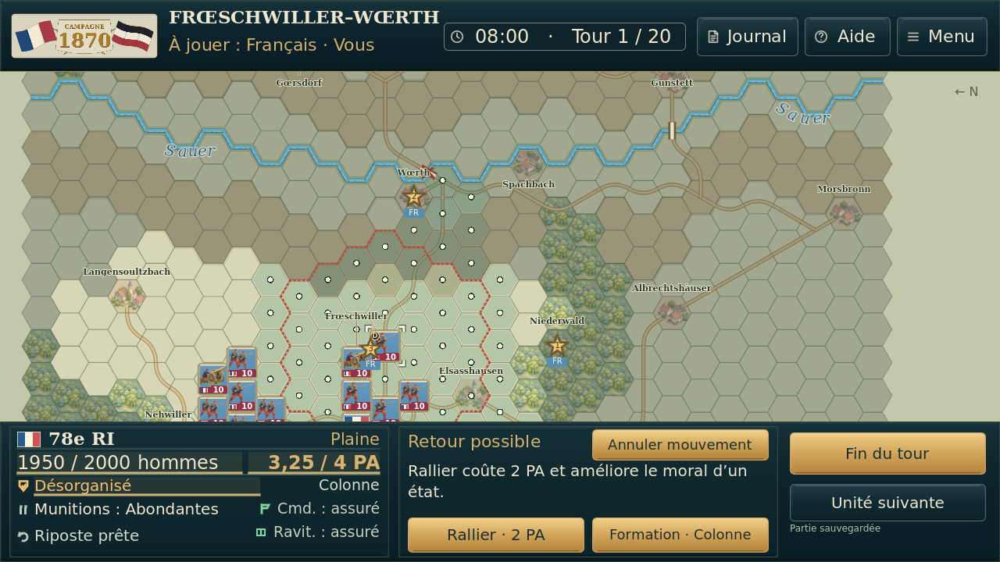

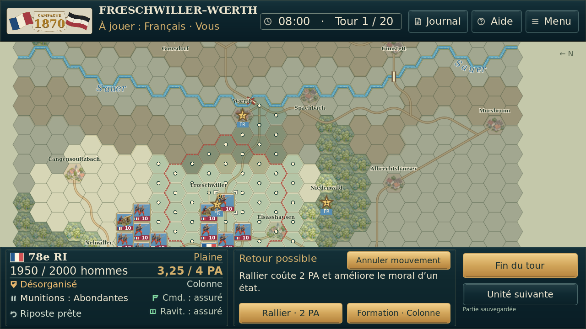

## Journal avec repères colorés

Même historique de test que précédemment, reddition de test ajoutée à la fixture T11. Les catégories, icônes et textes restent explicites.

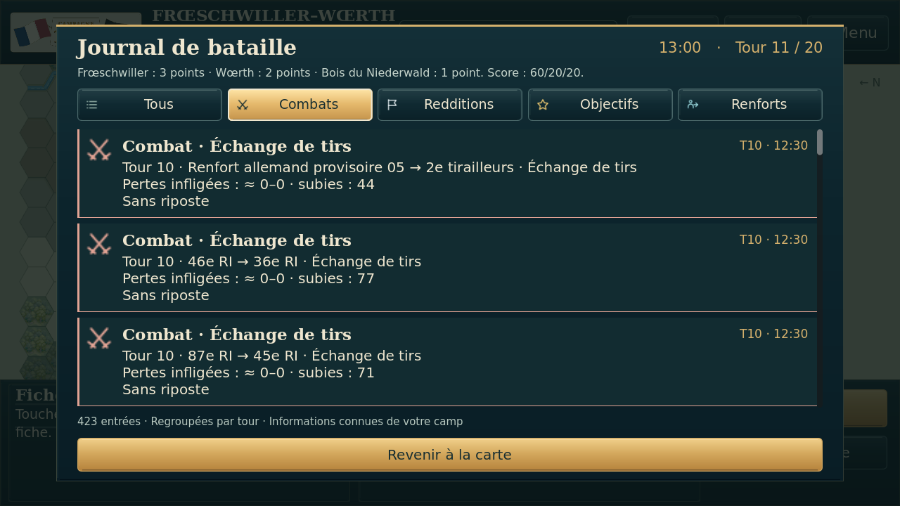

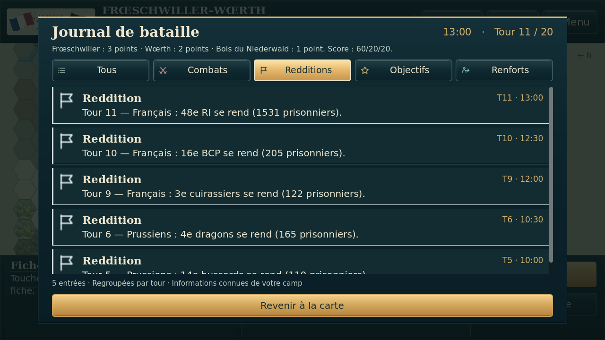

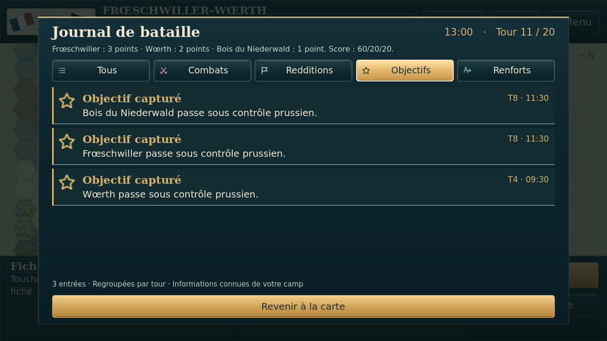

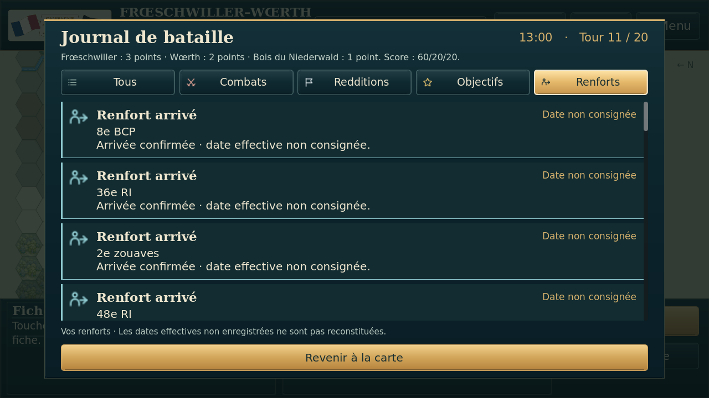

[Preuves détaillées](preuves/). Aucun essai physique ou émulateur Android ; aucun gain de fluidité sur téléphone revendiqué.
