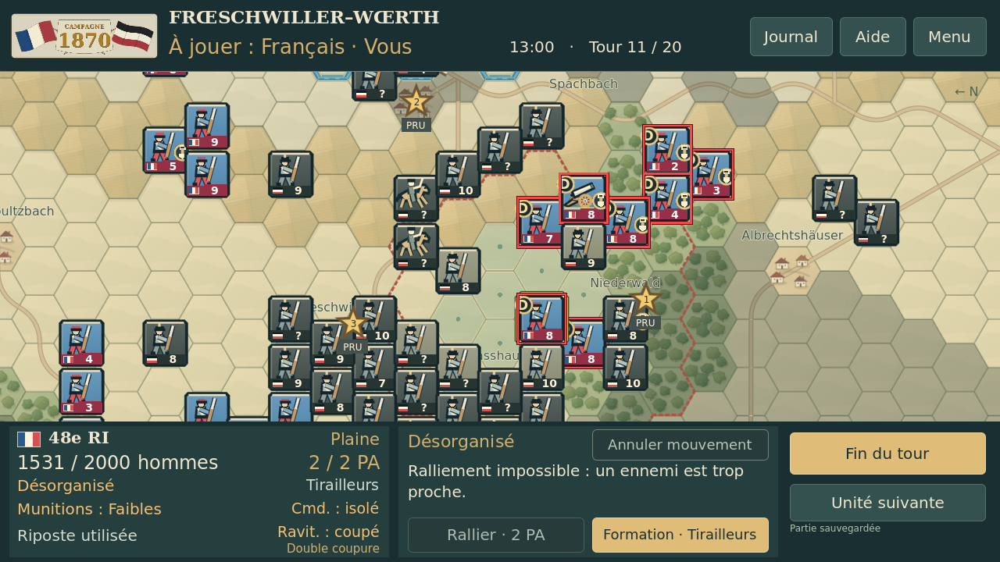
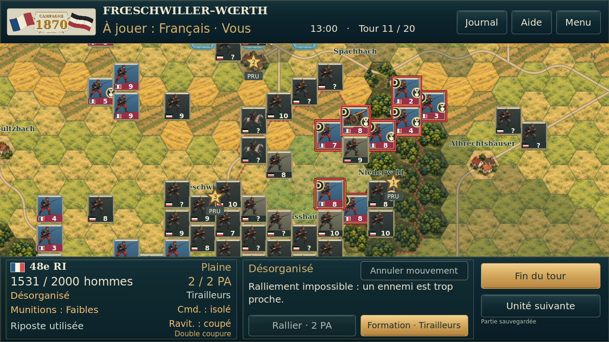
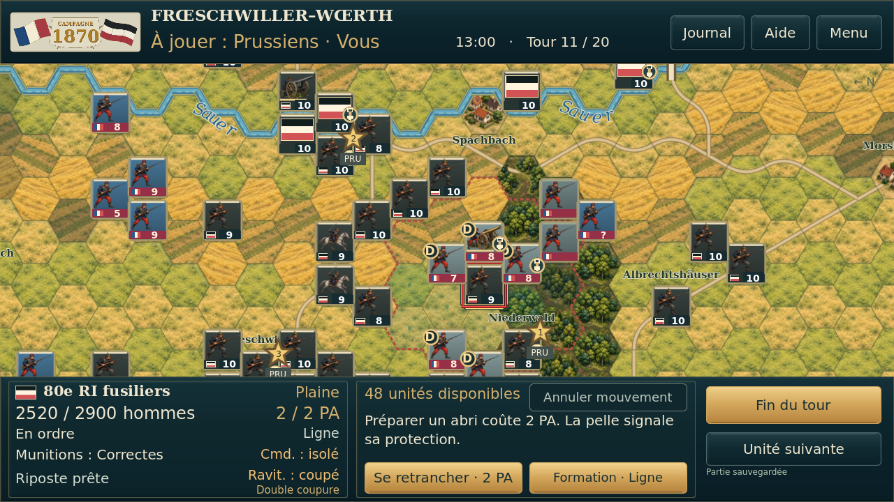
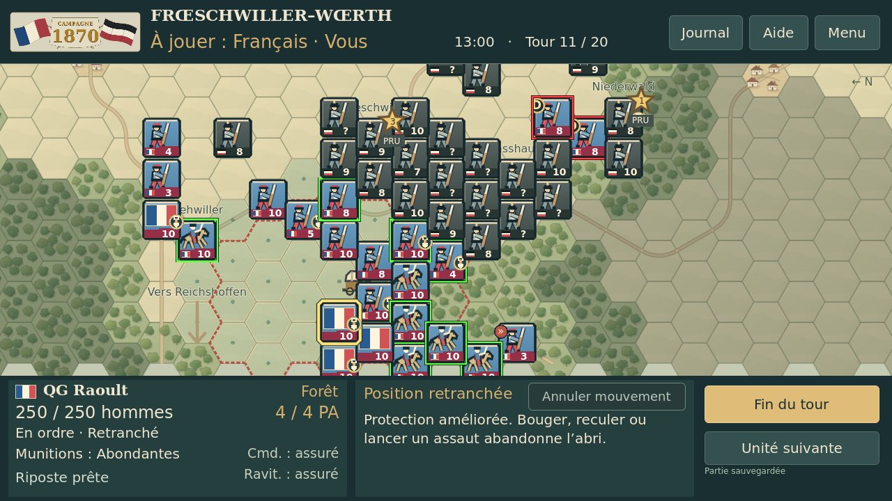
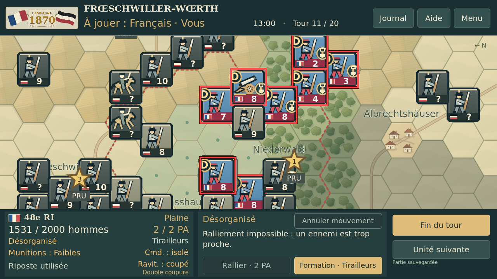

# Essai graphique 2D № 2 — avant/après

Captures réelles du jeu sous Godot 4.5.1, 1280 × 720, Linux/OpenGL logiciel. Avant : essai 1 ; après : essai 2 inspiré de la référence fournie. Les cinq paires utilisent le même état T11 de test, les mêmes positions, caméra, zoom et sélection. Aucune image de cette galerie n’est une maquette. Aucun essai physique Android.

La fiche garde ses textes et sa disposition ; son habillage change à la demande du joueur. Les 76 bandes de force visibles restent identiques pixel par pixel. Aucun bouton ajouté ou déplacé.

## Carte, Sauer et localités

| Essai 1 | Essai 2 |
| --- | --- |
|  |  |

## Combat — Français

| Essai 1 | Essai 2 |
| --- | --- |
|  |  |

## Combat — Prussiens

| Essai 1 | Essai 2 |
| --- | --- |
|  |  |

## QG Raoult et liaisons

| Essai 1 | Essai 2 |
| --- | --- |
|  |  |

## Détail des illustrations

| Essai 1 | Essai 2 |
| --- | --- |
|  |  |

[Zoom minimal 0,42](zooms/min_zoom.png) · [Zoom maximal 2,3](zooms/max_zoom.png) · [Galerie HTML hors ligne](index.html) · [Preuves](preuves/)
