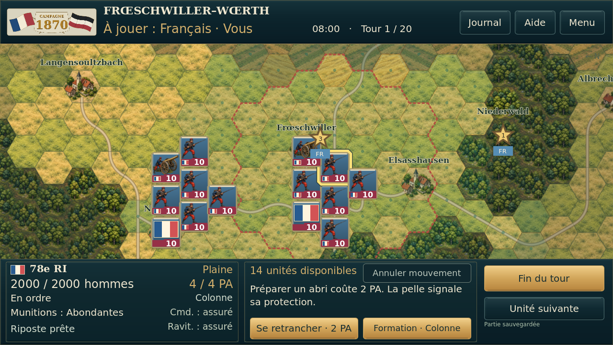
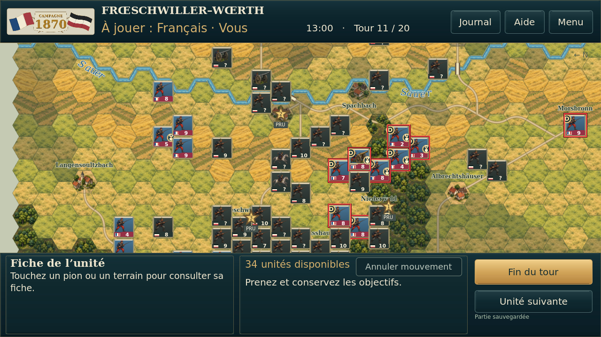
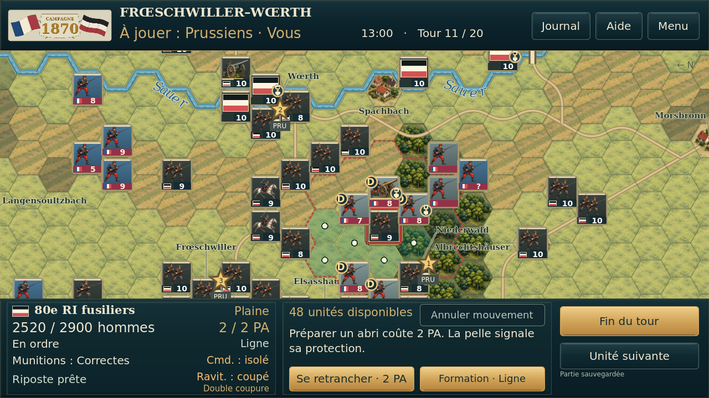
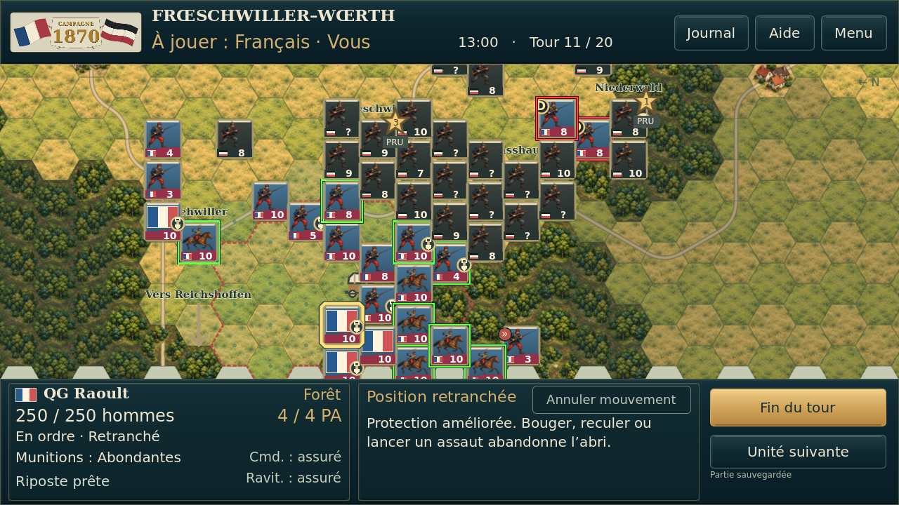
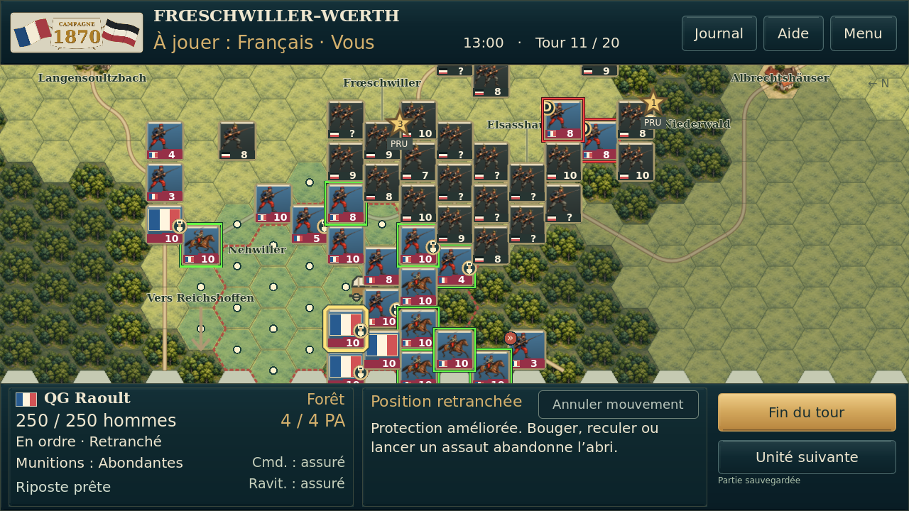
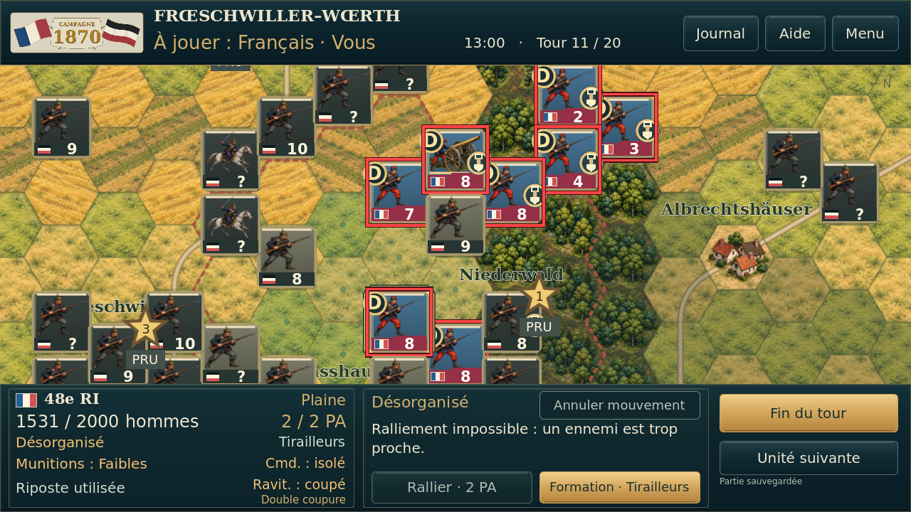

# Essai graphique № 3 — comparaisons réelles

Avant : essai 2 ; après : essai 3. Captures Godot 4.5.1, 1280 × 720, Linux/OpenGL logiciel. Mêmes positions, zooms et sélection dans chaque paire. Cinq cas utilisent la fixture T11 existante ; le déplacement utilise une nouvelle partie T1 française, graine fixée, 78e RI sélectionné à 2 000 hommes et 4 PA. Ce n’est pas une nouvelle simulation chronologique ni un essai Android.

Les 90 bandes de force comparées sont identiques pixel par pixel. Les règles, les commandes et la disposition des informations restent identiques.

## Déplacement de l’infanterie — destinations et deux soldats

| Essai 2 | Essai 3 |
| --- | --- |
|  |  |

## Carte générale — terrains uniformisés

| Essai 2 | Essai 3 |
| --- | --- |
|  |  |

## Front français — noms et points de déplacement

| Essai 2 | Essai 3 |
| --- | --- |
|  |  |

## Front prussien — contraste des pions

| Essai 2 | Essai 3 |
| --- | --- |
|  |  |

## QG Raoult et liaisons

| Essai 2 | Essai 3 |
| --- | --- |
|  |  |

## Détail des illustrations et des terrains

| Essai 2 | Essai 3 |
| --- | --- |
|  |  |

## Banc isolé des nouvelles règles visuelles

[Trois terrains uniformes et points contrastés](banc/uniform_tiles_and_markers.png). [Français 1 999](banc/infantry_0_1999.png) / [2 000](banc/infantry_0_2000.png). [Prussiens 1 999](banc/infantry_1_1999.png) / [2 000](banc/infantry_1_2000.png). Ces vues sont des états isolés du banc de rendu, pas des situations de bataille.

[Zoom 0,42](zooms/min_zoom.png) · [Zoom 2,3](zooms/max_zoom.png) · [Galerie hors ligne](index.html) · [Preuves](preuves/)
