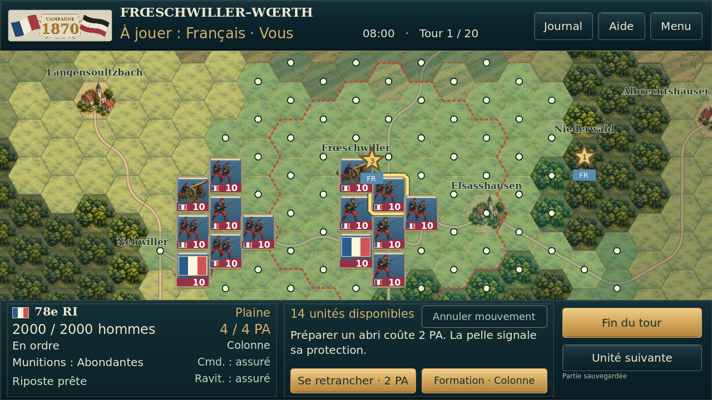
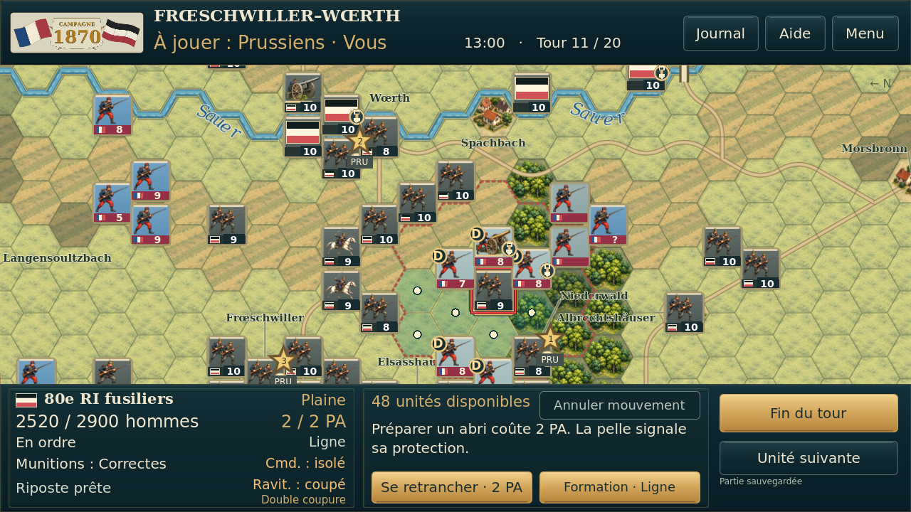
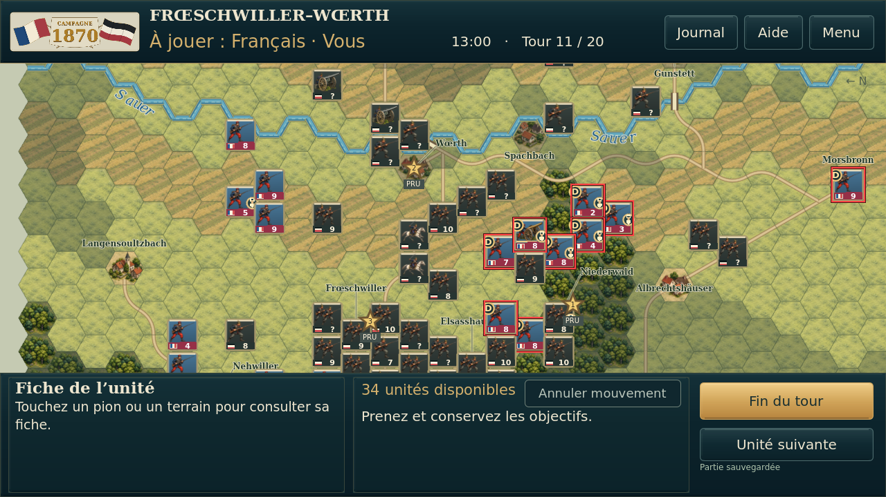
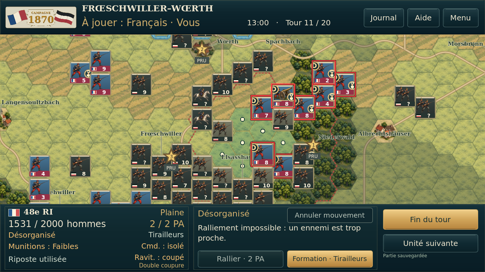
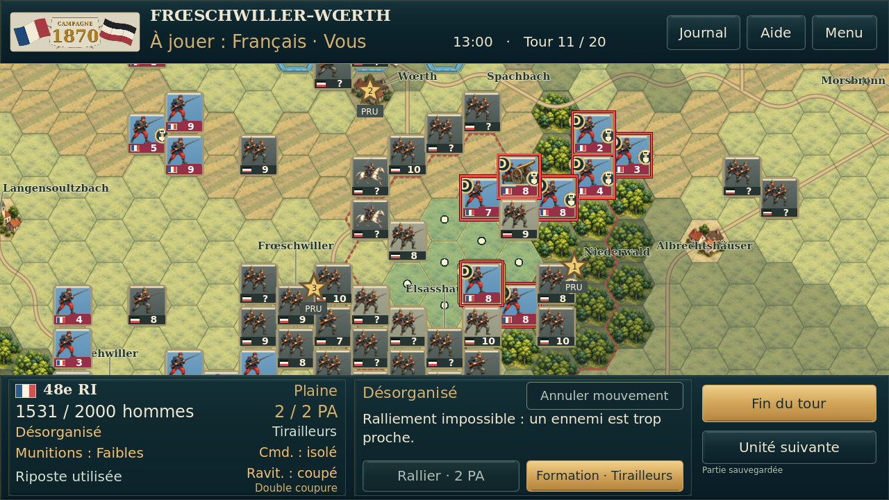
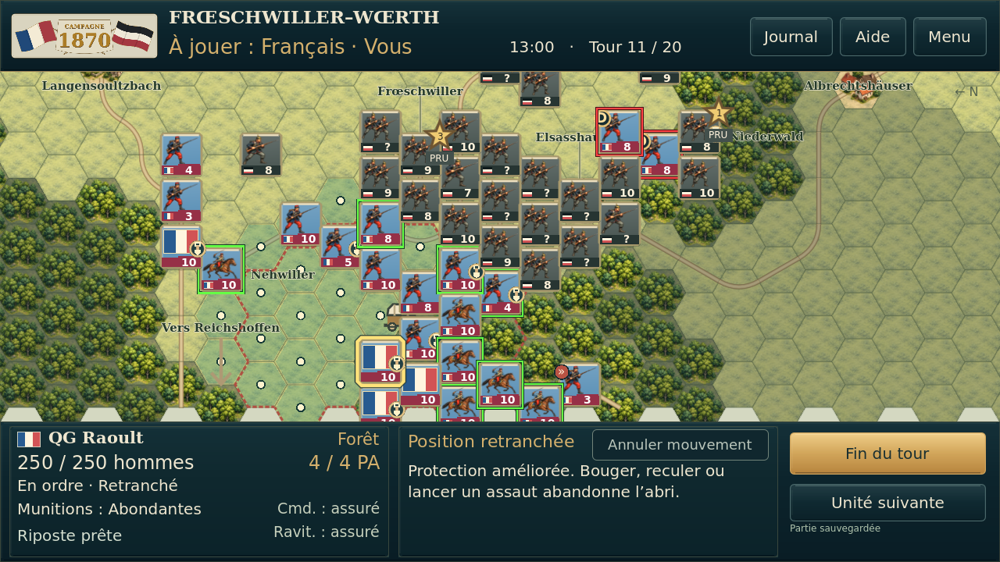
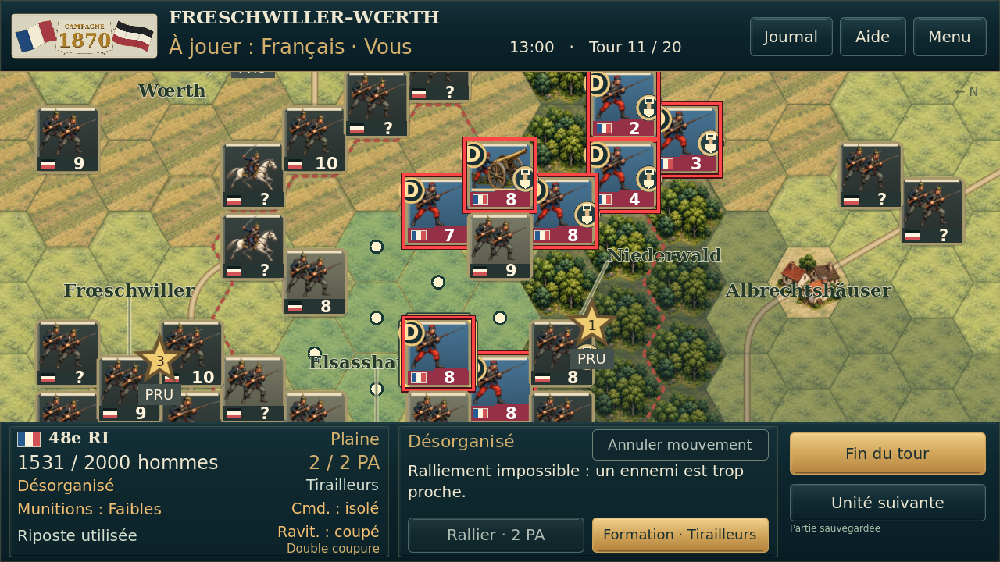
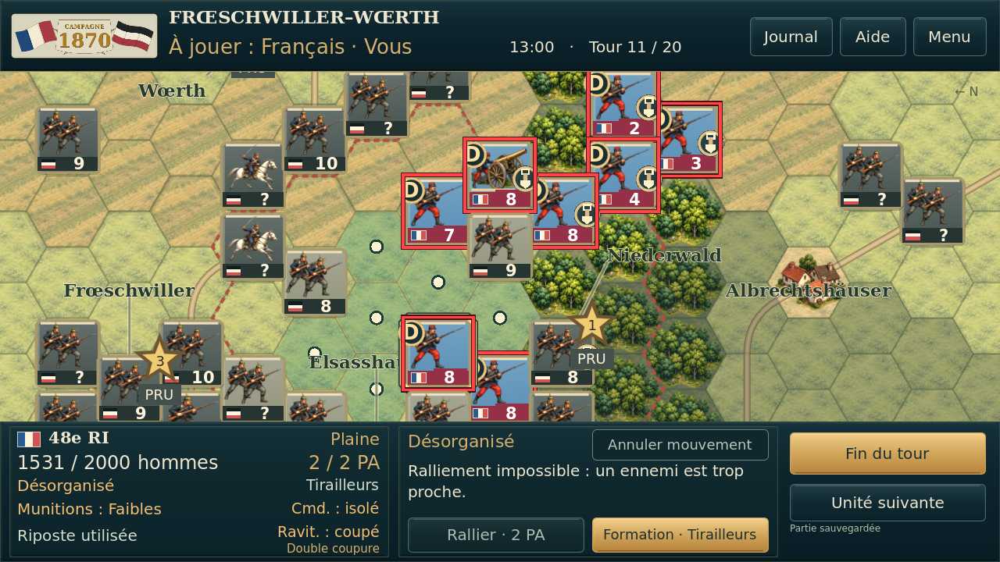

# Essai graphique № 4 — éclaircissement

Captures réelles Godot 4.5.1, 1280 × 720, Linux/OpenGL logiciel. Avant : essai 3 ; après : essai 4. Même état, caméra, zoom et sélection dans chaque paire. Déplacement : nouvelle partie française T1 avec graine fixée ; autres cas : fixture T11. Aucun essai physique Android.

Les 90 bandes de force comparées sont identiques pixel par pixel. Le brouillard garde exactement sa règle et sa surimpression. Les noms, commandes, informations et dispositions restent les mêmes.

## Déplacement — carte et pions éclaircis

| Essai 3 | Essai 4 |
| --- | --- |
|  |  |

## Pions prussiens plus lumineux

| Essai 3 | Essai 4 |
| --- | --- |
|  |  |

## Carte générale

| Essai 3 | Essai 4 |
| --- | --- |
|  |  |

## Front français

| Essai 3 | Essai 4 |
| --- | --- |
|  |  |

## QG Raoult et liaisons

| Essai 3 | Essai 4 |
| --- | --- |
|  |  |

## Détail des soldats et des bois

| Essai 3 | Essai 4 |
| --- | --- |
|  |  |

[Banc des terrains et marqueurs](banc/uniform_tiles_and_markers.png) · [Zoom minimal](zooms/min_zoom.png) · [Zoom maximal](zooms/max_zoom.png) · [Mesures RGB](preuves/brightness.json) · [Galerie hors ligne](index.html)
