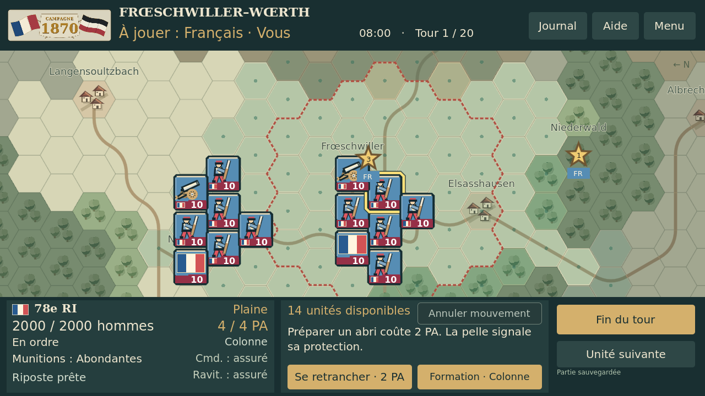
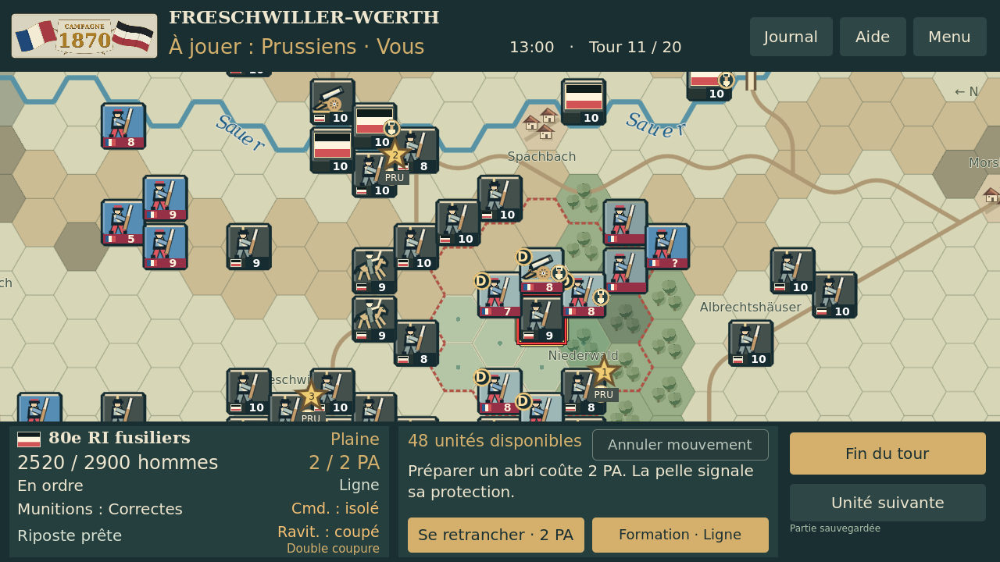
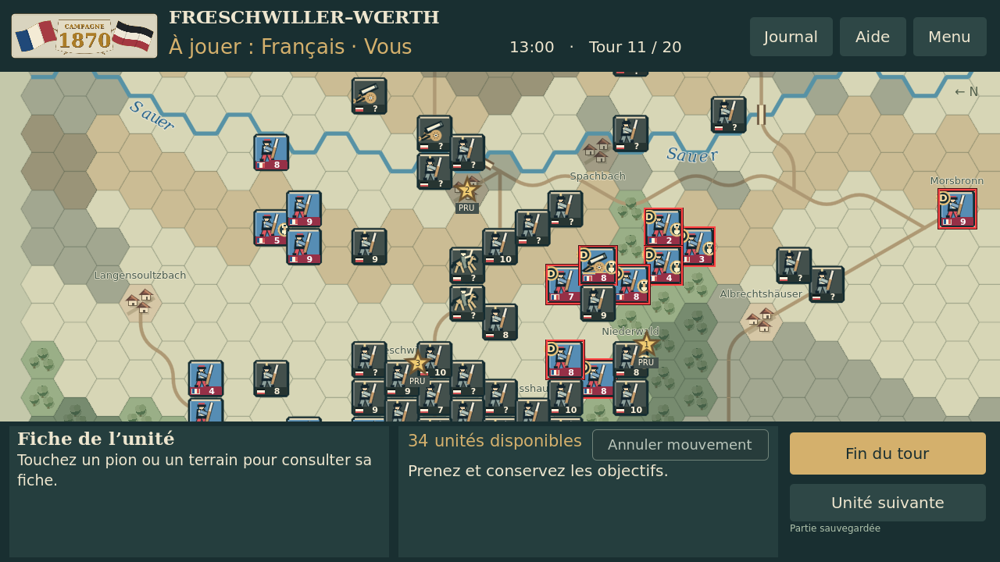
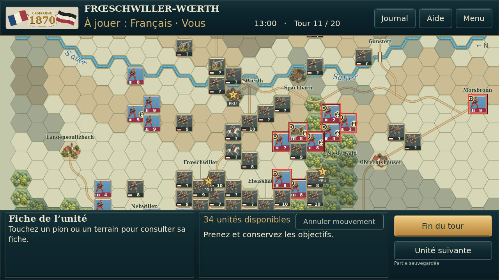
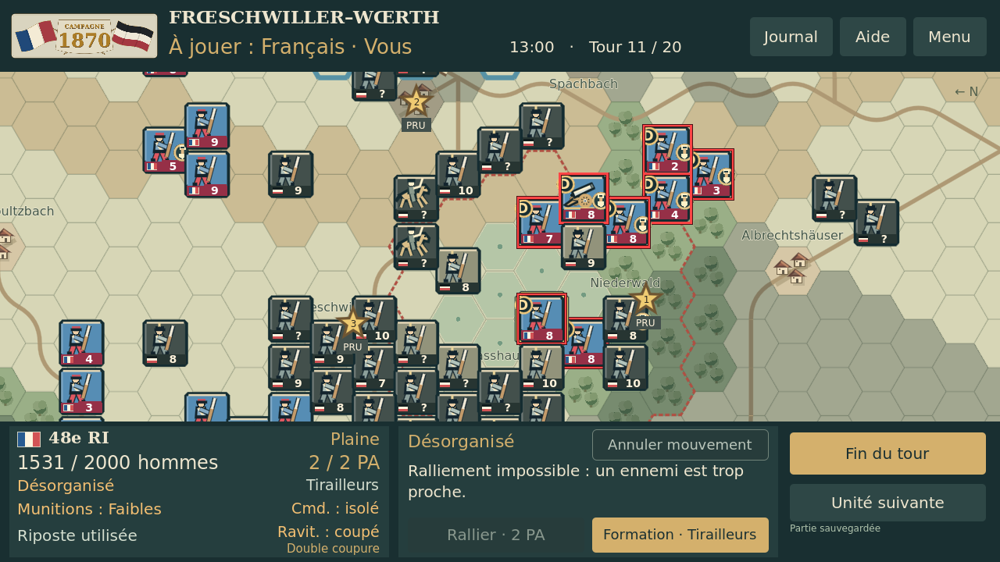
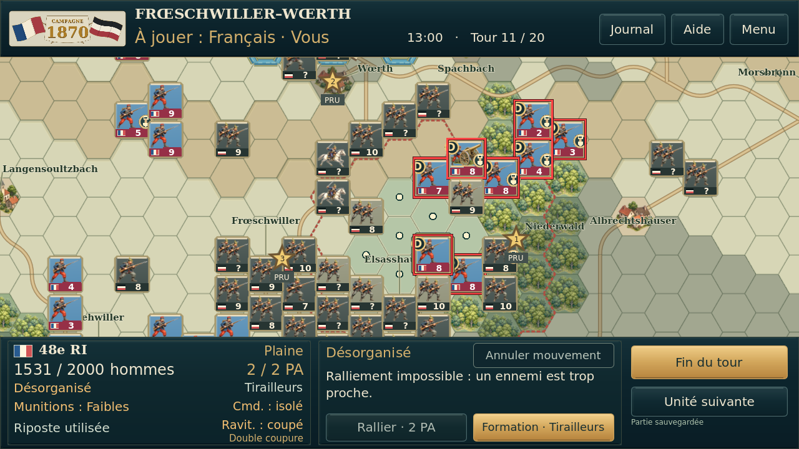
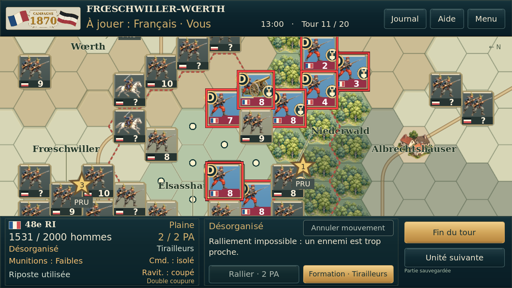

# Essai № 5 — référence V43.15, essai 4 et nouveau rendu

Captures réelles Godot 4.5.1, 1280 × 720, Linux/OpenGL logiciel, mêmes états/caméras/zooms. Déplacement : nouvelle partie française T1 à graine fixée ; autres cas : fixture T11. Aucun essai physique Android.

Les couleurs de fond des hexagones reprennent exactement celles du pack V43.15. Les dessins détaillés restent différents des anciens symboles : leur luminosité est comparable, pas leur image pixel par pixel. Les 90 bandes de force et les commandes sont identiques.

## Déplacement — palette claire de la V43.15

| V43.15 stable | Essai 4 | Essai 5 |
| --- | --- | --- |
|  |  |  |

## Pions prussiens

| V43.15 stable | Essai 4 | Essai 5 |
| --- | --- | --- |
|  |  |  |

## Carte générale

| V43.15 stable | Essai 4 | Essai 5 |
| --- | --- | --- |
|  |  |  |

## Front français

| V43.15 stable | Essai 4 | Essai 5 |
| --- | --- | --- |
|  |  |  |

## QG Raoult et liaisons

| V43.15 stable | Essai 4 | Essai 5 |
| --- | --- | --- |
|  |  |  |

## Détail des illustrations

| V43.15 stable | Essai 4 | Essai 5 |
| --- | --- | --- |
|  |  |  |

[Banc des terrains et marqueurs](banc/uniform_tiles_and_markers.png) · [Zoom minimal](zooms/min_zoom.png) · [Zoom maximal](zooms/max_zoom.png) · [Mesures RGB](preuves/reference_palette.json) · [Galerie hors ligne](index.html)
