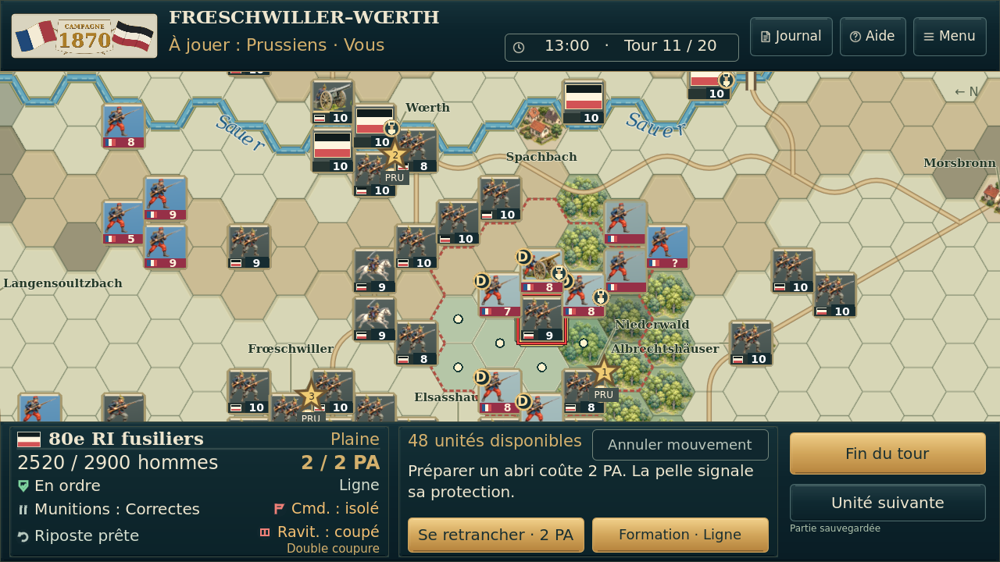
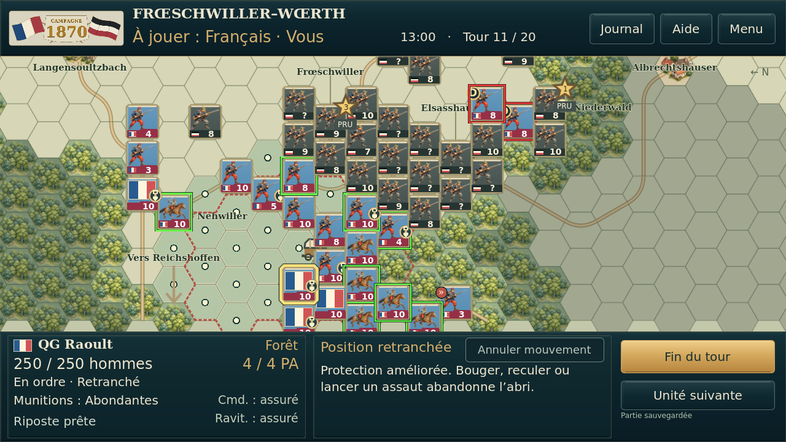
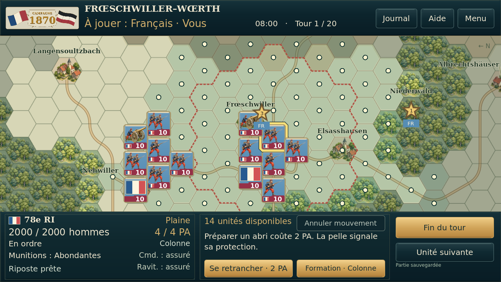
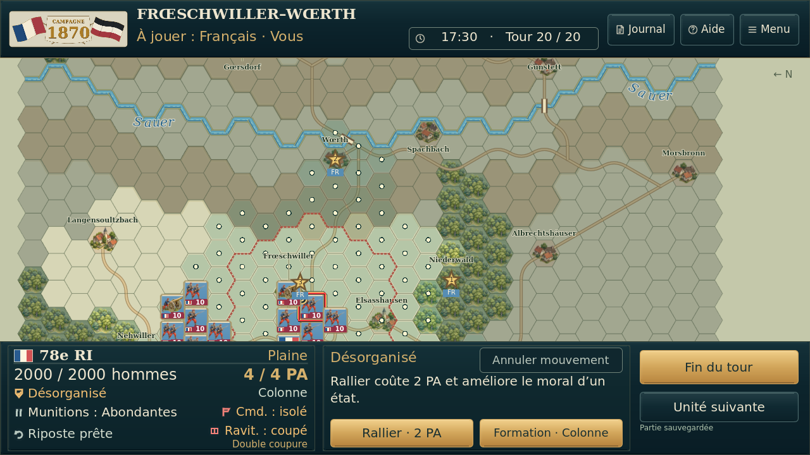

# Comparaison réelle — essai 5 / essai 6

Captures Godot 4.5.1, mêmes états synthétiques et cadrages, 1280 × 720. Les différences portent uniquement sur les bandeaux. La zone de carte, les pions et les bandes de force sont identiques en pixels. Aucun photomontage.

| Situation | Avant — essai 5 | Après — essai 6 |
| --- | --- | --- |
| Vue générale |  |  |
| Infanterie désorganisée, double coupure |  |  |
| Joueur prussien |  |  |
| QG Raoult |  |  |
| Zoom rapproché |  |  |
| Unité en ordre et déplacements |  |  |

Fiche en double coupure — état de test synthétique, sans prétendre reproduire une partie du joueur :

Les signes verts/orange/rouges complètent les textes existants. Aucun bonus, aucune règle de jeu modifiée. [Résultats détaillés](preuves/). Aucun essai physique Android.
