# Essai 6 / essai 7 — captures réelles

Huit états synthétiques identiques, Godot 4.5.1, 1280 × 720. Carte/pions de même luminosité ; différences ciblées sur sélection, trajet, noms, séparation de fiche et boutons indisponibles. Aucun photomontage.

| Situation | Avant — essai 6 | Après — essai 7 |
| --- | --- | --- |
| Vue générale | 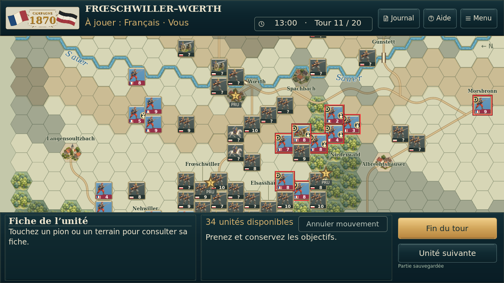 |  |
| Actions indisponibles | 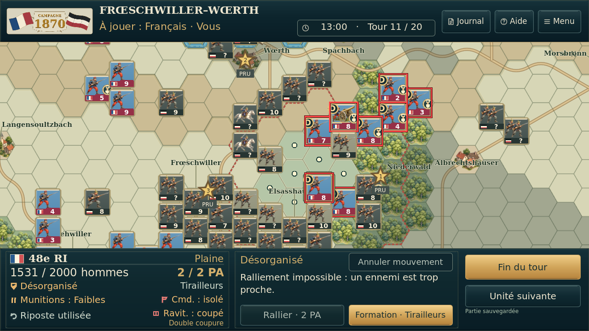 |  |
| Joueur prussien |  |  |
| QG et cadres tactiques |  | 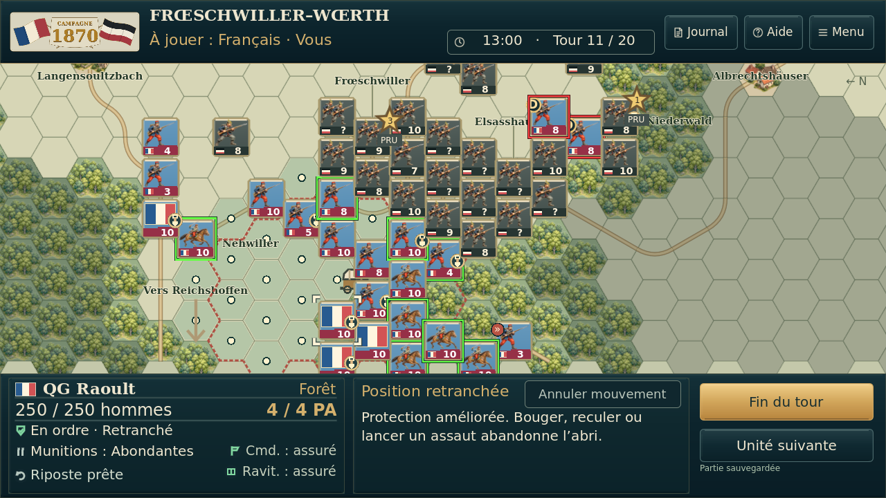 |
| Zoom rapproché | 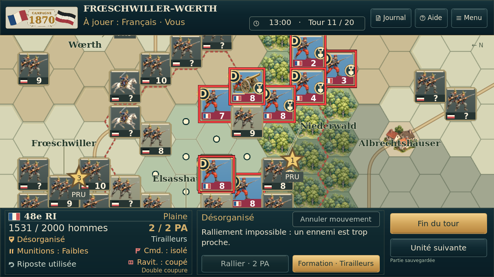 |  |
| Cases accessibles | 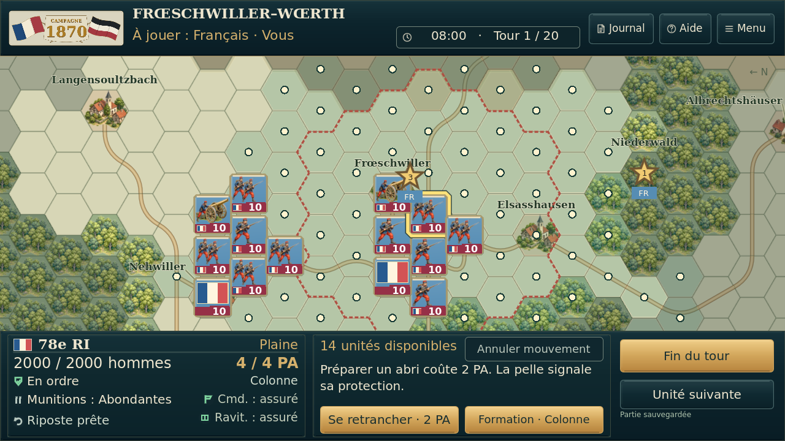 | 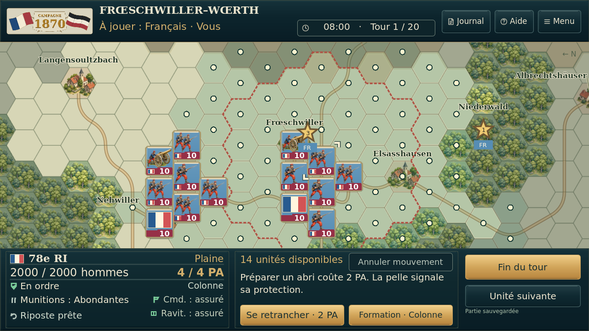 |
| Trajet préparé et destination | 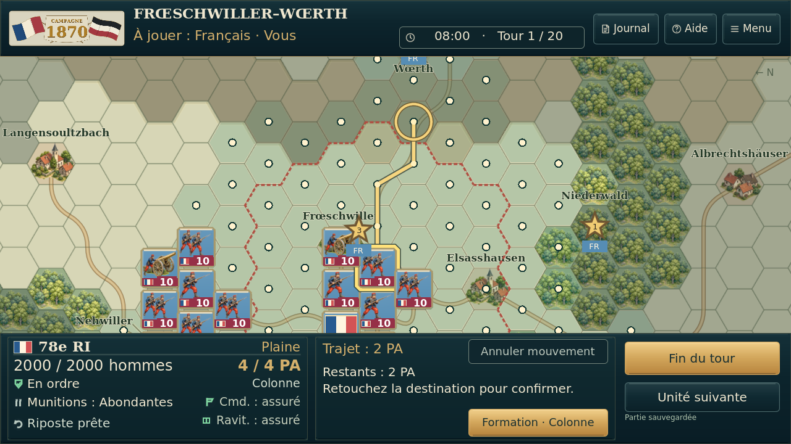 |  |
| Sélection et isolement | 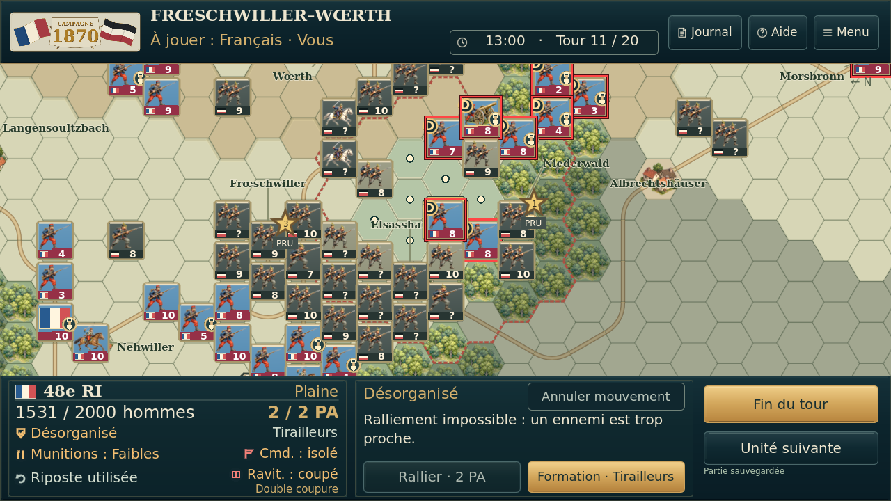 |  |

121 zones de chiffres de force identiques. Un petit drapeau voisin anciennement recouvert par le contour de sélection est dégagé. Les cadres tactiques rouges/verts conservent leur taille et leur rôle.

## Aides au toucher

Toucher un pictogramme de la fiche ouvre une explication. Aucun ordre ni sauvegarde exécuté.

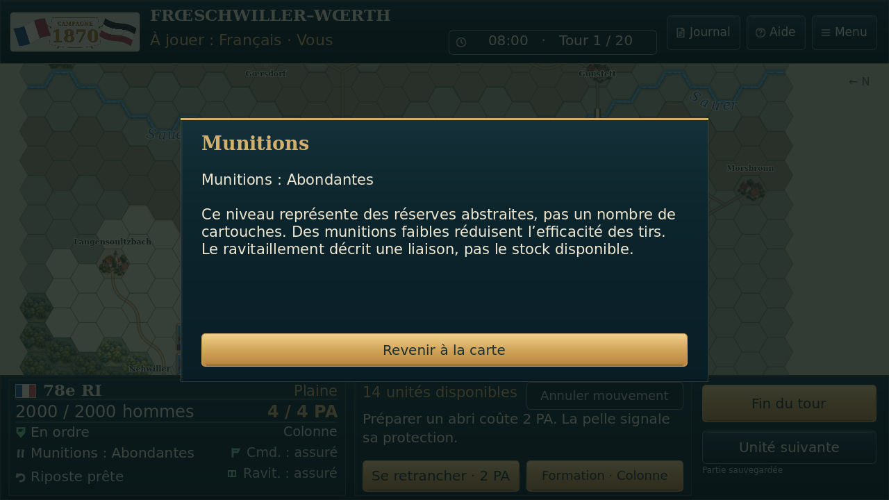

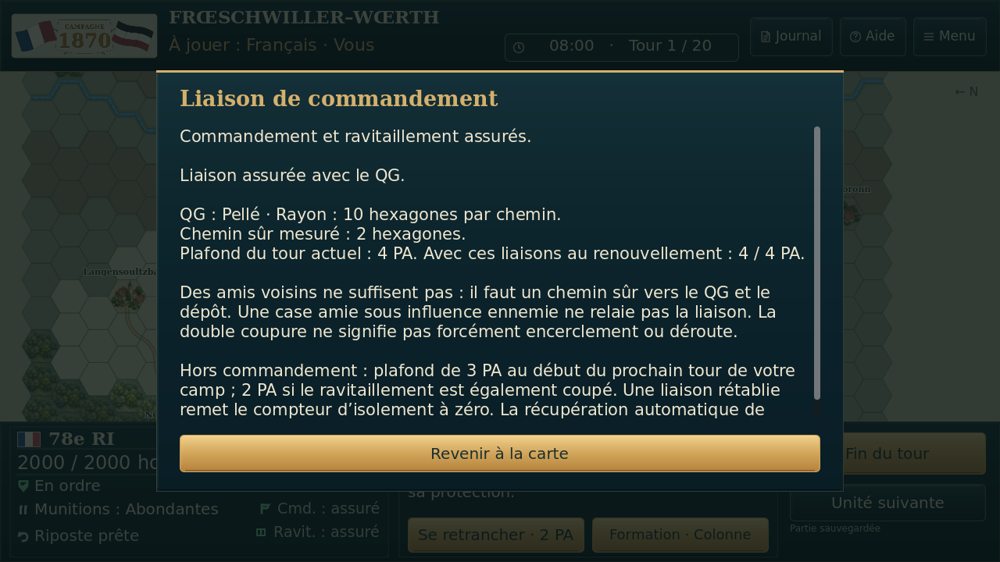

## Lisibilité aux quatre zooms

Planche de test synthétique, pas une nouvelle carte du jeu :

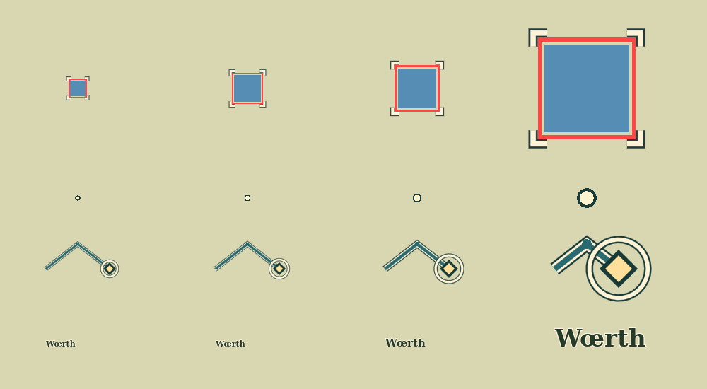

[Résultats détaillés](preuves/). Aucun essai physique Android.
