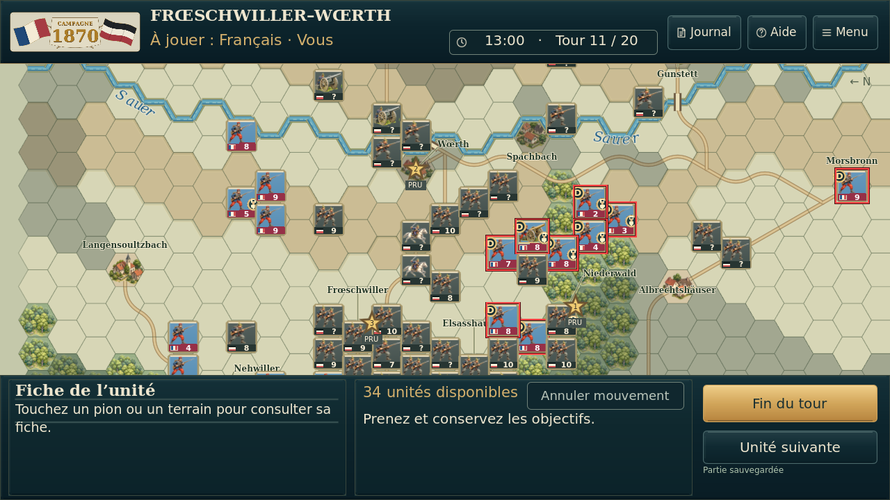
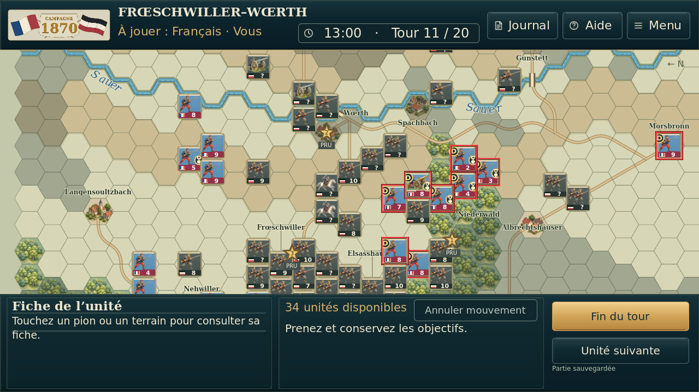
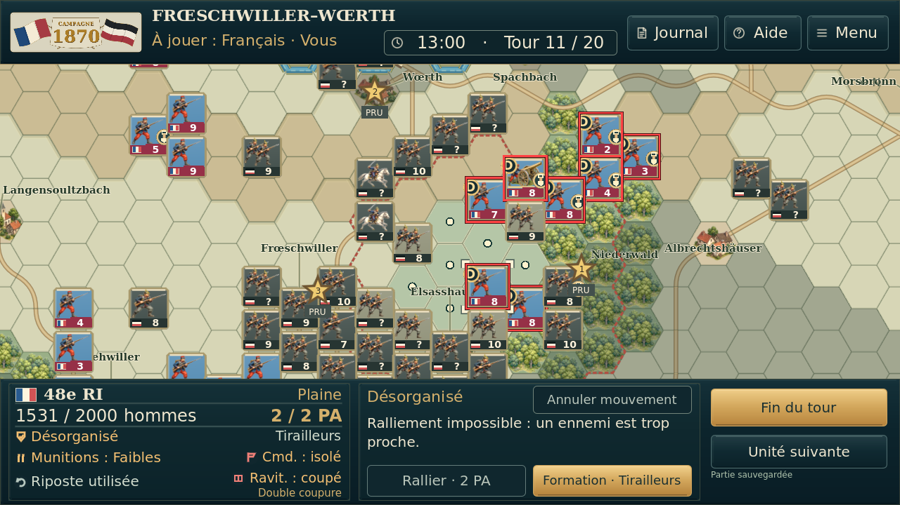
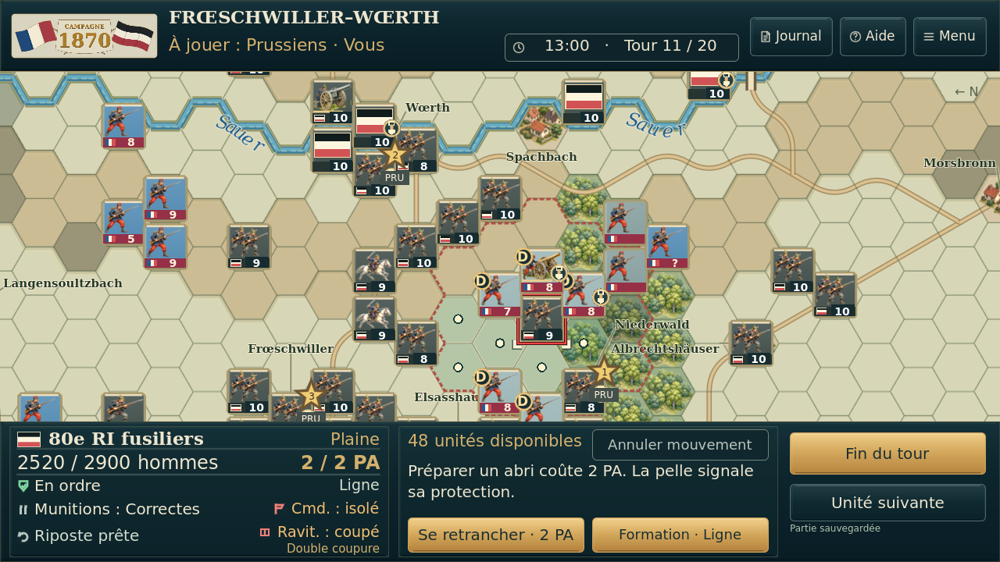
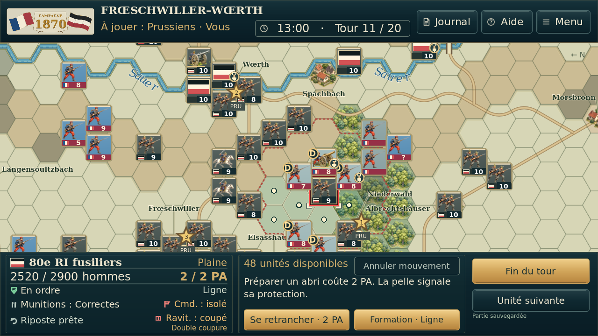
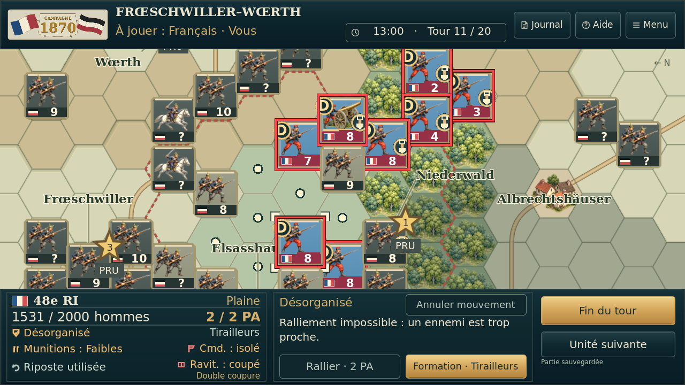
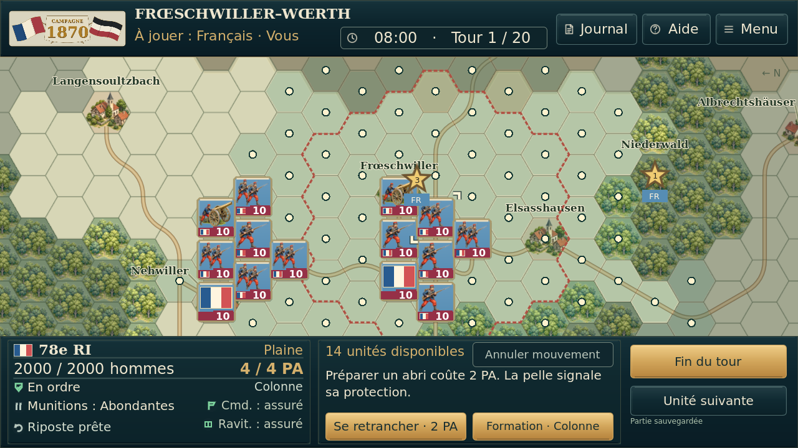
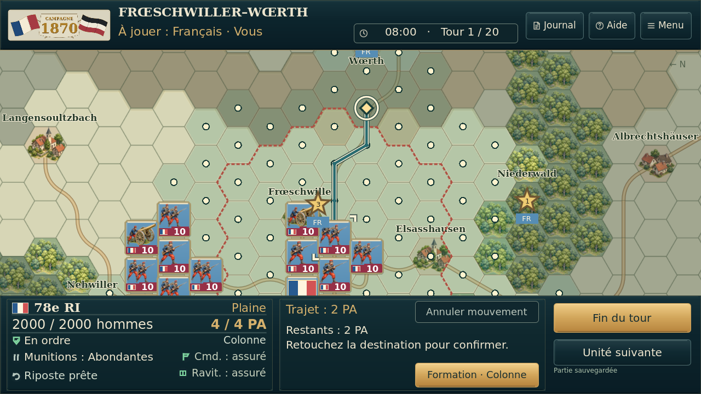
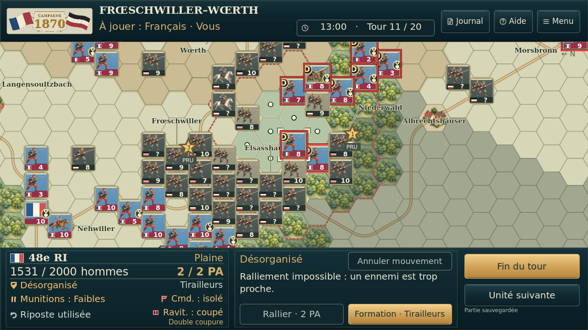
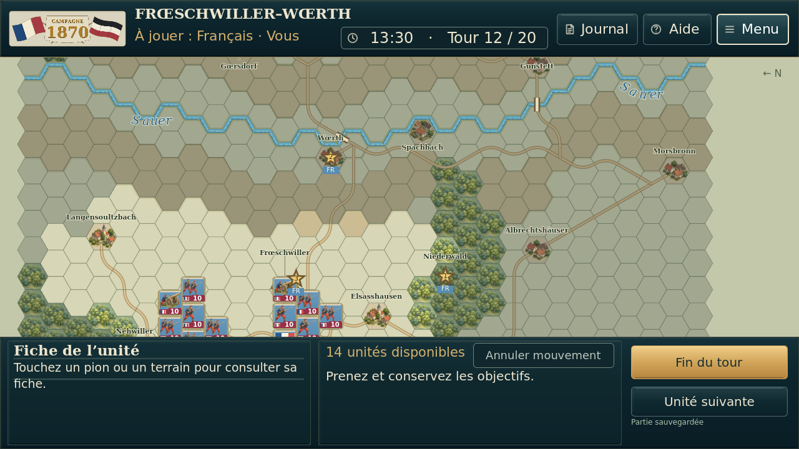

# Essai 7 / essai 8 — bandeau plus lisible

Heure/tours : 20 → 24. Journal/Aide/Menu : 17 → 22. Même hauteur, même place pour la carte. Tous les pixels sous l’en-tête restent identiques dans les huit situations comparées.

| Situation | Avant — essai 7 | Après — essai 8 |
| --- | --- | --- |
| Vue générale |  |  |
| Engagement |  |  |
| Camp prussien |  |  |
| QG |  |  |
| Zoom |  |  |
| Déplacements |  |  |
| Trajet préparé |  |  |
| Isolement |  |  |

Capture supplémentaire d’un état de test synthétique au tour 12 :

Captures Godot 4.5.1 sans retouche. [Preuves](preuves/). Aucun test physique Android.
