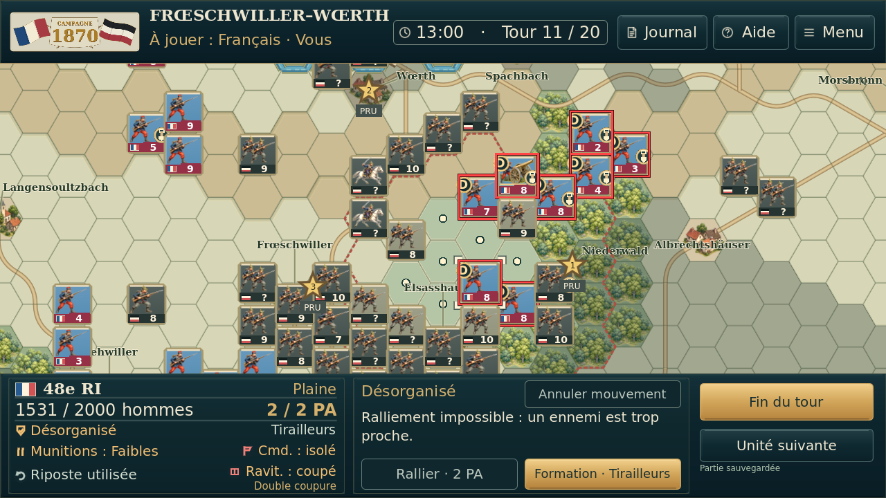
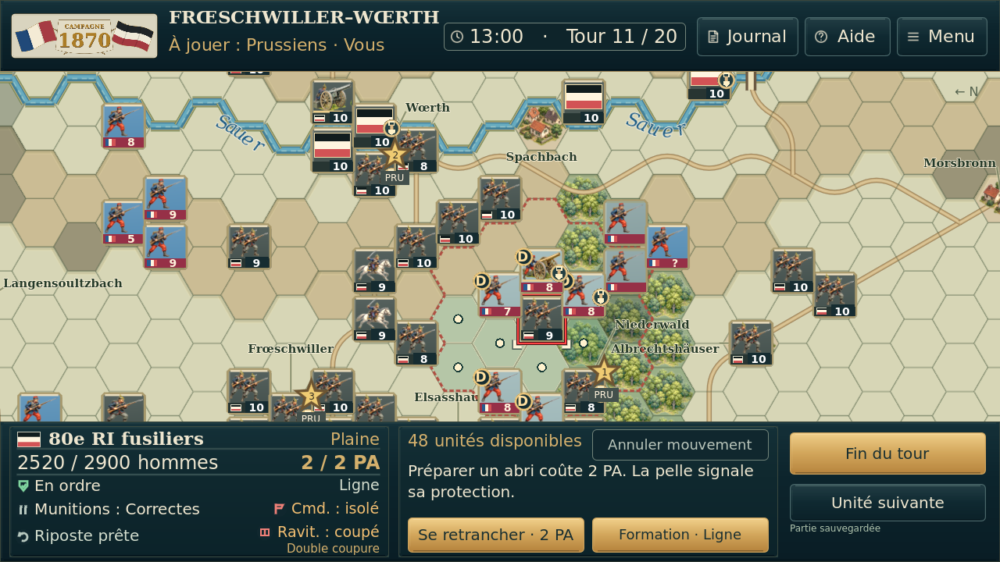
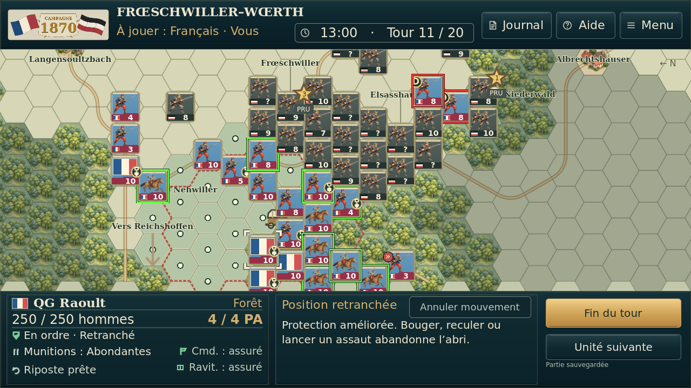
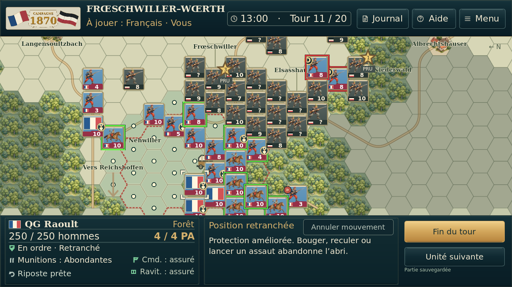
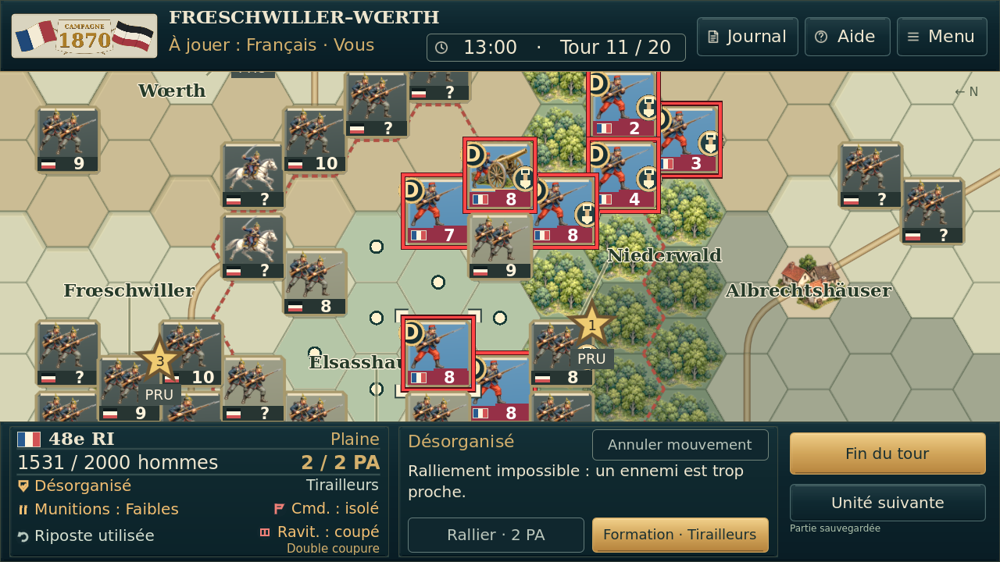
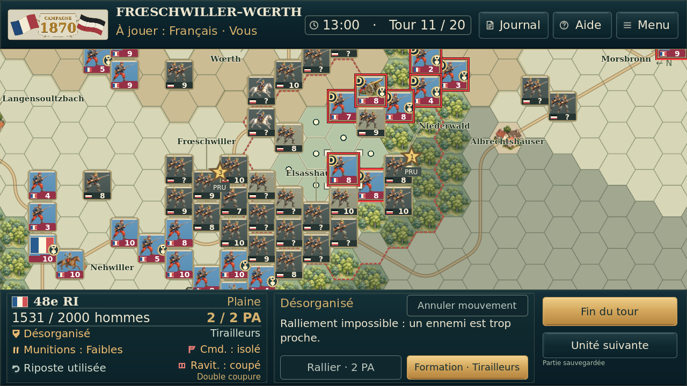
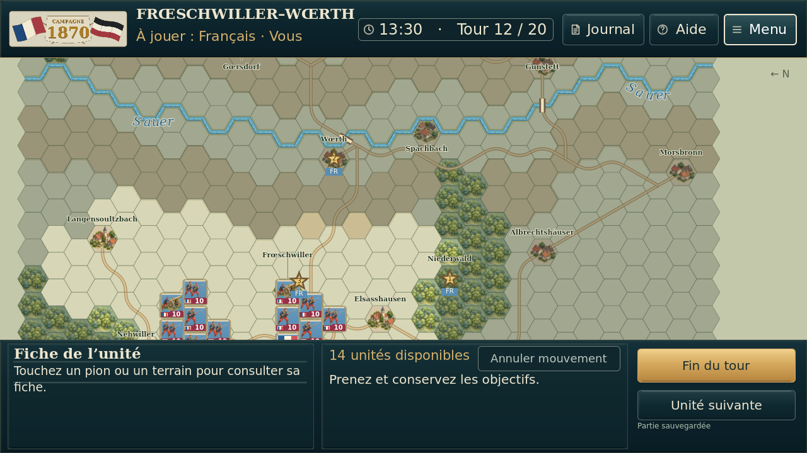

# Essai 8 / essai 9 — centrage du cadre

Centre vertical commun à l’heure/tours et aux trois boutons : y=47. Grandes polices conservées. Aucun changement de carte ou du bandeau inférieur.

| Situation | Avant — essai 8 | Après — essai 9 |
| --- | --- | --- |
| overview |  |  |
| engagement |  |  |
| prussiens |  |  |
| isolement |  |  |
| detail |  |  |
| deplacement |  |  |
| trajet |  |  |
| selection_isolee |  |  |

Captures réelles Godot sans retouche. [Preuves](preuves/). Aucun essai physique Android.
