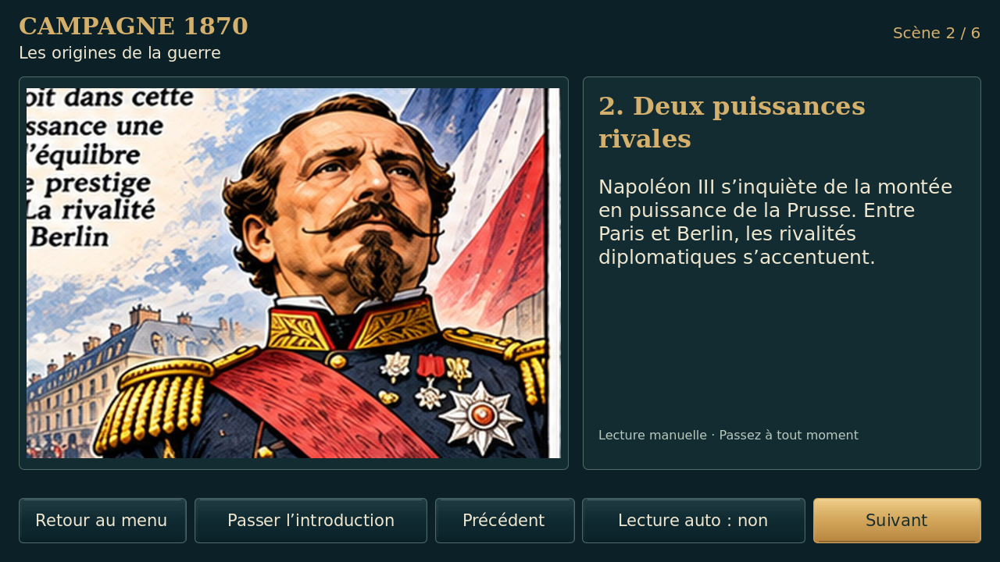
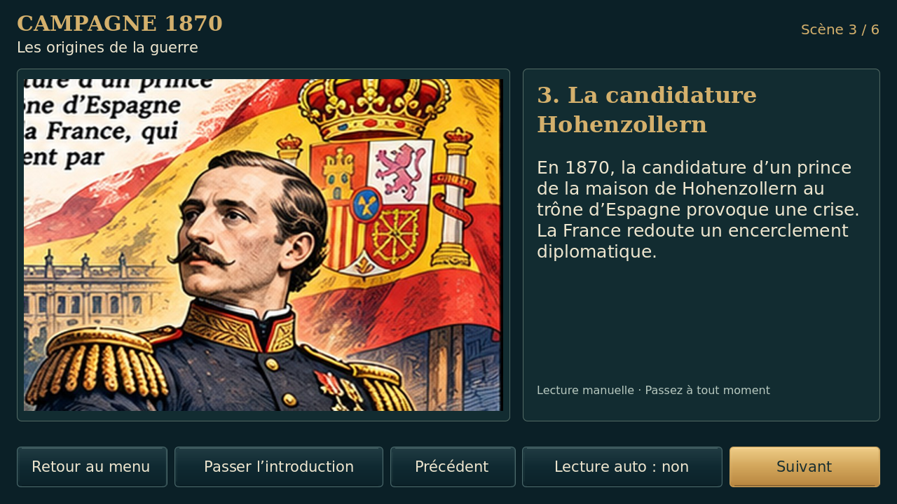
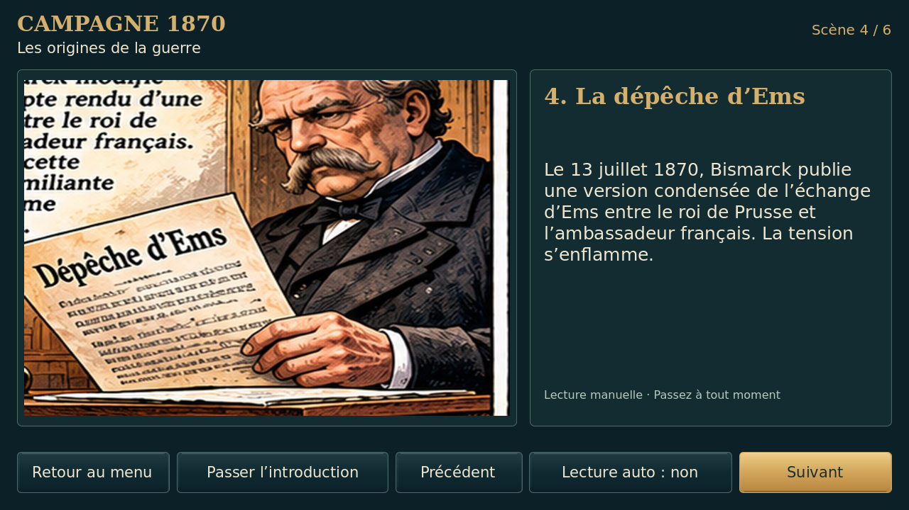
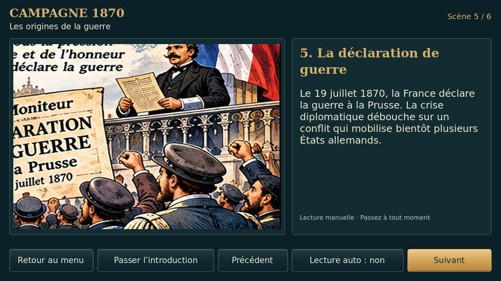
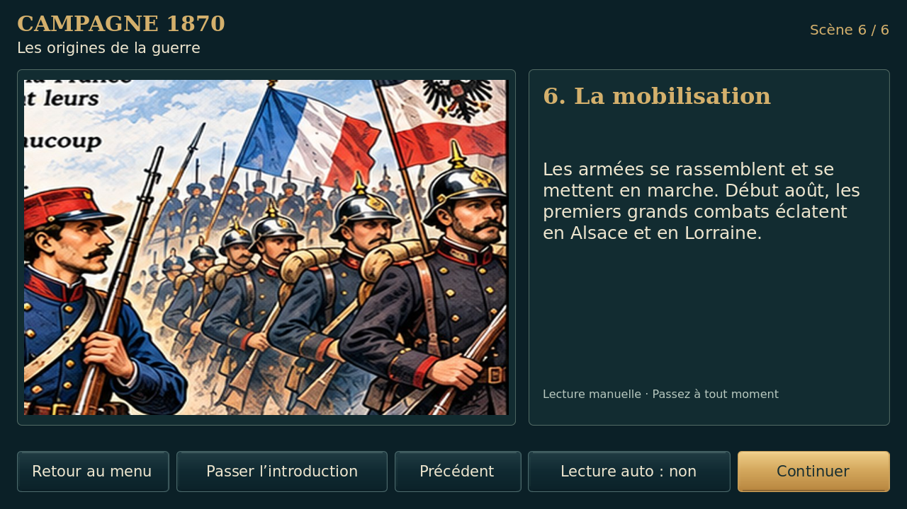
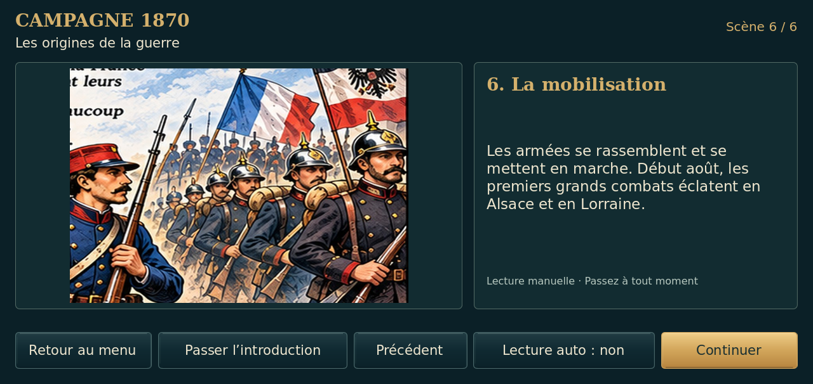
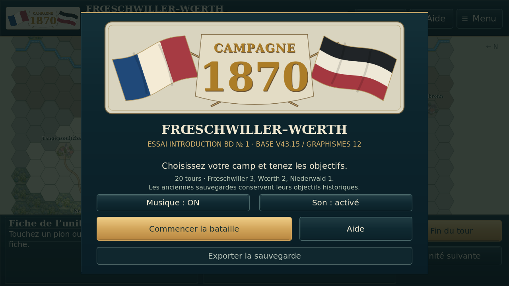
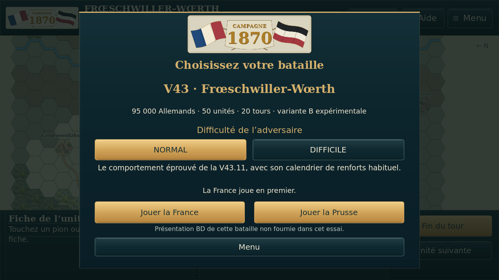
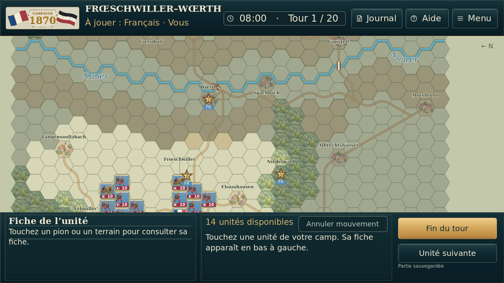

# Introduction BD expérimentale — V43

Captures réelles Godot 4.5.1/Linux, sans retouche. Six images et textes fournis conservés ; les fragments coupés font déjà partie des JPEG d’origine. Aucun récit BD de Frœschwiller-Wœrth créé.

## Les six tableaux

## Écran paysage à hauteur réduite

## Parcours jusqu’au jeu

Le test démarre une nouvelle partie de contrôle, sans simulation complète de bataille ni essai physique Android. [Résultats détaillés et provenance](preuves/).
