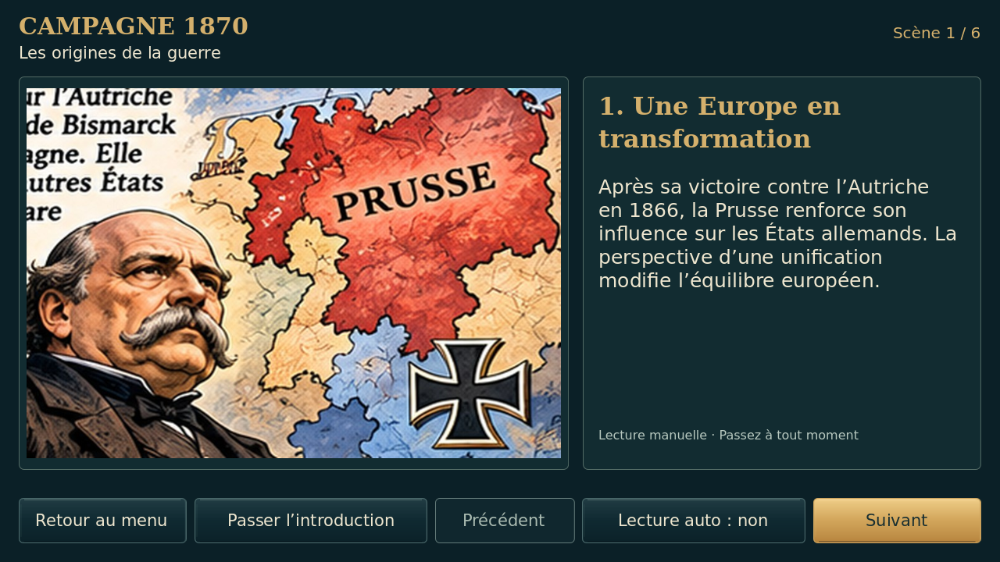
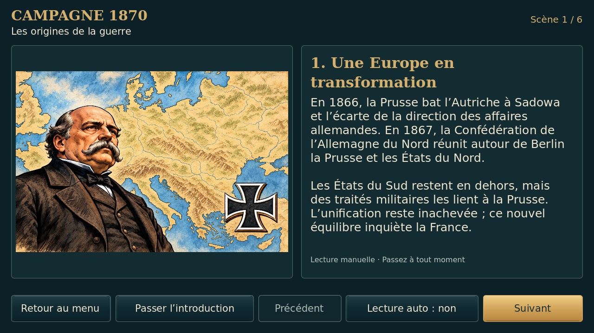
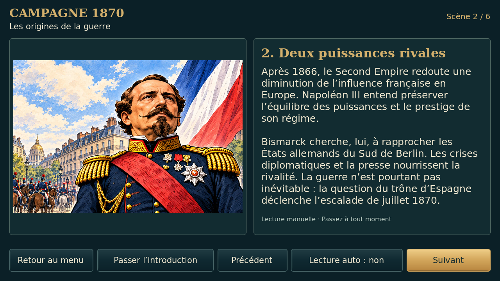
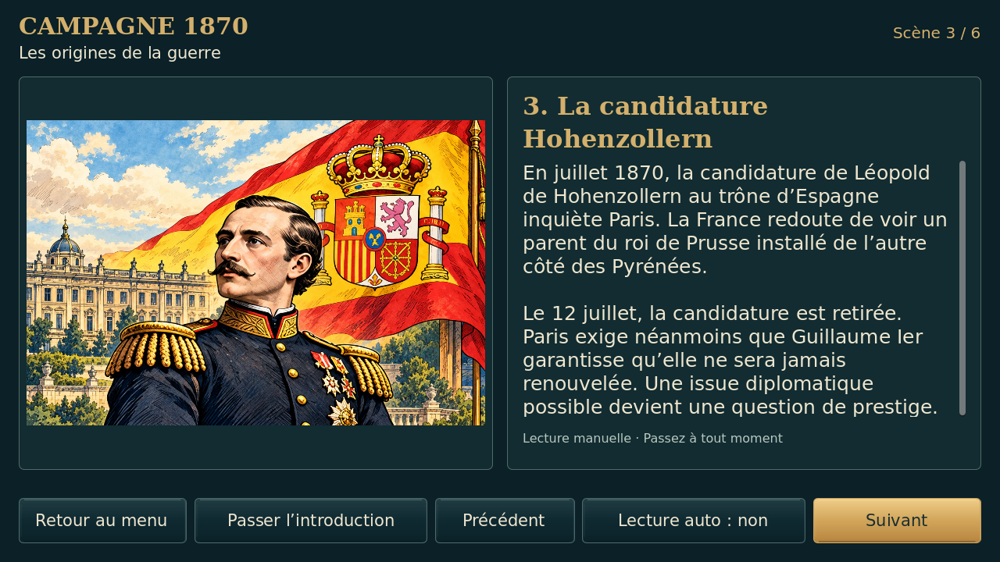
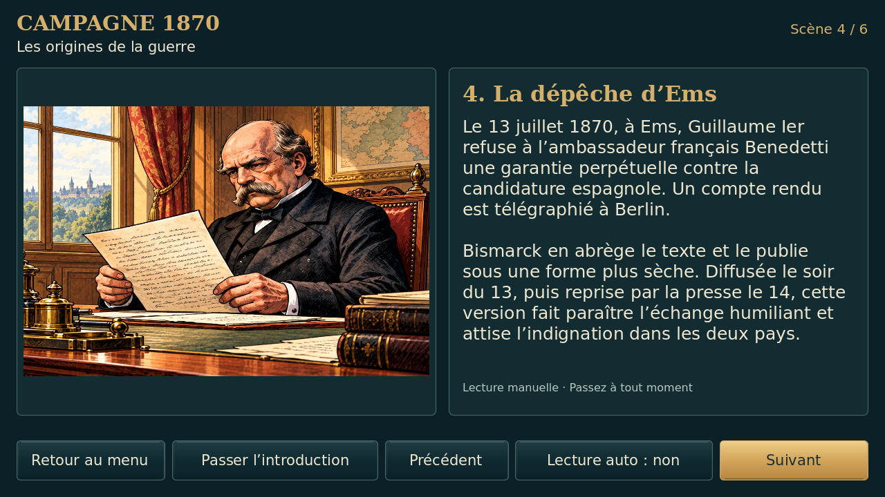
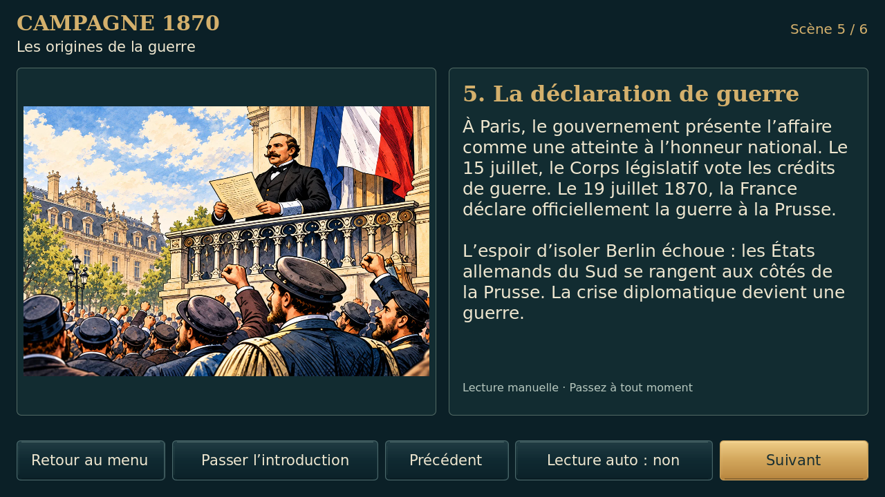
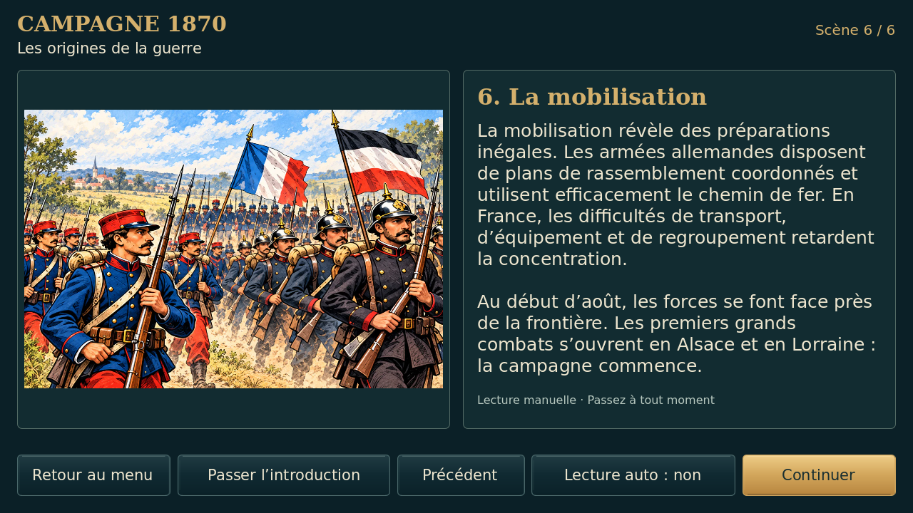
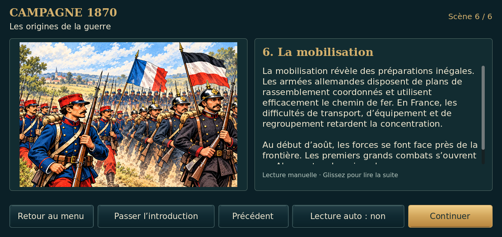
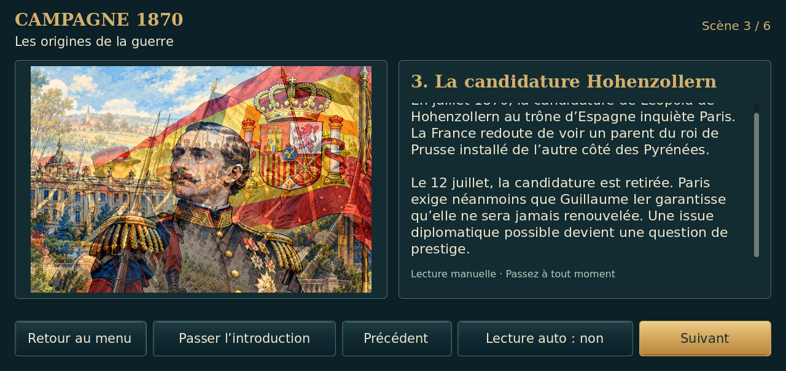

# Essai BD 2 — illustrations complètes et récit développé

Captures réelles Godot 4.5.1/Linux, sans retouche. Avant : essai BD 1 avec le JPEG original déjà tronqué ; après : composition réparée, sans phrases coupées, et textes historiques révisés. Les nouveaux dessins sont des reconstitutions, pas des archives.

| Avant | Après |
| --- | --- |
|  |  |

## Six tableaux

## Petit écran et texte défilant

Les cinq commandes sont conservées. Lecture automatique de 30 secondes avec défilement du paragraphe s’il dépasse. Le récit propre à Frœschwiller-Wœrth n’est pas ajouté. Les scènes du jeu, les règles et les sauvegardes restent inchangées. [Preuves détaillées](preuves/). Aucun essai physique Android.
