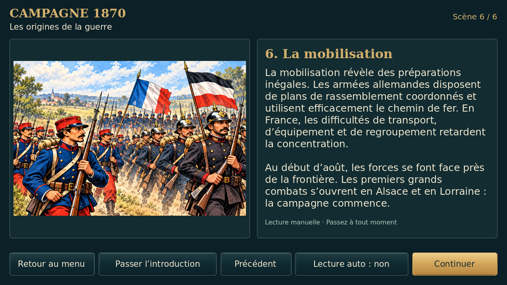
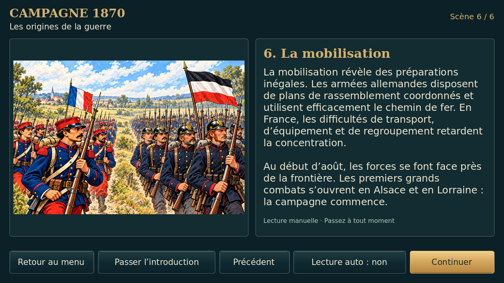
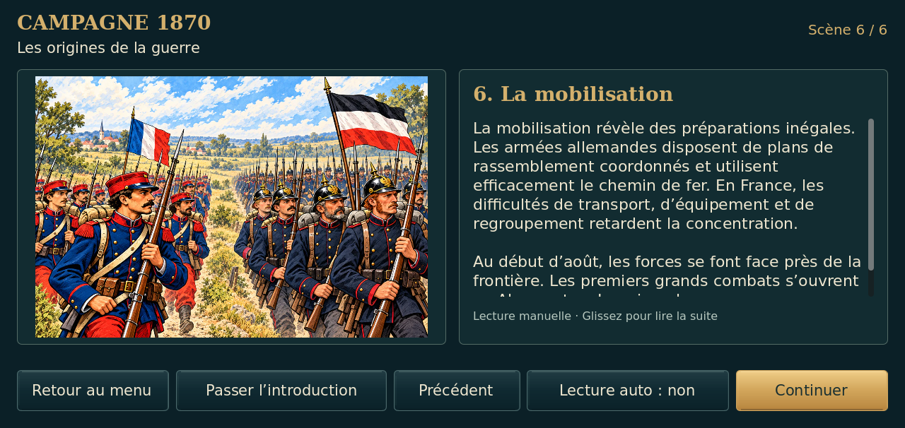
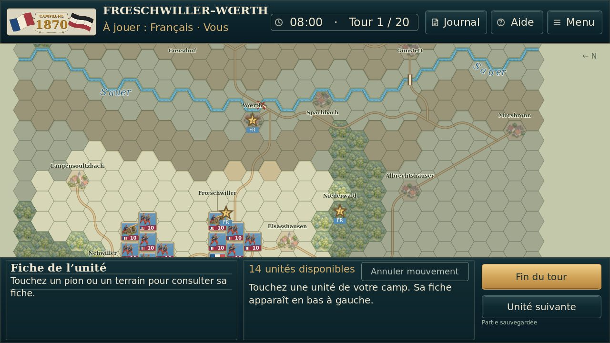

# Essai BD 3 — vignette 6

Captures réelles Godot 4.5.1/Linux, sans retouche. Le dessin lui-même est une illustration générée/retouchée, pas une image d’archives.

| Avant : essai BD 2 | Après : essai BD 3 |
| --- | --- |
|  |  |

Tuniques prussiennes bleu sombre, pantalons gris, visages plus variés ; épaulettes françaises rouges. Deux colonnes séparées dans un montage symbolique. Pas de certification d’uniforme régimentaire.

Les images 1 à 5, la narration, les commandes et les règles restent inchangées. [Tests détaillés](../../TESTS_INTRO_BD.md) et [preuves](preuves/). Aucun essai physique Android.
