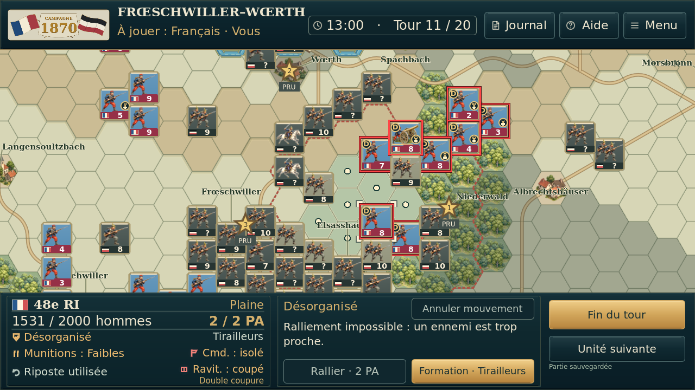
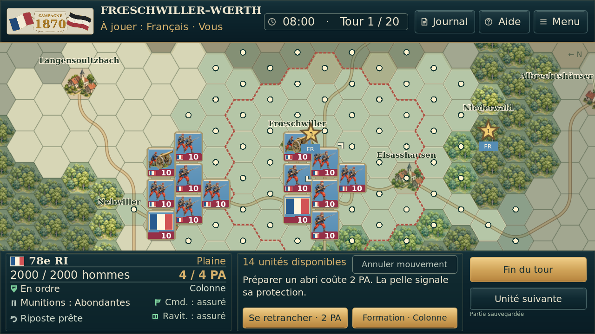
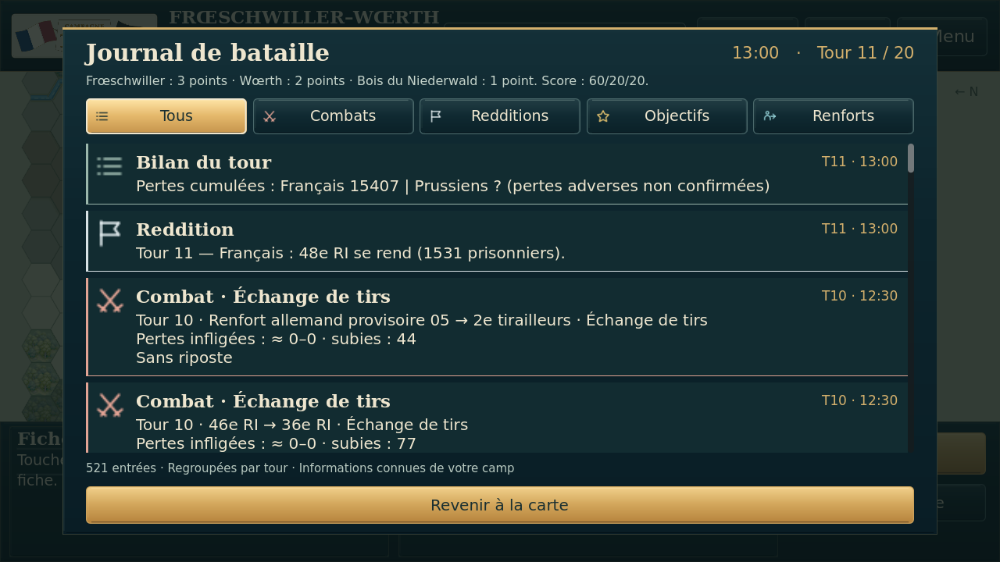

# V43.16 + Graphisme 12 — captures réelles Godot 4.5.1/Linux

24 novembre 2026. Six vues `overview`, `engagement`, `prussiens`, `isolement`, `detail`, `deplacement` identiques pixel par pixel à l’essai Graphisme 12 d’origine (commit ec50397). L’IA et les règles sont celles de V43.16 (8176972), sans aucune modification.

Les vues utilisent la fixture synthétique T11 du test existant ; déplacement : nouvelle partie à graine fixe. Les captures du journal et de la fiche utilisent des états de test. Ce ne sont ni des captures d’une partie Android ni des photographies d’appareil.

`coche_05_0` : fantassin sans action possible à 0,5 PA, coché. `coche_05_1` : cavalier ayant encore un déplacement légal, disponible. `coche_05_2` : batterie sans action active possible, cochée, riposte conservée.

`fiche_avant`, `fiche_pendant`, `fiche_apres` : surbrillance décorative brève, aucune modification de l’état par le rendu. Cinq images `journal_*` : filtres réels et tactile testés sous rendu logiciel llvmpipe.

